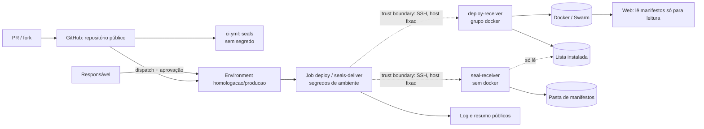

# Modelo de ameaças: deploy pelo CI e entrega dos manifestos selados (P-9)

- **Data**: 2026-11-23 (fatia P9.1)
- **Autor(es)**: manager (subagente de documentação), a partir do código e dos documentos em `a711a36`
- **Status**: Rascunho (Draft), entregue com a spec. Nada do que está aqui foi implementado. As fatias P9.2 a P9.5 atualizam a
  coluna de status; a G2 (P9-O06) e a G3 (P9-O07) registram as conferências
- **Escopo**: workflow `deploy.yml` e job `seals` do `ci.yml`; GitHub Environments `homologacao` e `producao`; chaves SSH e
  segredos de ambiente; receptores de deploy e de manifestos no host; caminho `link-audit-seals/` e lista de confiança
  versionada; logs públicos do Actions; pilha de homologação `gmn-hml`
- **Spec vinculada**: `docs/specs/ci-deploy-and-seal-delivery.md`
- **ADR vinculado**: `docs/adr/0004-ci-deploy-over-restricted-ssh.md`

## 1. Visão geral

O pipeline constrói as imagens no runner do GitHub, a partir do commit exato, e as leva por SSH a um receptor de comando único
que roda `docker stack deploy` com a stack instalada pelo responsável. Os manifestos assinados do P1 entram por PR num caminho
versionado. O CI os verifica sem segredo antes do merge, e um job com a chave de manifestos os entrega a um segundo receptor,
que verifica de novo e só acrescenta. Os dados tratados não são pessoais: imagens da aplicação, manifestos (hashes, `auditId`
opaco, `keyId`, datas, assinatura), a lista pública de chaves e os segredos de conexão. A fronteira nova é entre o GitHub
(público, conta única) e a VPS compartilhada.

O que já está coberto em outros modelos e **não** se repete aqui: falsificação de manifesto sem a chave e custódia da chave de
assinatura (`link-audit-p1-atestacao.md`); verificador `v2` e leitor do servidor (`link-audit-evidencias-e-selos.md`); guarda
externa e homologação da G2 (`link-audit-portoes-producao.md`).

## 2. Ativos

- **Host da VPS** e os serviços de terceiros nele (Traefik e certificados, n8n, Evolution, Portainer, PostgreSQL, outro Redis).
- **Aplicação GMN em produção:** imagens, secrets do Swarm (Supabase `service_role`, Serper, chaves da Fase 6, guarda), pastas da
  Fase 6.
- **Pasta de manifestos** e a **lista de confiança** (definem o que é autêntico, D15.5).
- **Chaves SSH** de deploy e de manifestos, por ambiente.
- **Segredos de ambiente do GitHub:** host, porta, `known_hosts`, URL e chave anônima do Supabase do build, domínio.
- **Confidencialidade do repositório público:** nenhum host, domínio, IP, projeto ou cliente em arquivo ou log.
- **Disponibilidade** do deploy e da entrega.

## 3. Atores

| Ator | Confiança | Notas |
|---|---|---|
| Responsável | alta | revisa, dispara, aprova ambientes, administra a VPS; como administrador está fora da garantia (D15.5) |
| Manager / workers | média | escrevem PRs; não aprovam ambiente |
| Custodiante, conferente | média | abrem e conferem o PR do manifesto |
| Autor de PR externo (fork) | não confiável | dispara o job `seals` sem segredo |
| Leitor do log público | não confiável | qualquer pessoa |
| Dependência/action comprometida | hostil | roda dentro do job |
| Portador de chave SSH vazada | hostil | fala direto com o receptor |
| Administrador da VPS por fora do canal | fora da garantia | edita pasta, lista instalada, stack |
| Atacante na rede (MITM) | hostil | entre o runner e a VPS |

## 4. Diagrama de fluxo

## 5. Análise STRIDE

| Componente | S | T | R | I | D | E | Notas |
|---|---|---|---|---|---|---|---|
| Workflow `deploy.yml` | DC-11 | DC-03 | DC-14 | DC-08 | DC-16 | DC-11 | dispatch só na `main`; segredos de ambiente |
| Job `seals` (`ci.yml`) | — (sem credencial) | DC-04, DC-17 | — | — | DC-20 | — | PR de fork sem segredo |
| Environments | DC-11 | — | DC-14 | — | — | DC-11 | revisor único (risco aceito) |
| Chaves SSH | DC-01, DC-10 | — | DC-14 | DC-08 | — | DC-01 | Ed25519, por usuário e ambiente |
| Receptor de deploy | DC-01 | DC-13 | DC-14 | DC-08 | DC-12 | DC-02 | grupo `docker` = root |
| Receptor de manifestos | DC-05 | DC-05, DC-06 | DC-14 | DC-08 | DC-12 | DC-18 | sem `docker`; só acrescenta |
| `link-audit-seals/` + lista | — | DC-04, DC-07, DC-17 | DC-14 | DC-09 | — | DC-07 | público |
| Logs públicos | — | — | — | DC-08 | — | — | só códigos fixos |
| Pilha `gmn-hml` | — | DC-13 | — | DC-13 | DC-12 | DC-13 | mesma VPS |
| Administrador da VPS | — | DC-19 | — | — | — | — | limite declarado |
| Reversão de imagem | — | DC-15 | — | — | — | — | R6-09 |

Sem entrada (—) = não se aplica ao componente: o job `seals` não tem credencial a falsificar nem privilégio a escalar; os logs
não guardam estado.

## 6. Ameaças (priorizadas)

### DC-02 [CRÍTICA] Elevação — chave de deploy (grupo `docker`) vira root no host compartilhado

- **Vetor**: o usuário de deploy está no grupo `docker`. Uma stack com `bind` de `/`, `privileged` ou `pid: host`, ou um defeito
  do receptor que execute comando arbitrário, dá root no host e atinge os outros projetos.
- **Probabilidade**: Média (exige chave vazada ou PR malicioso aprovado). **Impacto**: Crítico. **Risco**: Alto.
- **Mitigação**:
  - Código: gramática fechada; `execFile` com argv fixo e sem shell; parser estrito do arquivo de variáveis (nunca executado como
    shell); tags conferidas no `manifest.json` antes do `docker load` (P9-D01, P9-D04, P9-D07, P9-D08).
  - Config: a stack **não** vem do CI. É instalada pelo responsável e conferida por hash (`E_STACK_FILE_MISMATCH`, P9-D03; desvio D-1
    da spec).
  - Infra: `restrict,command=` + `ForceCommand`; `authorized_keys` em pasta do root; wrapper confere o hash do artefato.
  - Processo: receptor só reinstalado pelo responsável, com `sha256sum -c`.
- **Residual**: imagem arbitrária ainda roda como a aplicação (DC-01); um defeito no próprio Docker fica fora do alcance.
- **Status**: aberto (P9.3a, P9.4).

### DC-01 [ALTA] Falsificação — portador da chave de deploy implanta imagens próprias

- **Vetor**: chave privada vazada (segredo de ambiente exfiltrado, DC-03) usada direto contra o receptor, com pacote próprio.
- **Probabilidade**: Baixa. **Impacto**: Alto (aplicação, secrets do Swarm e dados da Fase 6 ao alcance da imagem). **Risco**:
  Médio.
- **Mitigação**: chave só como segredo de ambiente, liberado depois da aprovação; uma chave por ambiente; rotação a cada 12 meses
  e na hora, sob suspeita; o receptor exige `sha40` + hash do pacote + tags `<amb>-<sha40>` (dificulta erro, não impede o
  portador); o log local registra cada pedido; a tag com o SHA permite conferir contra o histórico de aprovações. Corte imediato:
  remover a linha do `authorized_keys`.
- **Residual**: aceito; é o mesmo poder de quem publica uma imagem.
- **Status**: aberto (P9.3a; conferência P9-O03).

### DC-03 [ALTA] Adulteração — action ou dependência comprometida no job com segredo

- **Vetor**: uma action fora de SHA, um pacote npm ou a imagem-base lê a chave SSH ou troca o pacote antes do envio.
- **Probabilidade**: Baixa a média. **Impacto**: Alto. **Risco**: Médio.
- **Mitigação**: actions fixadas por SHA, só as já usadas (P9-W03); o `seals-deliver` não roda `npm`/`node` (P9-W09); no
  `deploy`, o `npm ci` roda **dentro** do `docker build` (isolado do runner) e a chave só é escrita depois do build (P9-W08); sem
  cache do GitHub nos jobs com segredo (P9-W04); segredos só no `env:` do passo que os usa (P9-W05).
- **Residual**: a imagem-base do `Dockerfile` vai por tag, não por digest (fatia própria, ADR-0004); o pacote comprometido dentro
  do build altera a imagem (equivale a DC-01).
- **Status**: aberto (P9.4, P9.5).

### DC-07 [ALTA] Adulteração / Elevação — lista de confiança editada para aceitar uma chave do atacante

- **Vetor**: PR que acrescenta uma chave `active` própria, desfaz uma revogação ou troca o hash de um fecho, seguido de deploy.
- **Probabilidade**: Baixa. **Impacto**: Alto (manifestos forjados passam a valer). **Risco**: Médio.
- **Mitigação**: regras de transição no CI (`revoked` terminal, `retired` sem volta, hash fixado imutável, nada removido; P9-T03);
  fixação só de fecho já mergeado (P9-T04); lista e manifestos nunca no mesmo PR (P9-T05); CODEOWNERS do responsável no arquivo
  (P9-O02); deploy aprovado; conferência do livro de manifestos item 5 contra o hash que o receptor registra.
- **Residual**: conta do GitHub do responsável comprometida (limite declarado, ADR-0004).
- **Status**: aberto (P9.2).

### DC-08 [ALTA] Informação — log público expõe host, domínio, projeto Supabase ou caminho real

- **Vetor**: mensagens do `ssh`, saída do Docker, `set -x` ou expressões `${{ }}` no `run:` imprimem valores no log público.
- **Probabilidade**: Média. **Impacto**: Médio (ajuda ataque direcionado; fere a política do repositório público). **Risco**:
  Médio.
- **Mitigação**: host, porta, `known_hosts`, URL e domínio só como **segredo** (mascarado), nunca como variável (desvio D-2);
  receptores com saída pública só em código fixo, sem caminho nem valor (P9-R10, P9-D13); proibição estática de `${{ secrets.`/
  `${{ inputs.` no `run:`, de `set -x` e de `ssh -v` (P9-W05); `LogLevel=ERROR`; resumo só com campos públicos (§5.9 da spec).
- **Residual**: o mascaramento do GitHub não cobre valores transformados (base64, recortes); nenhum passo transforma segredo.
- **Status**: aberto (P9.3, P9.4, P9.5).

### DC-05 [MÉDIA] Adulteração — chave de manifestos grava fora da pasta ou um arquivo não verificado

- **Vetor**: `relpath` com `..`, link simbólico na raiz ou na subpasta, FIFO no destino, arquivo que não autentica.
- **Probabilidade**: Baixa. **Impacto**: Médio. **Risco**: Baixo.
- **Mitigação**: gramática fechada do `relpath` (P9-R01); raiz igual ao próprio caminho real, subpasta real (P9-R06); segunda
  verificação `v2` contra a pasta do host antes de gravar (P9-R05); `--permission` com escrita só na raiz de manifestos (P9-R11);
  usuário sem `docker` e sem `sudo`.
- **Status**: aberto (P9.3b).

### DC-06 [MÉDIA] Adulteração — sobrescrita ou remoção de um manifesto existente (RC-04)

- **Vetor**: reentrega com outros bytes, corrida entre duas entregas, verbo de remoção.
- **Mitigação**: não existe verbo de remoção; `link()` exclusivo; bytes idênticos ⇒ `ALREADY_PRESENT`; diferentes ⇒
  `E_EXISTS_DIFFERENT` com o arquivo intacto (P9-R04, P9-R08); no CI, só status `A` (P9-S01).
- **Status**: aberto (P9.2, P9.3b).

### DC-04 [MÉDIA] Adulteração — manifesto forjado ou alterado no PR

- **Vetor**: PR com manifesto não assinado, de outra auditoria, fora de ordem ou com bytes reformatados.
- **Mitigação**: verificador `v2` real com a lista do commit e cadeia completa (P9-S08); forma canônica (P9-S06); nome = corpo
  (P9-S07); o conferente compara o `sha256sum` do resumo com o livro.
- **Status**: aberto (P9.2).

### DC-09 [MÉDIA] Informação — `auditId` ou metadados revelam o cliente

- **Vetor**: `auditId` com nome de empresa ou com o rótulo `AUD-xxx` dos documentos, que o histórico público liga a um cliente
  real.
- **Mitigação**: padrão `^aud-[0-9a-f]{16}$` no CI (P9-S02); geração aleatória na autorização (runbook do custodiante); vínculo só
  no dossiê offline.
- **Residual**: datas, `keyId` e frequência das atestações ficam públicos (sem dado pessoal; aceito pela decisão do responsável).
- **Status**: aberto (P9.2).

### DC-10 [MÉDIA] Falsificação — homem no meio entre o runner e a VPS

- **Vetor**: TOFU (`accept-new`) ou `StrictHostKeyChecking=no` aceitam a chave de um servidor falso, que recebe o pacote e, no
  canal de manifestos, devolve `OK` falso.
- **Mitigação**: `known_hosts` fixado por segredo, conferido pelo responsável no console da VPS (H-09); `StrictHostKeyChecking=yes`
  e `GlobalKnownHostsFile=/dev/null` (P9-W07).
- **Residual**: um `OK` falso só engana o resumo; a conferência do livro contra o servidor acusa a ausência.
- **Status**: aberto (P9.4).

### DC-11 [MÉDIA] Elevação — contornar a proteção do ambiente

- **Vetor**: dispatch de outra branch; workflow alterado num PR para ler segredos; administrador contornando o revisor;
  `pull_request_target`.
- **Mitigação**: *deployment branches* = só `main` e `if: github.ref == 'refs/heads/main'` (P9-W02); segredos só de ambiente; o
  `ci.yml` usa `pull_request`, nunca `_target`; contorno por administrador desligado e CODEOWNERS em `.github/workflows/` (P9-O01,
  P9-O02).
- **Residual**: a mesma pessoa dispara e aprova (Q-4 da spec, risco aceito).
- **Status**: aberto (P9.4; conferência P9-O01).

### DC-13 [MÉDIA] Adulteração — confusão entre homologação e produção

- **Vetor**: imagem de homologação (outra URL do Supabase) rodando em produção pela mesma tag; homologação apontando para o
  projeto ou as pastas de produção; trava de homologação em produção.
- **Mitigação**: tag `<amb>-<sha40>` e conferência das tags (P9-D07); ambiente fixado no wrapper de cada chave; impressão do
  projeto Supabase igual entre build e host, e homologação diferente de produção (P9-D05); pastas de homologação sob prefixo
  (P9-D04); a trava só na sobreposição e proibida em produção (P9-H01, PD-08); secrets `gmn-hml_*`.
- **Status**: aberto (P9.3a, P9.4).

### DC-14 [BAIXA] Repúdio — quem implantou ou entregou o quê

- **Mitigação**: histórico de aprovações do ambiente; resumo do job com execução, commit e hashes; log local dos receptores; o
  custodiante copia a linha para o livro de manifestos (a retenção do GitHub é limitada).
- **Status**: aberto (P9.4, P9.5).

### DC-12 [BAIXA] Negação de serviço — disco do host cheio

- **Vetor**: pacotes grandes repetidos, imagens antigas acumuladas, entregas em massa.
- **Mitigação**: teto de 3 GiB no `upload`, recebimento com um pacote só; `E_DISK_LOW` antes de carregar; tetos de tamanho e de
  quantidade nas entregas; limpeza de tags antigas pelo responsável.
- **Status**: aberto (P9.3).

### DC-15 [MÉDIA] Adulteração — reversão para imagem anterior ao livro (R6-09)

- **Vetor**: commit de reversão ou `docker service rollback` para uma versão anterior ao livro, depois do primeiro `ENROLL`.
- **Mitigação**: regra do runbook e do `PLANO-DE-ROLLBACK.md`; o receptor nunca reverte por conta própria.
- **Residual**: o receptor não sabe se a imagem é anterior ao livro (não há git no host); a revisão do PR de reversão é o controle.
- **Status**: aberto (processo).

### DC-16 [BAIXA] Negação de serviço — job pendente cancelado

- **Vetor**: limite do GitHub: um pendente do mesmo grupo de concorrência é cancelado por outro mais novo.
- **Mitigação**: a entrega manda todos os arquivos e é idempotente; o deploy usa a `main` do momento.
- **Status**: aceito.

### DC-17 [BAIXA] Adulteração — conversão de fim de linha ou editor mudam os bytes

- **Mitigação**: `link-audit-seals/** -text`; forma canônica exigida no CI e no receptor; sha256 de ponta a ponta.
- **Status**: aberto (P9.2).

### DC-18 [MÉDIA] Elevação — chave de manifestos troca a lista de confiança

- **Vetor**: se o receptor de manifestos instalasse a lista, a chave dele bastaria para validar uma chave própria.
- **Mitigação**: só o receptor de deploy instala a lista; o de manifestos só a lê e exige o hash do commit (P9-R03); usuários e
  chaves separados (RC-09).
- **Status**: aberto (P9.3).

### DC-19 [INFO] Adulteração — administrador da VPS por fora do canal

- **Vetor**: escreve na pasta de manifestos, edita a lista instalada ou a stack, repõe um estado antigo.
- **Mitigação**: limite declarado da D15.5; a próxima entrega acusa lista diferente (`E_TRUST_LIST_MISMATCH`) e o próximo deploy,
  stack diferente; a conferência do livro (itens 2, 3 e 5) acusa o resto.
- **Status**: aceito (limite declarado).

### DC-20 [BAIXA] Negação de serviço — PR de fork com arquivos feitos para travar o parser

- **Vetor**: arquivos enormes, JSON profundo, nomes estranhos.
- **Mitigação**: teto de tamanho antes de ler, teto de quantidade, regex ancorada sem retrocesso catastrófico, porta de texto
  estrita do verificador antes do `JSON.parse`; o job não tem segredo e tem `timeout-minutes`.
- **Status**: aberto (P9.2).

## 7. Casos de abuso

- Abrir um PR que acrescenta `seal-0002.json` a uma auditoria alheia, assinado por uma chave revogada, esperando que o CI só olhe o
  formato. O S-10 recusa com `SEAL_V2_SEAL_KEY_REVOKED`.
- Com a chave de manifestos vazada, mandar `put ../../opt/gmn/stack.yml …`. A gramática recusa (`E_COMMAND`) antes de ler o stdin.
- Com a chave de deploy vazada, mandar um pacote com a tag `gmn-web:producao-<sha>` de um commit inexistente e uma imagem com
  `USER root`. O receptor aceita a forma (o portador tem o poder da aplicação, DC-01), mas a stack do host mantém `read_only`,
  `cap_drop: ALL` e nenhuma porta, e o deploy fica no log local e no histórico.
- Disparar o deploy de uma branch de teste com o workflow alterado. O ambiente recusa a branch, e os segredos não são liberados.
- Fazer uma revogação e, no mesmo PR, acrescentar um manifesto da chave nova. `SEALS_AND_TRUST_LIST_TOGETHER`.
- Configurar a homologação com a URL do Supabase de produção para "testar de verdade". `E_HML_PRODUCTION_PROJECT`.
