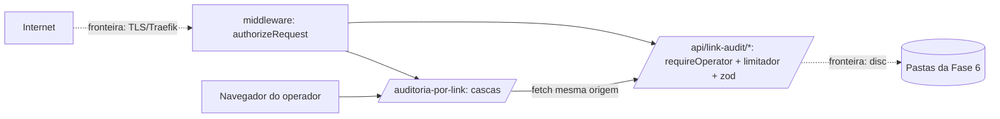

# Modelo de ameaças: Auditoria por Link — rotas `/api/link-audit/*` e páginas `/auditoria-por-link`

- **Data**: 2026-11-07
- **Autor(es)**: threat-modeler (subagente)
- **Status**: Rascunho (Draft)
- **Escopo**: `src/middleware.ts`, `src/lib/auth/*`, `src/lib/rate-limit.ts`, `src/app/api/link-audit/**` (parse, confirm, evidence, decisions, scoring), `src/app/auditoria-por-link/**`, `src/components/link-audit/**`, cabeçalhos em `next.config.ts` e Traefik (`deploy/hostinger/stack.yml`)
- **Spec vinculada**: `docs/phase6-auditoria-link/onda3-interface.md`, `onda5b-visualizacao-das-evidencias.md`
- **ADRs vinculados**: — (controles de autenticação vêm da Fase 5: `docs/phase5/security-review.md`)

## 1. Visão geral

Toda a plataforma passa pelo `middleware` (só `/login`, `/api/auth/login` e `/api/auth/logout` são públicos; `src/middleware.ts:13,22,40`) e **cada rota** chama `requireOperator` de novo (`src/lib/auth/require-operator.ts:12-19`). As páginas `/auditoria-por-link` e `/auditoria-por-link/[auditId]` são cascas: validam o `auditId` (`[auditId]/page.tsx:13-18`) e buscam os dados no navegador pelas rotas autenticadas. Nenhuma rota da Fase 6 faz chamada externa: `parse`/`confirm` só analisam texto; as demais leem/gravam em disco.

## 2. Ativos

- Sessão do operador (`gmn_session`, HMAC, 12 h — `src/lib/auth/session.ts:7`).
- Decisões, resultados e evidências acessíveis pelas rotas.
- Disponibilidade do processo web (único, atende todas as auditorias).

## 3. Atores

| Ator | Confiança | Observações |
|---|---|---|
| Anônimo na internet | hostil | Só alcança login/logout |
| Site de terceiros com o operador logado no navegador | hostil | Vetor CSRF/XSS refletido |
| Operador autenticado | média | Lê e escreve em qualquer auditoria (sem ACL por auditoria) |
| Traefik (proxy) | alta | Acrescenta o último salto de `X-Forwarded-For` e o HSTS |

## 4. Diagrama de fluxo

## 5. Análise STRIDE

| ID | STRIDE | Ameaça | Mitigação existente (arquivo:linha / teste) | Risco residual | Status |
|---|---|---|---|---|---|
| A-S1 | S | Acesso sem sessão / com cookie forjado | HMAC da sessão + allowlist reavaliada a cada requisição (`auth/guard.ts:122-154`); falha fechada sem segredo/allowlist ⇒ 503 (`:134-142`); defesa dupla middleware + rota. Teste: `tests/auth.test.ts`, `tests/middleware.test.ts` | Next instalado `15.5.28` (lockfile), já corrigido contra o desvio de middleware por `x-middleware-subrequest` (CVE-2025-29927); mesmo assim, as rotas não dependem só do middleware | mitigado |
| A-S2 | S | Bypass de desenvolvimento ativo em produção | `devBypassActive` desligado em build de produção pela constante literal (`auth/guard.ts:48-53`) e só com host loopback | — | mitigado |
| A-S3 | S | Cookie roubado continua válido após logout | Logout só expira o cookie no navegador; o token vale até 12 h; revogação apenas removendo o e-mail da allowlist | Sem lista de revogação de sessões; segredo = `SUPABASE_SERVICE_ROLE_KEY` (R12, aceito na Fase 5) | parcial (aceito) |
| A-T1 | T | CSRF em POST de decisão/revogação/finalização | `SameSite=Strict` + recusa de `Origin` de outro host ou `Sec-Fetch-Site: cross-site` (`auth/guard.ts:107-120`); corpo só `application/json` exato (`api/link-audit/body.ts:58-61`) | POST sem `Origin` e sem `Sec-Fetch-Site` passa (navegadores modernos sempre enviam um dos dois em POST cross-site) | mitigado |
| A-T2 | T | Entrada malformada / campos extras / caracteres invisíveis (bidi) para enganar a tela | zod `.strict()` em todos os corpos (`parse/route.ts:7`, `confirm/route.ts:20-33`, `decisions/types.ts:117-120`); recusa de controle/bidi/invisíveis (`confirm/route.ts:9-18`); identificadores do link sempre reanalisados no servidor (`confirm/route.ts:52`); `auditId` por regex antes de tocar o disco | — | mitigado |
| A-T3 | T | XSS armazenado via dados do perfil (nome, título do site, justificativa) | Nenhum `dangerouslySetInnerHTML`/`innerHTML` em `src/` (busca); React escapa texto; `safeText` corta/normaliza (`components/link-audit/audit-page/labels`); `href` só internos com `encodeURIComponent` (`stored-audit-list.tsx:66`, `stored-audit-detail.tsx:144`) | CSP não é imposta (A-I3), então não há segunda barreira se um sink surgir | mitigado (1 camada) |
| A-R1 | R | Ação sem trilha (quem fez o quê, quando, de onde) | Autor gravado nos arquivos de decisão/resultado | **Nenhum log estruturado** nas rotas da Fase 6 (zero `logger.` em `src/app/api/link-audit` e `src/lib/link-audit*`); `internalFailure()` devolve 500 genérico **sem registrar o erro** (`api/link-audit/body.ts:83-85` e `catch` de `parse`/`confirm`), contrariando o anti-padrão do `CLAUDE.md` ("Swallowing errors without structured logging") | **aberto** |
| A-I1 | I | Mensagem de erro com pilha, caminho, chave ou link | Respostas fixas + `code`; `issues` limitadas e saneadas (`decisions/shared.ts:41-58`); `no-store, private` + `Vary: Cookie` | — | mitigado |
| A-I2 | I | Cache de proxy/navegador guardar dados de auditoria | `Cache-Control: no-store` em todas as respostas da Fase 6 (`api/link-audit/body.ts:4`, `evidence/shared.ts:15-20`, `decisions/shared.ts:22-27`) | — | mitigado |
| A-I3 | I | Política de conteúdo sem efeito | CSP em **Report-Only** com `'unsafe-inline'` em `script-src` e `style-src` (`next.config.ts:24-29`) | Além de não bloquear nada, **não há `report-uri`/`report-to`**: a CSP Report-Only não envia relatório algum ao servidor, então o objetivo declarado ("mede antes de impor", comentário em `next.config.ts:24`) não é atingido — **achado novo, baixo** | aberto |
| A-I4 | I | Downgrade para HTTP / clickjacking | HSTS 1 ano no Traefik (`stack.yml:111-113`), redirecionamento https (`:118-121`); `X-Frame-Options: DENY` (`next.config.ts:19`) | Cabeçalhos efetivos na VPS **NÃO VERIFICADOS** nesta análise | mitigado (config) |
| A-D1 | D | Corpo enorme / lento | Teto 16 KiB lido em fluxo, 413/408, 10 s (`api/link-audit/body.ts:6-7,21-53`); cópia do middleware limitada a 64 KiB (`next.config.ts:37`). Teste: `link-audit-body-limit.test.ts` | — | mitigado |
| A-D2 | D | Rajada de leituras caras (reverificação de hashes, cadeia de resultados) | Limitadores por operador: evidências 30/min, decisões 30 leitura/20 escrita, prévia 20, resultados 30, finalização 6 (`evidence/shared.ts:26`, `decisions/shared.ts:31-32`, `scoring/shared.ts:29,125-126`); teto de memória de chaves (`rate-limit.ts:26-31`) | Em memória e por processo: reinício zera, réplicas não compartilham (aceito na Fase 5 para instância única). `parse`/`confirm` **não têm limitador** (só CPU, link ≤ 10 000 caracteres, sem regex com retrocesso exponencial em `maps-link.ts`) | parcial |
| A-E1 | E | Operador acessar auditoria de outro / ações administrativas | Administrativas recusadas (403). Sem ACL por auditoria (limitação herdada) | Ver E-I2 e D-E1 nos documentos de evidências e decisões | parcial (aceito de fato) |

## 6. Ameaças priorizadas

### T-A01 [MÉDIO] Repúdio/detecção — rotas da Fase 6 sem log estruturado (A-R1)
- **Vetor**: falha inesperada, recusa de integridade (409) ou escrita maliciosa não deixa rastro fora das pastas de dados; ninguém é alertado.
- **Probabilidade**: Alta (acontece em toda falha). **Impacto**: Médio (atrasa a detecção de adulteração e incidentes; contradiz `onda6c-checklist-producao.md` §6 "monitoramento").

### T-A02 [BAIXO] Defesa em profundidade — CSP sem imposição e sem coleta (A-I3)
- **Probabilidade**: Baixa (não há sink de XSS conhecido). **Impacto**: Alto se um sink aparecer (sessão do operador, escrita de decisões).

## 7. Abuse cases

- **Página maliciosa faz `fetch('/api/link-audit/decisions/x', {method:'POST', credentials:'include'})`**: cookie `SameSite=Strict` não vai; mesmo que fosse, `Origin` diferente ⇒ 403.
- **Operador cola link com caracteres bidi para que a tela mostre outro nome**: 400 no `confirm`.
- **Script do operador chama a prévia em laço**: 429 após 20/min; reiniciar o processo zera o contador.
- **Requisição com `Content-Type: text/plain; x=application/json`**: 415.
- **`GET /api/link-audit/evidence/../../etc`**: `auditId` fora do padrão ⇒ 400/404, sem I/O.

## 8. Risco residual e ações recomendadas

| Ação | Critério de aceite |
|---|---|
| **A-A1** Instrumentar as rotas da Fase 6 com `StructuredLogger`: erro inesperado (com `correlationId`, sem corpo/link), 409/503 de integridade e escritas bem-sucedidas | Teste com logger falso: `internalFailure` gera 1 evento `error` com `correlationId`, e a resposta inclui o mesmo `correlationId`; nenhum campo de corpo/link no evento |
| **A-A2** Adicionar `report-to`/`report-uri` (rota interna que só conta e registra) à CSP Report-Only, medir, e depois impor com nonce em vez de `'unsafe-inline'` | Teste de configuração (`tests/deploy-config.test.ts` ou novo) confere a diretiva; após a medição, `Content-Security-Policy` (não Report-Only) sem `'unsafe-inline'` em `script-src` |
| **A-A3** Limitador por operador em `parse`/`confirm` (ex.: 60/min) | Teste: 61ª requisição no minuto ⇒ 429 |
| **A-A4** Conferir na VPS os cabeçalhos efetivos (HSTS, X-Frame-Options, CSP) | `curl -I` anexado ao `VERIFICACAO-POS-DEPLOY.md` (na homologação, sem deploy local) |
| **A-A5** (opcional) Revogação de sessão no logout (lista curta de `jti` revogados em memória/Redis) | Teste: cookie reutilizado após logout ⇒ 401 |

## 9. Referências

- `docs/phase5/security-review.md` §1, §6; `docs/phase5/risk-register.md` (R1, R12)
- `docs/phase6-auditoria-link/onda6c-checklist-producao.md` (CSP Report-Only, limitadores em memória, §6)
- OWASP ASVS V3 (sessão), V4 (controle de acesso), V7 (logs), V14 (cabeçalhos)
