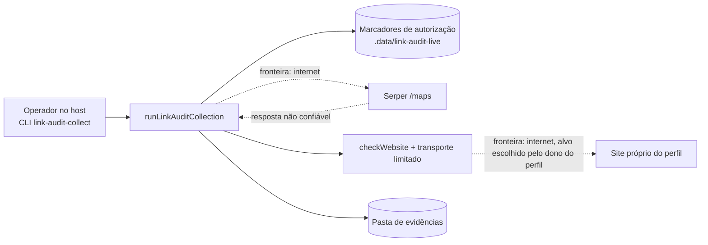

# Modelo de ameaças: Auditoria por Link — coleta e provedores (Serper /maps, site próprio)

- **Data**: 2026-11-07
- **Autor(es)**: threat-modeler (subagente), a partir do código da branch `chore/saneamento-tecnico`
- **Status**: Rascunho (Draft), aguardando revisão do responsável
- **Escopo**: coleta LIVE/SIMULATED/DRY_RUN da Fase 6 (`src/lib/link-audit-runtime/*`, `src/lib/link-audit/collector/*`, `src/lib/site-check.ts`, `src/lib/url-safety.ts`, `scripts/link-audit-collect.ts`)
- **Spec vinculada**: `docs/phase6-auditoria-link/onda4b-integracao-provedores.md`, `onda4a-coleta-inventario.md`
- **ADRs vinculados**: `onda6c-adr-proveniencia-evidencias.md` (o que acontece com a captura depois de gravada)

## 1. Visão geral

A coleta transforma um link do Google Maps já confirmado pelo operador em evidência: **uma** chamada paga ao Serper `/maps` e, se o perfil informar site próprio, até **8** requisições HTTP ao site (sem custo de API). **Não há rota HTTP de coleta**: ela só roda pelo CLI `scripts/link-audit-collect.ts` (`src/lib/link-audit-runtime/run.ts:27`). O `/reviews` está desligado na Fase 6 (`run.ts:177`, `budget.ts:15`). A captura bruta é gravada antes de qualquer processamento (`serper-maps-provider.ts:168`) — a integridade e a autenticidade dela são tratadas em `link-audit-evidencias-e-selos.md`.

## 2. Ativos

| Ativo | Por que importa |
|---|---|
| `SERPER_API_KEY` | Crédito pago; o vazamento permite gasto por terceiros |
| Crédito Serper (49 consultas por auditoria na Fase 5; 1 por coleta na Fase 6) | Regra do projeto: nenhuma consulta paga sem autorização explícita |
| Rede interna da VPS / metadados de nuvem | Alvo clássico de SSRF via site do perfil |
| Autorização de uso único (`.data/link-audit-live/<id>.json`) | Barreira contra gasto repetido |
| Disponibilidade do processo que coleta | Coleta é manual, mas um site hostil pode tentar segurá-la |

## 3. Atores

| Ator | Confiança | Observações |
|---|---|---|
| Operador com shell no host + variáveis LIVE | alta | Único que inicia LIVE; precisa de `--authorization-id` igual a `GMN_LINK_AUDIT_AUTH_ID` (`scripts/link-audit-collect.ts:194`) |
| Dono do perfil no Google (controla nome, site, textos) | hostil em potencial | O **site** do perfil vem da resposta do Serper e define para onde o servidor faz requisições |
| Dono do site próprio | hostil em potencial | Controla redirecionamentos, DNS, cabeçalhos, tamanho e ritmo da resposta |
| Serper (terceiro) | baixa-média | Resposta tratada como dado não confiável; corpo limitado |
| Operador da interface web | baixa para a coleta | Não alcança a coleta (sem rota) |

## 4. Diagrama de fluxo

## 5. Análise STRIDE

Legenda de status: **mitigado** (código + teste), **parcial** (mitigação com lacuna conhecida), **aberto** (sem mitigação no código).

| ID | STRIDE | Ameaça | Mitigação existente (arquivo:linha / teste) | Risco residual | Status |
|---|---|---|---|---|---|
| C-S1 | S | Desviar a chave do Serper para outro host trocando `SERPER_MAPS_URL` | `assertSerperMapsUrl` exige `https`, host `serper.dev`/`*.serper.dev`, sem porta, caminho exatamente `/maps` (`serper-maps-provider.ts:87-100`); `redirect: 'error'` (`:147`). Teste: `tests/link-audit-serper-provider.test.ts` | Qualquer subdomínio de `serper.dev` é aceito (risco de tomada de subdomínio do fornecedor: baixo, fora do nosso controle) | mitigado |
| C-S2 | S | Iniciar coleta LIVE sem autorização (outro processo, outro operador) | Trava tripla: `GMN_LINK_AUDIT_LIVE=on`, `GMN_LINK_AUDIT_AUTH_ID` igual ao `--authorization-id` (`scripts/link-audit-collect.ts:194`), autorização bem-formada, vinculada à auditoria e à empresa, ≤ 24 h, com ciência do custo (`budget.ts:170-208`). Teste: `link-audit-budget.test.ts`, `link-audit-cli.test.ts` | A autorização é um objeto **não assinado** montado pelo próprio CLI; quem tem shell + ambiente se autoriza. Aceitável para ferramenta interna, mas não há registro fora do host de quem autorizou | parcial |
| C-T1 | T | Resposta do Serper adulterada/enorme | Leitura em fluxo com teto de 1 MiB (`serper-maps-provider.ts:19,45-60`); não-2xx não tem corpo lido (`:155-158`); JSON validado (`:169-176`) | TLS do Node é a única garantia de origem da resposta; autenticidade posterior depende do manifesto (ver `link-audit-evidencias-e-selos.md`) | mitigado |
| C-R1 | R | Operador nega ter disparado a coleta paga | Marcador `wx` guarda id, operador, auditoria, limites e hora (`used-authorizations.ts:77-83`); a captura guarda pedido/resposta | Campo `operator` vem de argumento do CLI (não autenticado); marcador fica no mesmo host que o operador controla. Nenhum log estruturado da coleta | parcial |
| C-I1 | I | Chave do Serper em log, erro, evidência ou relatório | Chave só no cabeçalho; `scrub` em mensagens de falha (`serper-maps-provider.ts:124,151,164`); varredura `BROAD` da entrada antes de pagar (`run.ts:185`); varredura antes de gravar e flags `KEY_REDACTED`/`AUTH_PATTERN_IN_BODY` (`link-audit-evidence/store.ts:380-393`); plano DRY_RUN mostra `<não exibida>` | Nenhum relevante identificado no código | mitigado |
| C-I2 | I | SSRF: site do perfil aponta para rede interna, metadados (169.254.169.254), Redis do host, IPv6 local | `assertSafeUrlShape` (só http/https, portas 80/443, sem credenciais, nomes internos bloqueados: `url-safety.ts:110-138`); faixas privadas/reservadas IPv4/IPv6, mapeadas, NAT64 e 6to4 (`:32-102`); **todas** as respostas DNS precisam ser públicas e o IP validado é fixado na conexão (`:156-175`, `site-check.ts:92-100`); revalidação a cada salto, ≤ 3 redirecionamentos (`site-check.ts:156-182`). Teste: `tests/url-safety.test.ts`, `link-audit-site-provider.test.ts` | Prefixo NAT64 local `64:ff9b:1::/48` (RFC 8215) não é tratado — só importa se a VPS tiver NAT64 com esse prefixo (**NÃO VERIFICADO**, improvável) | mitigado |
| C-I3 | I | Coleta de área autenticada / página de login do site | Bloqueio por caminho e rótulo de host (`site-provider.ts:16-19,39-42`); 401/403 só registrados como sinal | Lista por expressão regular: caminhos fora do padrão (ex.: `/minhaarea`) passam. Sem envio de cookies/credenciais, o dano é limitado a ler páginas públicas | parcial |
| C-D1 | D | Site hostil segura o coletor (slowloris, corpo infinito, redirecionamento em laço) | Timeout de inatividade 8 s + prazo total 2× por requisição (`site-check.ts:23,126`); 512 KiB (`:22,105-110`); ≤ 8 requisições por verificação (`site-provider.ts:14,34-37`); ≤ 3 saltos | Nenhum relevante (a coleta é manual e de um perfil por vez) | mitigado |
| C-D2 | D (custo) | Gasto repetido de crédito: reexecutar o comando, queda no meio, repetição automática | Marcador de uso único criado com `wx` **antes** da chamada (`run.ts:193`, `used-authorizations.ts:82`); `CallLedger` não repete tentativa falha (`budget.ts:76-91`); teto absoluto 1 chamada `/maps`, 0 `/reviews` (`budget.ts:15,204`); bloqueio de 24 h por empresa (`run.ts:173`); pré-voo do armazenamento antes de consumir (`run.ts:188`) | Ver C-D3 (corrida entre autorizações distintas) | mitigado |
| C-D3 | D (custo) | Duas execuções LIVE simultâneas, com **ids de autorização diferentes**, para a mesma empresa | `companyUsedSince` (`run.ts:173`) | A checagem por empresa é *check-then-act*: entre ela (`run.ts:173`) e o `markUsed` (`run.ts:193`) há `await checkStorage` (`:188`). Duas execuções concorrentes passam ambas e gastam 2 créditos. Exige o operador abrir dois comandos com dois ids — **achado novo, baixo** | aberto |
| C-D4 | D (evidência) | Site hostil injeta texto com forma de token/cabeçalho de autenticação na página ou num redirecionamento | Varredura `BROAD` recusa gravar a observação (`store.ts:468`) | O dono do site consegue **impedir a persistência da observação do site** (falha fechada: a captura paga fica; o relatório sai sem site). Efeito: evidência incompleta, nunca falsa | parcial (aceitável) |
| C-E1 | E | Interface web ou rota alcançar a coleta paga | Não existe rota HTTP de coleta (`run.ts:27`); o contêiner web monta evidências **somente leitura** (`deploy/hostinger/stack.yml:43-46`) | O contêiner web recebe `SERPER_API_KEY` (usado pelas rotas da Fase 5, `prospect`/`enqueue`), não pela Fase 6 | mitigado |

## 6. Ameaças priorizadas

### T-C01 [MÉDIO] Repúdio/autorização — autorização LIVE não assinada e sem registro fora do host (C-S2, C-R1)
- **Vetor**: quem tem shell e ambiente monta a autorização e o marcador; o campo `operator` é texto livre.
- **Probabilidade**: Baixa (ferramenta interna, poucos com shell). **Impacto**: Médio (gasto pago sem rastreabilidade).
- **Mitigação existente**: travas de ambiente + id igual + uso único `wx`.
- **Recomendação**: ver A-C1.

### T-C02 [BAIXO] Custo — corrida entre `companyUsedSince` e `markUsed` (C-D3)
- **Probabilidade**: Baixa. **Impacto**: Baixo (1 crédito extra por corrida).
- **Recomendação**: ver A-C2.

## 7. Abuse cases

- **Dono do perfil coloca `http://169.254.169.254/latest/meta-data/` (ou um domínio que resolve para 10.x) como site**: recusado na forma ou na resolução DNS; com DNS rebinding, o IP validado é o único usado (`site-check.ts:92-100`).
- **Site redireciona 3× para hosts diferentes e depois para `localhost`**: cada salto é revalidado; o 4º salto é recusado.
- **Site responde 1 byte a cada 7 s**: o prazo total por requisição corta (`site-check.ts:126`).
- **Operador reexecuta o comando após queda de rede**: o marcador já existe ⇒ `ALREADY_USED`, nenhum crédito.
- **Operador abre dois terminais com dois ids para a mesma empresa ao mesmo tempo**: hoje ambos podem pagar (C-D3).
- **Perfil com URL de site contendo `?token=...`**: a URL é saneada (`url-redaction.ts:60`) e a varredura de segredo recusa gravar a observação se sobrar algo com forma de segredo.

## 8. Risco residual e ações recomendadas

| Ação | Critério de aceite |
|---|---|
| **A-C1** Registrar cada coleta LIVE em log estruturado (`src/lib/logger.ts`) com id da autorização, auditoria, hash da captura e usuário do SO, e copiar o marcador para fora do host junto com o dossiê do P1 (`onda6c-contrato-p1-atestacao.md` §5) | Teste com logger falso mostra 1 evento por coleta LIVE, sem chave nem link bruto; procedimento descrito no runbook |
| **A-C2** Tornar a reserva por empresa atômica: criar um marcador exclusivo `company-<hash>.json` (`wx`) antes do `markUsed`, ou reavaliar `companyUsedSince` depois do `markUsed` e abortar se houver outro marcador da mesma empresa na janela | Teste com duas execuções concorrentes (ids diferentes, mesma empresa) mostra exatamente 1 chamada ao transporte falso |
| **A-C3** (opcional) Incluir `64:ff9b:1::/48` em `isPublicIPv6` | Caso em `tests/url-safety.test.ts` |
| **A-C4** (opcional) Retirar `SERPER_API_KEY` do contêiner web quando a Fase 5 deixar de chamar o Serper pelo web (privilégio mínimo) — **depende da arquitetura da Fase 5, fora deste escopo** | `stack.yml` sem o segredo no serviço web e smoke test da Fase 5 verde |

Risco aceito implicitamente hoje (sem registro formal de aceite): a autorização LIVE vale como "quem tem shell decide". Precisa de aceite explícito do responsável.

## 9. Referências

- `docs/phase6-auditoria-link/onda4b-integracao-provedores.md`, `onda4d-pos-live-resgate.md`
- `docs/phase5/security-review.md` (SSRF preservado da Fase 4)
- OWASP SSRF Prevention Cheat Sheet
