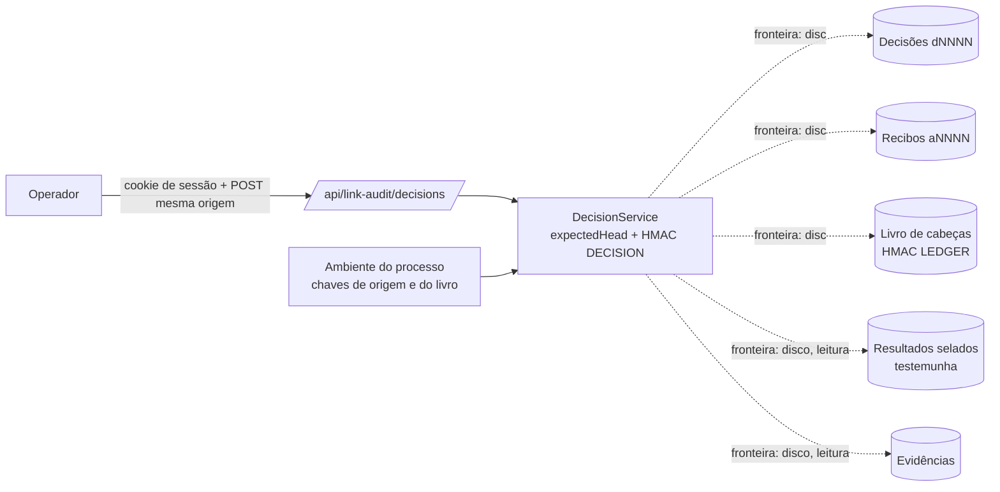

# Modelo de ameaças: Auditoria por Link — decisões humanas (6B), recibos/âncoras, testemunha e chaves

- **Data**: 2026-11-07
- **Autor(es)**: threat-modeler (subagente)
- **Status**: Rascunho (Draft)
- **Escopo**: `src/lib/link-audit-decisions/*`, `src/lib/link-audit-storage/receipts.ts`, `src/lib/link-audit-origin/index.ts`, rotas `/api/link-audit/decisions/[auditId]` (GET/POST), `/revocations` (POST)
- **Spec vinculada**: `docs/phase6-auditoria-link/onda6b-decisoes-humanas.md`
- **ADRs vinculados**: `onda6b-adr-ancora-externa.md` (+ Emenda 1), `onda6c-adr-prova-de-origem.md` (ADR 6C-02), `onda6c-runbook-chaves.md`

> **Não duplica** `onda6c-modelo-de-ameacas-recuperacao.md`: lá estão a matriz de quem escreve em qual pasta (itens 1–12, 17), o STRIDE da **recuperação de pendências**, os limites MINOR-2, §6.2–§6.5 e a rotação de chave × testemunha (10e). Este documento cobre o **caminho normal** (criar, substituir, revogar, listar) e o que fica fora daquela matriz.

## 1. Visão geral

O operador registra juízos humanos (ex.: C2, categoria) e revogações sobre uma auditoria. Cada entrada é um arquivo `dNNNN` encadeado por hash, com etiqueta HMAC do servidor (domínio `DECISION`) e um **recibo** imutável `aNNNN` em outra pasta. A escrita exige o `expectedHead` (visão do operador) e só é confirmada depois do recibo (Emenda 1 do ADR da âncora). O autor e a hora vêm da sessão e do relógio do servidor; o corpo do cliente não aceita autor, data, caminhos nem pontuação (`decisions/shared.ts:12-21`, `service.ts:602`). Uma testemunha independente (cabeças dos resultados selados ou o livro de cabeças) impede que o histórico regrida sem detecção.

## 2. Ativos

- Decisões ACTIVE (alimentam o motor) e sua **autoria**.
- Revogações/substituições (perder uma reativa uma decisão).
- Chave de origem `GMN_LINK_AUDIT_ORIGIN_KEY` e chave do livro `GMN_LINK_AUDIT_LEDGER_KEY` (segredos novos, só no web).
- Disponibilidade das escritas de decisão (falha fechada congela a auditoria).

## 3. Atores

| Ator | Confiança | Observações |
|---|---|---|
| Operador autenticado | média | Pode criar, substituir e **revogar qualquer decisão de qualquer operador** (sem ACL por auditoria nem por autor) |
| Escritor de **uma** pasta (decisões, âncoras, resultados, livro) | não confiável | A1 do modelo da recuperação |
| Processo web | alta | Detém as chaves HMAC (origem e livro) |
| Administrador (papel administrativo) | **não existe** | `RESTORE_ACK`, `QUARANTINE_ACK`, `ADOPT` respondem 403 `ADMIN_APPROVAL_UNAVAILABLE` (`service.ts:985`) |

## 4. Diagrama de fluxo

## 5. Análise STRIDE

| ID | STRIDE | Ameaça | Mitigação existente (arquivo:linha / teste) | Risco residual | Status |
|---|---|---|---|---|---|
| D-S1 | S | Gravar decisão em nome de outro operador | Autor = e-mail da sessão (`service.ts:591`, `decisions/shared.ts:12-21`); corpo estrito sem autor/data (`types.ts:117,120`); etiqueta HMAC cobre autor/hora/conteúdo (`link-audit-origin/index.ts:114`). Teste: `link-audit-decisions-api.test.ts`, `link-audit-origin-protocol.test.ts` | Sessão roubada (fora de escopo, Fase 5) | mitigado |
| D-S2 | S | Forjar arquivo de decisão/revogação numa pasta e fazê-lo virar ACTIVE | Coberto: itens 1, 3–6 da matriz do modelo da recuperação | — | mitigado (ver modelo existente) |
| D-T1 | T | Escrita sobre visão desatualizada (corrida entre operadores) | `expectedHead` obrigatório ⇒ `HEAD_MISMATCH`; escrita sob trava (`service.ts:915-947`). Teste: `link-audit-decisions-service.test.ts` | — | mitigado |
| D-T2 | T | Juízo C2 carimbado com captura diferente da que o operador viu (coleta nova entre abrir a tela e enviar) | Nenhuma no contrato (P-1, `onda6c-riscos-p1-p4.md`) | Só com coleta concorrente; hoje a coleta é manual (CLI). Regra de procedimento proposta, não aceita formalmente | aberto (P-1) |
| D-T3 | T | Remover recibo / mover revogação / rollback das pastas | Recibos + testemunha + livro (ADR 6C-02 §4.5, §11) | Rollback **coordenado** de decisões + recibos + livro sem guarda externa: **não detectado** (ver `link-audit-ledger-e-resultados.md`) | parcial (ver modelo existente §8b) |
| D-R1 | R | Operador nega ter revogado a decisão de um colega | `recordedBy` + etiqueta HMAC + recibo; o livro registra `INTENT`/`CONFIRMED` | Nenhum **log estruturado** nas rotas da Fase 6 (busca por `logger.` em `src/app/api/link-audit` e `src/lib/link-audit*`: zero ocorrências); a prova de autoria fica só nas pastas que o atacante A1 controla, e a etiqueta não é reverificada em confirmados (§5 do modelo da recuperação) | parcial |
| D-I1 | I | Pendente revela conteúdo/autor a quem não deve | DTO não revela conteúdo/autor sem origem comprovada nem a quem não é o autor (§5 do modelo da recuperação) | — | mitigado |
| D-I2 | I | Chaves HMAC em log, resposta ou arquivo | Só ambiente; mensagens fixas; nunca gravadas (`link-audit-origin/index.ts:36-37`); `docker-entrypoint.sh` ainda não entrega `*_FILE` para elas (`link-audit-ledger/config.ts:5-7`) | Entregues por variável de ambiente, ficam visíveis em `docker inspect`/`/proc/<pid>/environ` para quem tem acesso ao host (**NÃO VERIFICADO** na VPS; checklist §2 pede conferência) | parcial |
| D-D1 | D | Arquivo plantado (pendente forjada, FIFO, resultado contraditório) congela a auditoria | Falha fechada por desenho (itens 10g, 13 da matriz); limite 20 escritas/min e 30 leituras/min por operador (`decisions/shared.ts:31-32`) | Sem operação administrativa, uma auditoria congelada **não tem caminho de reabertura pela aplicação** (checklist, "Operações administrativas BLOQUEADAS") | parcial (aceito por desenho) |
| D-D2 | D | Esgotar a capacidade do livro (4000 registros) com reemissões | Máx. 1 `RECEIPT_REISSUED` por entrada; reserva de 100 revogações (checklist §12, spec §16.12) | Auditoria `EXHAUSTED` precisa do papel administrativo inexistente | parcial |
| D-E1 | E | Operador comum revogar/substituir decisão de outro | Nenhuma checagem de autoria em `revoke` (`service.ts:899-947`: busca o alvo por id e só exige `ACTIVE`) | Por desenho (equipe única), mas **não está registrado como aceite**. Combinado com D-R1, uma revogação maliciosa só é rastreada pelos arquivos | aberto (aceite pendente) |
| D-E2 | E | Executar operação administrativa (`ADOPT`, `RESTORE_ACK`, `QUARANTINE_ACK`) sem dupla aprovação | Recusada sempre: 403 `ADMIN_APPROVAL_UNAVAILABLE` (`service.ts:968-985`). Teste: `link-audit-ledger-q5.test.ts` | — | mitigado |
| D-E3 | E | Usar a chave de origem para forjar registros do livro (ou o inverso) | Domínios e derivação separados (`link-audit-origin/index.ts:46-55`); configuração recusa id ou material repetido entre as famílias (`link-audit-ledger/config.ts:35-38`). Teste: `link-audit-ledger-keys.test.ts`, `link-audit-ledger-hkdf.test.ts` | — | mitigado |

### Rotação de chaves (resumo; procedimento em `onda6c-runbook-chaves.md`)

| Situação | Comportamento no código | Status |
|---|---|---|
| Rotação planejada da chave de origem | Antiga em `..._RETIRED_KEYS` só verifica, com validade ≤ 93 dias (`link-audit-origin/index.ts:120,172`) | mitigado |
| Comprometimento | Id em `..._REVOKED_KEY_IDS` ⇒ `KEY_REVOKED`; material de id revogado presente ⇒ configuração inválida, escritas 503 (`:28-30,196`) | mitigado |
| Comparação da etiqueta | `timingSafeEqual` (`:205`) | mitigado |
| Rotação da chave do livro | Sem botão; `RECOVER` por auditoria antes de remover a antiga (checklist §12); janela antes do 1º registro da chave nova declarada (§8b do modelo da recuperação) | parcial (procedimento manual, **não ensaiado**) |

## 6. Ameaças priorizadas

### T-D01 [MÉDIO] Repúdio + elevação — revogação cruzada sem trilha fora das pastas (D-E1 + D-R1)
- **Vetor**: operador autorizado revoga a decisão de um colega; a única prova é o arquivo de revogação e o livro, que vivem nos volumes da VPS.
- **Probabilidade**: Baixa (equipe interna). **Impacto**: Médio (altera o índice; alteração honesta é indistinguível de sabotagem sem log).

### T-D02 [MÉDIO] Tampering — vínculo C2 ↔ captura (P-1)
- Já analisado em `onda6c-riscos-p1-p4.md`; continua **sem decisão**.

## 7. Abuse cases

- **Dois operadores revogam a mesma decisão ao mesmo tempo**: o segundo recebe `HEAD_MISMATCH`/`DECISION_NOT_ACTIVE`.
- **Operador envia `{"record": {...}, "score": 10}`**: `FORBIDDEN_FIELDS` (400).
- **Site de terceiros faz POST com o cookie do operador**: `SameSite=Strict` + recusa de `Origin` diferente (`auth/guard.ts:107-120`).
- **Operador mal-intencionado revoga todas as decisões de um colega numa auditoria**: aceito pelo código, limitado a 20 escritas/min; sem alerta.
- **Incidente de chave**: auditorias protegidas congelam até a operação administrativa que não existe (R6-13, checklist).

## 8. Risco residual e ações recomendadas

| Ação | Critério de aceite |
|---|---|
| **A-D1** Log estruturado (sem PII além do e-mail do operador, sem conteúdo da justificativa) para criar/revogar/substituir/`ENROLL`/`RECOVER` e para recusas de integridade (409/503), via `src/lib/logger.ts`, enviado para fora da VPS | Teste com logger falso: cada operação de escrita gera 1 evento com `auditId`, `seq`, `action`, `operator`, `code`; nenhum campo de texto livre |
| **A-D2** Decidir e registrar: revogação só pelo autor **ou** aceite formal de revogação cruzada | Teste de serviço (se restringir: 403 para não-autor) **ou** linha no registro de riscos com responsável |
| **A-D3** Entregar `GMN_LINK_AUDIT_ORIGIN_KEY` e `GMN_LINK_AUDIT_LEDGER_KEY` por `docker secret`/`*_FILE` (lista fixa do entrypoint) | `tests/deploy-config.test.ts` confere os nomes no entrypoint e no `stack.yml`; `docker inspect` sem as chaves (verificação manual na homologação) |
| **A-D4** Decidir P-1 (contrato `basisCapture` ou regra de procedimento aceita) | Testes (a)–(d) listados em `onda6c-riscos-p1-p4.md` P-1, ou aceite registrado |
| **A-D5** Ensaiar a rotação planejada e por comprometimento das duas famílias em homologação | Roteiro executado e anexado ao runbook, com `keyCoverage.covered` conferido |

## 9. Referências

- `docs/phase6-auditoria-link/onda6c-modelo-de-ameacas-recuperacao.md` (§4, §5, §6, §8b)
- `docs/phase6-auditoria-link/onda6b-adr-ancora-externa.md` §3–§4, Emenda 1
- `docs/phase6-auditoria-link/onda6c-adr-prova-de-origem.md` §4–§11
- `docs/phase6-auditoria-link/onda6c-checklist-producao.md` (pendências declaradas, §2, §12)
