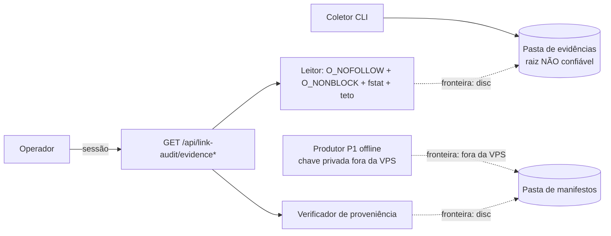

# Modelo de ameaças: Auditoria por Link — evidências imutáveis, manifestos (selos) e leitor

- **Data**: 2026-11-07
- **Autor(es)**: threat-modeler (subagente)
- **Status**: Rascunho (Draft)
- **Escopo**: `src/lib/link-audit-evidence/*` (store, reader, provenance, secrets, present), leitor endurecido em `src/lib/link-audit/snapshot-store.ts`, rotas `GET /api/link-audit/evidence*`
- **Spec vinculada**: `docs/phase6-auditoria-link/onda5a-persistencia-e-leitura.md`, `onda5b-visualizacao-das-evidencias.md`
- **ADRs vinculados**: `onda6c-adr-proveniencia-evidencias.md` (ADR 6C-03), `onda6c-contrato-p1-atestacao.md`, `onda6c-runbook-chaves.md` §4

> **Não duplica** `docs/phase6-auditoria-link/onda6c-modelo-de-ameacas-recuperacao.md`. As linhas 13–16 da matriz §4 de lá (FIFO, captura forjada, captura removida, legado reescrito, evidência reescrita com selo refeito, manifesto forjado) e o §6.6 já cobrem a fronteira "pasta de evidências = raiz NÃO confiável". Aqui ficam o **armazenamento**, o **leitor**, a **divulgação** e as lacunas de operação.

## 1. Visão geral

Cada coleta LIVE grava arquivos JSON imutáveis (`cNNNN.capture.json`, `.site.json`, `.report-rNNNN.json`) com `contentSha256` sobre o JSON canônico (`store.ts:117-125`), publicados de forma exclusiva (temporário + `fsync` + `link()`, `store.ts:29,333`). O hash **detecta alteração, não prova autoria** (`types.ts:21-25`). A autenticidade vem de um **manifesto Ed25519** (`seal-NNNN.json`) guardado numa pasta separada e verificado com chaves públicas de confiança (`provenance.ts:8-27,191-256`). **Não existe produtor do manifesto** (P1 só tem contrato): toda finalização responde `NOT_FINALIZABLE` por desenho.

## 2. Ativos

- Corpo bruto da resposta paga do Serper (dados públicos de empresas, mas evidência de auditoria).
- Integridade e autenticidade das capturas que alimentam o motor Lumos.
- Chave privada de atestação (fora da VPS — custódia em `onda6c-contrato-p1-atestacao.md` §2) e lista de chaves públicas (`GMN_LINK_AUDIT_EVIDENCE_TRUST_KEYS`).
- Disponibilidade do processo web (o leitor relê e reconfere hashes a cada consulta).

## 3. Atores

| Ator | Confiança | Observações |
|---|---|---|
| Coletor (CLI no host) | alta | Único escritor previsto da pasta de evidências |
| Quem escreve na pasta de evidências (Worker comprometido, admin, rsync errado) | não confiável | Modelado como A1 no modelo da recuperação |
| Quem escreve na pasta de manifestos | não confiável | Sem a privada só consegue apagar/estragar (indisponibilidade) |
| Detentor da chave privada Ed25519 | alta | Atesta qualquer coisa; fora de escopo se comprometido (§6.5 do modelo da recuperação) |
| Operador autenticado (web) | baixa-média | Lê qualquer auditoria (sem ACL por auditoria) |

## 4. Diagrama de fluxo

## 5. Análise STRIDE

| ID | STRIDE | Ameaça | Mitigação existente (arquivo:linha / teste) | Risco residual | Status |
|---|---|---|---|---|---|
| E-S1 | S | Fatos plantados na pasta de evidências passarem por coleta autêntica | Manifesto assinado fora da pasta; base ⊆ manifesto **e** manifesto ⊆ base (`provenance.ts:236-249`); sem chave/manifesto ⇒ política fechada (`provenance.ts:260-271`). Teste: `link-audit-evidence-provenance.test.ts` (matriz 14–16 do modelo da recuperação) | Coberto lá. Aqui: nenhum produtor existe, então **nada** é autêntico hoje (falha fechada, disponibilidade) | mitigado (por bloqueio) |
| E-S2 | S | Pasta de manifestos sobreposta à de evidências (ou via symlink), deixando o escritor de evidências tocar a prova | Checagem léxica na configuração e por `realpath` a cada verificação (`provenance.ts:204-210,264-269`); diretório da auditoria não pode ser symlink (`:216`) | Comparação em minúsculas (`toLowerCase`) é conservadora (recusa mais) — sem risco | mitigado |
| E-T1 | T | Alterar evidência e refazer o `contentSha256` | Hash ≠ manifesto ⇒ `EVIDENCE_HASH_MISMATCH` (`provenance.ts:240-241`); sem manifesto, a leitura mostra integridade OK mas a prévia bloqueia finalização (`preview.ts:299`) | A página da auditoria mostra "origem NÃO comprovada" a partir da prévia (`components/link-audit/audit-page/company-panel.tsx:35-71`), mas as rotas `GET /api/link-audit/evidence*` e o painel "Auditorias armazenadas" (Onda 5B) só trazem a integridade por hash: um arquivo alterado com hash refeito aparece como "íntegro" ali (verificado por busca: `reader.ts`/`present.ts` não referenciam proveniência) | parcial |
| E-T2 | T | Sobrescrever arquivo já publicado | Publicação exclusiva (`link()`/`wx`), nunca sobrescreve (`store.ts:333`); bloqueio por `realpath` da base (`store.ts:92-115`) | Root/host continua podendo alterar (detectado, não impedido) | mitigado |
| E-T3 | T | Gravar evidências dentro de `public/`, `src/`, `.next/`, `node_modules/` (exposição estática ou build) | `assertAllowedBase` + segunda checagem pelo caminho real (`store.ts:134-147,189-203`) | Nenhum | mitigado |
| E-R1 | R | Negar que uma captura veio da coleta | Hash + manifesto (quando existir) + dossiê do P1 (`onda6c-contrato-p1-atestacao.md` §5) | Sem produtor, não há não-repúdio de coleta | aberto (dependência P1) |
| E-I1 | I | Corpo bruto do provedor, chaves ou caminhos do disco saírem pela API | Leitor nunca expõe `bodyText` nos tipos de visão; `sanitizeForOutput` remove chaves sensíveis (`url-redaction.ts:134-162`, `reader.ts:9-13`); erros com `scrubPaths` (`store.ts:53-55`); rotas devolvem mensagens fixas e `no-store, private` (`evidence/shared.ts:15-20`). Teste: `link-audit-evidence-api.test.ts`, `link-audit-redaction-json.test.ts` | Nenhum relevante | mitigado |
| E-I2 | I | Operador ler auditoria de outro operador | Nenhuma ACL por auditoria; o `authorize` injetado é tautológico (`candidate.email === access.operator`, `evidence/shared.ts:63`) | Limitação herdada e declarada (§5 do modelo da recuperação). Aceitável enquanto todos os operadores forem a mesma equipe | aberto (aceito de fato, sem aceite formal) |
| E-D1 | D | FIFO, symlink, dispositivo ou arquivo gigante na pasta | Leitor `O_RDONLY\|O_NOFOLLOW\|O_NONBLOCK`, `fstat` no descritor, teto 2 MiB e `size+1` (`snapshot-store.ts:89-102`). Teste: `link-audit-special-files.test.ts` | Coberto (item 13 do modelo da recuperação) | mitigado |
| E-D2 | D | Listagem relê e reconfere todas as auditorias a cada `GET /evidence` | Limite 30/min por operador (`evidence/shared.ts:26,53`); paginação ≤ 50 (`:22-24`) | `listAudits` é O(n auditorias) por requisição antes de paginar (`evidence/route.ts:18-19`). Com centenas de auditorias, cada chamada fica cara; o limitador é em memória e por operador | parcial |
| E-D3 | D | Escritor da pasta de manifestos apaga todos os selos ou planta `seal-9999.json` inválido | Fail-closed por desenho: o selo de maior `seq` vale e não há recuo (`provenance.ts:226-232`) | Congela a finalização da auditoria (disponibilidade). Aceito por desenho; mitigação = pasta de manifestos somente leitura para o web e backup próprio (**NÃO VERIFICADO**: a pasta ainda não existe no `stack.yml`) | parcial (aceito) |
| E-E1 | E | Web gravar/alterar evidências | No `stack.yml` o volume de evidências é montado **somente leitura** no web (`deploy/hostinger/stack.yml:43-46`) | Permissões reais na VPS **NÃO VERIFICADAS** | mitigado (config) |

## 6. Ameaças priorizadas

### T-E01 [MÉDIO] Tampering — evidência adulterada aparece "íntegra" na tela de evidências (E-T1)
- **Vetor**: escritor da pasta troca o JSON e refaz `contentSha256`; o painel de auditorias armazenadas e a API de evidências mostram integridade OK (a página da auditoria, via prévia, já avisa "origem NÃO comprovada").
- **Probabilidade**: Baixa (exige escrita no volume). **Impacto**: Médio (operador toma decisão humana 6B sobre dado falso; a finalização continua bloqueada).
- **Relação**: complementa P-2 (`onda6c-riscos-p1-p4.md`), que trata o mesmo sinal na consulta de resultados.

### T-E02 [MÉDIO] Disponibilidade — sem produtor P1, nenhuma evidência é autêntica (E-S1, E-R1)
- Bloqueio por desenho; registrado no checklist (`onda6c-checklist-producao.md`, "FINALIZAÇÃO FECHADA POR DESENHO").

## 7. Abuse cases

- **Worker comprometido grava `c0002.capture.json` com categoria inventada e hash correto**: a tela de evidências mostra; a prévia marca `EVIDENCE_PROVENANCE_UNPROVEN`; finalização recusada.
- **Atacante cria symlink `evidence/<auditId>` → `/etc`**: diretório da auditoria que é symlink é tratado como não encontrado (`reader.ts:20-26`); leitura final com `O_NOFOLLOW`.
- **Operador curioso chama `GET /api/link-audit/evidence?limit=50&offset=0` em laço**: 429 após 30/min; cada chamada relê todas as auditorias.
- **Restauração de backup antigo com manifesto autêntico antigo**: autêntico, mas desatualizado — limite de "atualidade" já declarado (§6.4 do modelo da recuperação).

## 8. Risco residual e ações recomendadas

| Ação | Critério de aceite |
|---|---|
| **A-E1** Mostrar também no DTO de `GET /api/link-audit/evidence*` e no painel de auditorias armazenadas o veredito de proveniência (`AUTHENTICATED` / `UNAUTHENTICATED: <razão>`) ao lado da integridade, nunca "OK" sem a palavra "integridade" | Teste de renderização: captura com hash refeito e sem manifesto exibe "integridade OK, origem NÃO comprovada"; teste de API com o campo novo |
| **A-E2** Paginar/cachear `listAudits` (ex.: listar nomes de diretório e só verificar a página pedida) | Benchmark sem rede com 500 auditorias sintéticas: `GET /evidence?limit=20` lê no máximo 20 auditorias |
| **A-E3** Implementar o produtor P1 conforme `onda6c-contrato-p1-atestacao.md` (decisão do responsável) | Contrato P1 §3 implementado com testes; uma auditoria de homologação passa a `AUTHENTICATED` |
| **A-E4** Ao provisionar `GMN_LINK_AUDIT_EVIDENCE_SEALS_DIR`, montar a pasta somente leitura no web, com backup próprio | `stack.yml` com `read_only: true` e teste em `tests/deploy-config.test.ts` |
| **A-E5** Registrar aceite formal (ou ACL) para leitura cruzada entre operadores (E-I2) | Linha no registro de riscos com responsável e data |

## 9. Referências

- `docs/phase6-auditoria-link/onda6c-modelo-de-ameacas-recuperacao.md` §4 (itens 13–16), §6.6, §7
- `docs/phase6-auditoria-link/onda6c-adr-proveniencia-evidencias.md` §4–§7
- `docs/phase6-auditoria-link/onda6c-riscos-p1-p4.md` (P-2)
