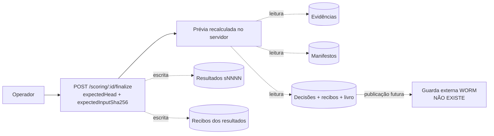

# Modelo de ameaças: Auditoria por Link — livro de cabeças, finalização e resultados selados (lacunas)

- **Data**: 2026-11-07
- **Autor(es)**: threat-modeler (subagente)
- **Status**: Rascunho (Draft) — documento de **lacunas**, complementar
- **Escopo**: `src/lib/link-audit-ledger/*`, `src/lib/link-audit-scoring-runs/results*.ts`, `preview.ts`, rotas `/api/link-audit/scoring/[auditId]` (prévia), `/finalize`, `/results`, `/results/[seq]`, `/api/link-audit/decisions/[auditId]/ledger`
- **Spec vinculada**: `docs/phase6-auditoria-link/onda6c-especificacao-livro-de-cabecas.md`, `onda6c-integracao-orquestracao.md`
- **ADRs vinculados**: `onda6c-adr-prova-de-origem.md` §4.5–§11, `onda6c-adr-proveniencia-evidencias.md`

## 1. O que já está coberto (não repetir)

O **modelo de ameaças da recuperação** (`docs/phase6-auditoria-link/onda6c-modelo-de-ameacas-recuperacao.md`) é a referência normativa para:

| Tema | Onde |
|---|---|
| Resultado PONTUADO forjado, pendente de origem não comprovada | §4 itens 2, 8 |
| Remoção de recibo de resultado, cadeia de resultados adulterada/ilegível | §4 itens 10, 10d, 10g, 12 |
| Livro de cabeças: truncar, reordenar, remover, chave antiga, `RESULT_LEDGER_MISMATCH`, `PUBLISHED_AFTER_ABORT` | §8b (tabela) e §8b.1 |
| Rollback coordenado sem guarda externa (**não detectado**) | §8b, linha "livro + decisões + recibos, sem resultado e sem guarda" |
| Queima de capacidade do livro, relógio, TOCTOU no `RECOVER`, `DURABILITY_UNKNOWN` | §8b.1 |
| Hipóteses de confiança (FS com `link()`/`fsync`, chaves só no ambiente) | §9 |

Este documento registra só o que **não** está lá: o estado de **finalização fechada**, a **guarda externa inexistente**, as **operações administrativas bloqueadas**, a superfície HTTP e os riscos P-2/P-3/P-4 vistos como ameaças.

## 2. Ativos

- Resultado confirmado (arquivo + recibo) — consumido pela futura Onda 7 (PDF) e pelo cliente.
- Cabeça do livro por auditoria (`ledgerSeq` + `sha256`).
- Disponibilidade da auditoria (estados `HISTORY_UNRESOLVED`, `UNTRUSTED`, `EXHAUSTED` não têm saída pela aplicação).

## 3. Atores

Os mesmos do §2 do modelo da recuperação, mais: **provedor de guarda externa** (não existe) e **administrador com dupla aprovação** (não existe).

## 4. Diagrama de fluxo

## 5. Análise STRIDE (somente lacunas)

| ID | STRIDE | Ameaça | Mitigação existente (arquivo:linha / teste) | Risco residual | Status |
|---|---|---|---|---|---|
| L-S1 | S | Cliente injeta pontuação, entrada do motor ou data de referência na finalização | Corpo estrito `{expectedHead, expectedInputSha256}`, qualquer query ⇒ 400; prévia recalculada no servidor (`scoring/[auditId]/finalize/route.ts:8-21`) | — | mitigado |
| L-T1 | T | Finalizar sobre evidência não autêntica ou histórico não resolvido | `NOT_FINALIZABLE` quando há `EVIDENCE_PROVENANCE_UNPROVEN` ou `DECISIONS_HISTORY_UNRESOLVED` (`results.ts:464,492`; bloqueio emitido em `preview.ts:299`). Teste: `link-audit-scoring-results-service.test.ts`, `link-audit-evidence-provenance.test.ts` | Hoje **toda** finalização é recusada (não há produtor de manifesto): risco convertido em indisponibilidade aceita por desenho | mitigado (por bloqueio) |
| L-T2 | T | **Rollback coordenado** de decisões + recibos + livro (ou escrita em ≥ 2 pastas incluindo o livro) | Porta `ExternalGuardPort` + adaptador **sintético** só para testes (`link-audit-ledger/guard.ts:6-25`); as rotas **não** ligam guarda (`decisions/ledger-wiring.ts:5-9`); sessão começa com `guard: NOT_CONFIGURED` (`link-audit-ledger/service.ts:115`). Teste que trava o limite: `link-audit-ledger-guard.test.ts` | **Não detectado.** Bloqueador de produção declarado (checklist, "GUARDA EXTERNA IMUTÁVEL (Q6)"). Nenhum provedor contratado | **aberto** |
| L-T3 | T | Evidência fixada por um resultado é trocada/removida depois e aparece só como `stale` | Finalização seguinte recusa `EVIDENCE_HASH_CHANGED`; prévia acusa `EVIDENCE_MISSING`/`EVIDENCE_HASH_MISMATCH` para coletas atestadas | `list/get` de resultados continuam mostrando só "desatualizado" (P-2, `onda6c-riscos-p1-p4.md`) | aberto (P-2) |
| L-R1 | R | Negar quem finalizou | Autor e hora da sessão/servidor; etiqueta HMAC domínio `RUN`; recibo | Etiqueta não reverificada em confirmados (R2-MINOR-3, recomendado e não implementado); sem log estruturado nas rotas | parcial |
| L-I1 | I | Resultado expor dados internos | `toPublicRun` (`results-verify.ts`), mensagens fixas | — | mitigado |
| L-D1 | D | Verificação a frio síncrona (`verifyRunRecord`) bloqueia o laço de eventos; cache limpo inteiro ao encher | Cache `VERIFIED_CAP = 4096` (`results.ts:265-269`); 30 leituras/min e 6 finalizações/min por operador (`scoring/shared.ts:125-126`) | P-3: não medido. A listagem de decisões e a prévia também leem a cadeia de resultados (testemunha) | aberto (P-3, medir) |
| L-D2 | D | Auditoria cai em `HISTORY_UNRESOLVED`/`UNTRUSTED`/`EXHAUSTED`/`LEGACY_READ_ONLY` e não há reabertura | Falha fechada por desenho; `ADOPT`, `RESTORE_ACK`, `QUARANTINE_ACK` ⇒ 403 `ADMIN_APPROVAL_UNAVAILABLE` (`link-audit-decisions/service.ts:968-985`) | **Qualquer** escritor de uma única pasta (resultados ou livro) congela a auditoria de forma permanente pela aplicação; incidente de chave congela **todas** as auditorias protegidas (R6-13) | aberto (bloqueador de produção declarado) |
| L-D3 | D | Perda de durabilidade (`fsync` de diretório melhor-esforço nos resultados) após queda | Com o livro: falha de `fsync` interrompe escritas (R6-07). Resultados/recibos/evidências: melhor-esforço | P-4: falso `RESULT_TRUNCATED` (falha fechada) — ensaio de queda não executado | aberto (P-4) |
| L-E1 | E | Operador executa operação que concede confiança (adotar histórico legado, aceitar restauração) | Recusada sempre (L-D2). Teste: `link-audit-ledger-q5.test.ts` | — | mitigado |

## 6. Ameaças priorizadas

### T-L01 [ALTO] Tampering — rollback coordenado sem guarda externa (L-T2)
- **Vetor**: quem tem escrita nos volumes de decisões, recibos e livro (root na VPS, backup restaurado errado) volta os três a um instante anterior; uma revogação desaparece e a decisão antiga volta a ACTIVE.
- **Probabilidade**: Baixa (exige acesso ao host ou erro de restauração). **Impacto**: Alto (índice com decisão revogada).
- **Status**: aberto, declarado como bloqueador de produção.

### T-L02 [MÉDIO] DoS — congelamento sem reabertura (L-D2)
- **Probabilidade**: Média (basta escrita numa pasta, ou um incidente de chave). **Impacto**: Médio (auditoria inutilizável; recuperação humana fora do sistema).

## 7. Abuse cases

- **Operador tenta finalizar repetidamente para "forçar" o índice**: 409 `NOT_FINALIZABLE`; 6/min.
- **Restauração de backup só da pasta de resultados**: `RESULT_LEDGER_MISMATCH`/`UNTRUSTED`, congela.
- **Admin restaura os três volumes de ontem após incidente de disco**: aceito em silêncio (sem guarda) — exatamente o caso que a guarda externa existe para pegar.
- **Atacante planta um `sNNNN` pendente contraditório**: congela a auditoria (10g da matriz), sem saída administrativa.

## 8. Risco residual e ações recomendadas

| Ação | Critério de aceite |
|---|---|
| **A-L1** Escolher e integrar um provedor de guarda externa imutável (objeto com retenção/WORM em domínio de falha separado), cumprindo o contrato R6-10 do checklist | Adaptador real atrás de `ExternalGuardPort`; testes de contrato (`head:null` só com `ledgerSeq ≤ 1`, atraso limitado, "nunca publicou" ≠ "esqueceu"); `externalGuard` ≠ `NOT_CONFIGURED` em homologação |
| **A-L2** Especificar e implementar o papel administrativo com dupla aprovação auditável (spec §16.8) | `ADOPT`/`RESTORE_ACK`/`QUARANTINE_ACK` aceitos só com duas identidades distintas e registro fora da VPS; teste de que uma única identidade é recusada |
| **A-L3** P-2: indicador `evidenceIntegrity` em `list/get` de resultados | Testes (a)–(e) de `onda6c-riscos-p1-p4.md` P-2 |
| **A-L4** P-3: benchmark de 500 resultados sintéticos (latência p95 e atraso do laço) | Benchmark reproduzível sem rede com limites explícitos |
| **A-L5** P-4: requisito de FS documentado + ensaio de queda em homologação | Relatório do ensaio anexado ao checklist |
| **A-L6** R2-MINOR-3: indicador não bloqueante de origem dos confirmados; Onda 7 exigir `PROVEN` | Teste de que um confirmado sem etiqueta aparece marcado; contrato da Onda 7 cita a exigência |

## 9. Referências

- `docs/phase6-auditoria-link/onda6c-modelo-de-ameacas-recuperacao.md` (referência principal)
- `docs/phase6-auditoria-link/onda6c-checklist-producao.md` (pendências declaradas, §12)
- `docs/phase6-auditoria-link/onda6c-riscos-p1-p4.md`
- `docs/phase6-auditoria-link/onda6c-especificacao-livro-de-cabecas.md` §16
