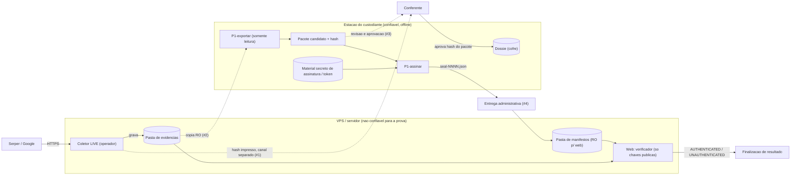

# Threat Model: Link Audit P1 — atestação offline da coleta (manifesto Ed25519)

> Status: modelo de ameaças da PROPOSTA de P1 (o produtor NÃO existe; o verificador existe). Data: 2026-11-16.
> Base lida: `docs/phase6-auditoria-link/onda6c-contrato-p1-atestacao.md` (§2 custódia, §3 processo, §4 conferência, §5 dossiê, §7 riscos), `onda6c-adr-proveniencia-evidencias.md`, `onda6c-runbook-chaves.md`, `src/lib/link-audit-evidence/provenance.ts`, `src/lib/link-audit/snapshot-store.ts` (leitura), `scripts/link-audit-collect.ts`, `src/lib/link-audit-runtime/{run,used-authorizations}.ts`.
> Nada foi executado; nenhuma chamada externa. Citações `arquivo:linha` referem-se à árvore de trabalho em 2026-11-16.

## Escopo

- Componentes: coletor LIVE (`scripts/link-audit-collect.ts` + `link-audit-runtime`); pasta de evidências; leitor (`link-audit-evidence`); verificador (`provenance.ts`); pasta de manifestos (volume novo, somente leitura para o web); servidor web (lista de chaves PÚBLICAS em `GMN_LINK_AUDIT_EVIDENCE_TRUST_KEYS`); P1 futuro: comando de exportação do candidato, dossiê, comando de assinatura na estação do custodiante.
- Dados: evidências da coleta (corpo Serper, status, relatórios), hashes, manifesto `seal-NNNN.json` (não secreto), dossiê (pode conter nome de empresa e e-mails de operadores), material secreto de assinatura do custodiante (chave privada Ed25519 e senha/PIN).
- Objetivo do atacante (raiz da árvore): FAZER O SISTEMA TRATAR COMO AUTÊNTICA UMA EVIDÊNCIA FORJADA OU ADULTERADA (status `AUTHENTICATED`, finalização liberada).
- Atores: A1 escritor só na pasta de evidências (o cenário RV2-F1); A2 operador que coleta (insider); A3 conferente; A4 custodiante titular / A5 suplente; A6 atacante com RCE no processo web (lê env, lê pastas, NÃO escreve em manifestos); A7 administrador da VPS (escreve config e volumes); A8 malware/supply chain na estação do custodiante; A9 atacante externo (phishing, roubo físico).
- Fora de escopo: veracidade do que o Google/Serper devolveu (o contrato §1 já declara que a assinatura não prova isso); chave de ORIGEM (HMAC) e chave do LIVRO (runbook §0, §7), tratadas em `onda6c-modelo-de-ameacas-recuperacao.md`.

## Fluxo de dados



Fronteiras de confiança: (#1) coletor ↔ canal separado do operador; (#2) VPS ↔ estação (cópia, não montagem com escrita); (#3) pacote ↔ aprovação humana; (#4) estação ↔ volume de manifestos (único caminho de volta ao servidor); (#5) servidor ↔ configuração de chaves públicas.

## O que o verificador JÁ garante (controles existentes, base para as lacunas)

| Controle | Onde |
|---|---|
| Sem chave de confiança, sem pasta, chave malformada ou pastas sobrepostas ⇒ política FECHADA; não existe valor que "confie em tudo" | `provenance.ts:71-75`, `:164-177`, `:260-271` |
| Chave pública de ordem pequena/não canônica recusada; qualquer item inválido invalida a lista inteira | `provenance.ts:107-162`, `:172-173` |
| Manifesto de OUTRA auditoria, chave desconhecida ou `seq` do arquivo ≠ `seq` do corpo ⇒ `SEAL_INVALID` | `provenance.ts:232` |
| Usa sempre o de MAIOR `seq`; se não valer, não recua para um antigo | `provenance.ts:226-229` |
| Esquema `strict`, entradas ordenadas e sem repetição, 1..2000 entradas, arquivo ≤ 256 KiB | `provenance.ts:79-91`, `:234`, `:32` |
| Assinatura sobre `canonicalJson(body)` (inclui `kind`, `schemaVersion`, `auditId`, `seq`, `keyId`, `entries`) | `provenance.ts:235`, `:104` |
| Cobertura bidirecional: base ⊆ manifesto (mesmo hash) e manifesto ⊆ base (nada atestado pode sumir) | `provenance.ts:237-248` |
| Pasta de manifestos não pode ser/estar dentro de outra pasta de dados (léxico + realpath) | `provenance.ts:204-210`, `:263-270` |
| Diretório do manifesto não pode ser link simbólico; leitura com `O_NOFOLLOW`+`O_NONBLOCK`, tipo conferido (sem FIFO/symlink) | `provenance.ts:215-216`; `snapshot-store.ts:89-97` |
| Qualquer exceção ⇒ `VERIFICATION_ERROR` (fecha) | `provenance.ts:249-251` |
| Relatório precisa referenciar o hash da captura dona (`captureSha256`) | `scoring-basis.ts:304` |
| Marcador de autorização usada criado com `wx` ANTES da chamada | `used-authorizations.ts:82` |

Lacunas observadas no verificador (alimentam as ameaças): `sealedAt` é validado só pelo formato (`provenance.ts:86`), sem relação com `collectedAt` nem com o relógio; não há encadeamento entre manifestos (`seq` N não referencia o hash de N-1); `createEvidenceSeal` (`:101-105`) não impõe continuidade de `seq` nem recusa legado; o manifesto v1 não distingue entrada nova de legada nem registra a fonte; confirmados não são reverificados após revogação de chave (runbook §4, §5).

## Árvore de ataque

Objetivo (raiz): O sistema trata como AUTÊNTICA uma evidência forjada ou adulterada. Notação: `[OU]` = qualquer filho basta; `[E]` = todos necessários. Marcas: `BLOQUEADO` (controle existente verificado no código), `ABERTO` (lacuna), `PROCESSO` (depende de pessoas/contrato).

```
RAIZ: evidência forjada/adulterada tratada como AUTENTICADA                                 [OU]
|
+-- A. Produzir um manifesto válido SEM a chave privada                                      [OU]
|   +-- A1 Quebrar Ed25519 ........................................ inviável
|   +-- A2 Chave de confiança de ordem pequena (qualquer um forja) .. BLOQUEADO provenance.ts:143-156
|   +-- A3 Política "aberta" por configuração ruim .................. BLOQUEADO :71-75, :262 (fecha)
|   +-- A4 Injetar chave PRÓPRIA em GMN_LINK_AUDIT_EVIDENCE_TRUST_KEYS             [E]
|   |       +-- escrita na configuração do servidor (stack/env) (A7)
|   |       +-- escrita na pasta de manifestos OU manifesto próprio entregue .... ABERTO (T-014)
|   +-- A5 Escolher manifesto antigo/forjado pela seleção de seq .... BLOQUEADO :226-229 (só maior seq)
|   +-- A6 Manifesto de outra auditoria / cópia entre auditorias .... BLOQUEADO :232
|   +-- A7 Confundir o parser (duplicata, ordem, campo extra) ....... BLOQUEADO :79-91, :234
|   +-- A8 Colocar a pasta de manifestos onde A1 escreve ............ BLOQUEADO :204-210, :263-270
|   +-- A9 symlink/FIFO no manifesto ................................ BLOQUEADO :215-216, snapshot-store.ts:89-97
|
+-- B. Alterar a evidência DEPOIS de atestada ........................ BLOQUEADO (hash por ref, :241; sumiço :247)
|       (resta só DoS: T-012)
|
+-- C. Obter uma assinatura LEGÍTIMA sobre dado ruim                                         [OU]
|   +-- C1 Adulterar na janela coleta -> exportação -> aprovação (A1/A2) ........ ABERTO (T-001)
|   +-- C2 Trocar o pacote entre aprovação e assinatura (TOCTOU / swap) ......... ABERTO (T-002)
|   +-- C3 Conferência negligente ou conivente (mesma pessoa opera/confere/assina) PROCESSO (T-003)
|   +-- C4 "Regularizar" o legado TUVAPLAST sem fonte independente .............. PROCESSO (T-004)
|   +-- C5 Enganar o conferente com prova falsa (marcador de autorização forjado,
|   |       hash "do canal separado" ditado pelo mesmo atacante)  ................ ABERTO (T-005)
|   +-- C6 Comprometer a FERRAMENTA de assinatura para assinar conjunto diferente
|           do exibido (tsx, npm, zod, dependências, PATH)  ...................... ABERTO (T-006)
|
+-- D. Obter o material secreto de assinatura (ou usá-lo)                                    [OU]
|   +-- D1 argv / variável de ambiente / histórico do shell ..................... ABERTO (T-007)
|   +-- D2 log, relatório de falha do Node, core dump, heap snapshot ............ ABERTO (T-008)
|   +-- D3 swap / hibernação / arquivo temporário / editor / backup não cifrado . ABERTO (T-009)
|   +-- D4 Roubo físico do token/meio + senha (phishing, shoulder-surf) .......... PROCESSO (T-010)
|   +-- D5 Suplente com CÓPIA do mesmo material (em vez de par próprio) .......... PROCESSO (T-011)
|
+-- E. Repetir estado autêntico antigo (replay/rollback)                                     [E]
|       +-- manifesto antigo restaurado (admin) + evidências antigas do mesmo instante ... ABERTO (T-013)
|
+-- F. Fazer o servidor confiar em chave que já não deveria                                  [OU]
        +-- chave comprometida continua na lista (detecção tardia) .... ABERTO (T-010, T-015)
        +-- janela entre rotação e remoção da chave antiga ............ PROCESSO (T-015)
```

Leitura da árvore: o ramo A está quase todo BLOQUEADO por código testável; o risco real está concentrado em C e D (pessoas, procedimento e a estação do custodiante), exatamente onde o código do verificador não alcança. O ramo C é o mais barato para um insider.

## Escala de pontuação

Probabilidade: Baixa=1, Média=2, Alta=3. Impacto: Baixo=1, Médio=2, Alto=3, Crítico=4. Risco = P×I (1-3 baixo, 4-6 médio, 8-9 alto, 12 crítico). Probabilidade considera exposição, atratividade e o fato de o projeto ser uma ferramenta interna com poucos operadores.

## Ameaças (priorizadas)

### T-001 [HIGH, 8] Tampering — janela entre a coleta e a atestação
- Categoria/ativo: T; pasta de evidências e pacote candidato.
- Ator: A1 (escreve só na pasta de evidências), A2 (operador), A6/A7.
- Pré-condição: a coleta grava na pasta (a cópia "fica no mesmo disco", `link-audit-collect.ts:108`); o conferente só olha depois, e a exportação parte da cópia dessa mesma pasta.
- Cenário: entre a gravação da captura e a exportação, o atacante regrava captura+relatório+selo SHA-256 (o pipeline de gravação aceita; é o RV2-F1) com nome, telefone ou endereço falsos. A integridade local fica `OK`, o pacote é gerado do dado adulterado, o conferente o aprova e o custodiante assina. A partir daí o verificador o trata como autêntico.
- Impacto: Crítico (fato forjado vira resultado definitivo, com etiqueta de origem do servidor).
- Controle existente: contrato §4.1 itens 2, 3 e 5 (hash do corpo registrado pelo operador em canal separado; coerência de URL/consulta; relatório reproduzível offline); `scoring-basis.ts:304` (relatório ↔ captura); ADR 6C-03 fase 3 (coletor assina) é a única eliminação, adiada.
- LACUNA CONCRETA: o item 2 do §4.1 supõe que "o coletor imprimiu no fim da execução o hash do corpo". Não imprime: a saída é `auditoria · captura N · relatório rM` sem hash (`link-audit-collect.ts:108`; o hash existe em `run.ts:308`, `captureRead.value.contentSha256`, mas só é usado para gerar o relatório). Além disso o contrato §6 diz que o coletor "não é tocado" por P1. Os dois textos se contradizem: sem esse hash, o controle principal da janela não existe.
- Mitigação proposta: (1) decidir entre (a) mudança mínima e aditiva do coletor para imprimir, na última linha, `auditId`, `bodySha256` da captura e `contentSha256` dos arquivos de captura e de relatório (sem alterar o formato das evidências; atualizar o §6), ou (b) comando separado somente leitura (`link-audit:fingerprint`) rodado pelo operador imediatamente após a coleta; (2) o operador registra essas linhas em canal que A1 não escreve (impressão, mensagem a outra pessoa, cofre) ANTES de qualquer outra operação; (3) a exportação compara o pacote com essa linha e recusa se divergir (`--expected-capture-sha256`, obrigatório para captura nova); (4) reduzir a janela: exportar logo após a coleta e registrar no dossiê o tempo entre `collectedAt` e a exportação, com limite configurável (por exemplo 24 h), acima do qual exige justificativa; (5) pasta de evidências com permissão 0700, dono distinto do web, e cópia imediata para mídia offline.
- Teste: pacote cuja captura foi alterada após a "linha do coletor" ⇒ `export` falha com `CAPTURE_HASH_DIVERGES_FROM_COLLECTOR_LINE`; teste do coletor (com `deps.out` injetado, sem rede) prova que a última linha contém o hash de 64 hex e é igual ao `contentSha256` relido.
- Risco residual: Médio. Se o atacante é o próprio operador (A2), o canal separado não ajuda: exige 2ª pessoa (T-003). Só a assinatura pelo coletor (fase 3) fecha totalmente.
- Responsável: dono da Fase 6. Tracking: SEC-P1-001.

### T-002 [HIGH, 8] Tampering — troca do pacote entre a aprovação e a assinatura (TOCTOU)
- Categoria/ativo: T; pacote candidato, dossiê.
- Ator: A8 (malware na estação), A2/A4 conivente, A1 se a exportação lê de montagem viva.
- Pré-condição: a aprovação é "por escrito no dossiê" (§3 etapa 3), isto é, não é criptográfica; o contrato §3.4(c) pede recusa se "hash do pacote aprovado ≠ hash do pacote a assinar", mas não define quem produz esse hash nem como ele é transportado.
- Cenário: (a) o conferente aprova o pacote P (hash H); o arquivo no disco é trocado por P' antes de o comando de assinatura lê-lo; (b) a ferramenta relê a pasta de evidências em vez de assinar exatamente o P aprovado, e entre exportação e assinatura a pasta mudou; (c) o texto da aprovação aponta para H, mas a assinatura usa `entries` recalculadas.
- Impacto: Crítico (assinatura legítima sobre dado que ninguém conferiu).
- Controle existente: `createEvidenceSeal` ordena e valida (`provenance.ts:101-104`) mas aceita qualquer `entries`; o verificador cobre a base atual, não o que foi aprovado. Contrato §3.4(c) e a v2 proposta (`dossier:{id,sha256}` na parte assinada).
- Lacuna: não há (i) aprovação com identidade criptográfica própria sobre H; (ii) leitura única do pacote; (iii) exibição de H ao custodiante por canal independente do computador que gerou o pacote.
- Mitigação proposta: a) o assinador NÃO acessa a pasta de evidências: só lê o arquivo de pacote (JSON canônico) e calcula H localmente; b) leitura única em memória: lê os bytes, calcula H e assina os MESMOS bytes (nunca relê por caminho); c) o conferente produz uma aprovação ASSINADA (segundo par Ed25519, de papel diferente do custodiante, `approver-*`) cobrindo `{auditId, H, seq, dossierSha256}`; o assinador valida essa assinatura contra uma lista local de conferentes; d) antes de assinar, a ferramenta exibe H curto e exige que o custodiante digite os 12 primeiros hex lidos do dossiê/da aprovação (confirmação humana por canal distinto); e) adotar a v2 com `dossier.sha256` na parte assinada antes do primeiro resultado de produção (pergunta 4 do §8: recomendada SIM); f) pacote e dossiê em diretório 0700 do custodiante, com o hash do pacote gravado no dossiê antes da aprovação.
- Teste: (1) trocar 1 byte do pacote após a aprovação ⇒ assinatura recusada `APPROVAL_HASH_MISMATCH`; (2) aprovação assinada por chave fora da lista de conferentes ⇒ recusada; (3) aprovação com `auditId` ou `seq` diferente ⇒ recusada; (4) o assinador, com `fs` falso, falha se tentar abrir qualquer caminho fora do pacote/dossiê/material de assinatura (prova de que não lê evidências); (5) mutar o arquivo entre leitura e assinatura (`fs` injetado que devolve bytes diferentes numa 2ª leitura) não altera o que foi assinado.
- Risco residual: Baixo-Médio com conferente e custodiante em pessoas e dispositivos diferentes; Médio se forem a mesma pessoa.
- Tracking: SEC-P1-002.

### T-003 [CRITICAL, 12] Repudiation / Elevation of privilege — atestar sem conferir (fator humano) e acúmulo de papéis
- Categoria/ativo: R (e E); a conferência, que é a única coisa que dá valor à assinatura (contrato §1).
- Ator: A2, A3, A4 (individualmente ou em conluio); pressão operacional ("preciso finalizar hoje").
- Pré-condição: poucos operadores; a pergunta 2 do §8 (conferente pode ser quem opera a coleta?) está em aberto; o contrato diz "sempre que possível diferente".
- Cenário: o operador coleta, "confere" o que ele mesmo imprimiu, aprova e (se também for custodiante) assina. Ou o conferente marca todos os itens do §4 como OK sem executá-los. Nada no sistema distingue conferência real de carimbo; o dossiê é texto livre arquivado fora da VPS e não lido pelo servidor. Se der errado, qualquer um pode negar ter conferido (não há registro com identidade criptográfica).
- Impacto: Crítico (anula o único controle de fundo; a assinatura vira carimbo).
- Controle existente: contrato §2 (quatro olhos "sempre que possível"), §5 (dossiê), §7.2 (auditoria periódica de dossiês).
- Lacuna: "sempre que possível" não é controle; o dossiê não é verificável pela ferramenta; nenhum item do §4 é executado por máquina.
- Mitigação proposta: (1) separação de papéis OBRIGATÓRIA e imposta pela ferramenta: `operator` (do coletor), `approverId` (chave de aprovação) e `custodianKeyId` são três identidades distintas, ou duas distintas com exceção formal registrada e assinada pelo responsável; (2) a ferramenta executa mecanicamente tudo o que for mecanizável do §4 (autorização consumida e dentro da janela, hash do corpo vs linha do coletor, `collectedAt`, HTTP 2xx, reprodução offline do relatório com o gerador do código) e grava o resultado de cada verificação (`PASS|FAIL|NOT_EXECUTED`) no dossiê; item manual só é aceito com justificativa e identificação; (3) a aprovação assinada (T-002) dá não-repúdio por pessoa; (4) o assinador recusa quando houver verificação `NOT_EXECUTED` sem exceção; (5) revisão amostral trimestral de dossiês por pessoa fora do fluxo, registrada; (6) o dossiê registra horários (sinal de carimbo em lote).
- Teste: o assinador recusa com `ROLE_SEPARATION_VIOLATED` quando operador = aprovador ou aprovador = custodiante sem exceção válida; recusa com `CHECK_NOT_EXECUTED` se o dossiê tiver item em branco; dossiê com 2 assinaturas diferentes verifica; dossiê adulterado após aprovação falha.
- Risco residual: Médio-Alto. Controle humano não é eliminável, só reduzível. Declarar no ADR que a assinatura vale o que vale esta conferência (já dito em §1).
- Tracking: SEC-P1-003.

### T-004 [HIGH, 9] Spoofing / Tampering — legado TUVAPLAST sem fonte independente
- Categoria/ativo: S/T; evidência `legacy-status:c0001`, `capture:c0001` e relatório legado (`scoring-basis.ts:360-411`).
- Ator: A2/A4 (quer finalizar a primeira auditoria real), A1.
- Pré-condição: a única cópia é a da própria VPS ("a cópia fica no mesmo disco; não é backup independente": `E0-CONTRATO-DE-FIDELIDADE.md:350`, `link-audit-collect.ts:108`). O §4.2 exige fonte independente anterior ao incidente; ela pode não existir. O verificador NÃO diferencia entrada legada de nova no manifesto (`provenance.ts:236-242` só compara hashes), então um manifesto que cubra o legado é aceito; a única barreira é o procedimento do assinador (§3.4(b)).
- Cenário: (a) o custodiante assina "porque o SHA-256 confere" (o contrato proíbe, mas a ferramenta só recusa se acreditar num "dossiê de fonte" que ela não valida); (b) quem escreveu na pasta antes (A1) tem o fato falso "legitimado"; (c) fabrica-se um "backup independente" a partir da mesma pasta.
- Impacto: Alto (resultado definitivo com dado possivelmente adulterado; é o primeiro caso real e o mais visível).
- Controle existente: contrato §4.2 e §3.4(b); verificador fecha por padrão sem manifesto (`LEGACY_NO_SEAL`, `provenance.ts:219,225`).
- Lacuna: o assinador não tem como saber se uma "fonte independente" é de fato independente e anterior; nada impede que exista uma opção que ignore a regra.
- Mitigação proposta: (1) padrão `NOT_ATTESTABLE` para legado; a ferramenta NÃO tem opção que ignore isso; (2) para atestar legado exige-se `--independent-source <pasta RO>` e a ferramenta compara byte a byte (hash por ref) com a fonte; só aceita se a fonte tiver comprovante de anterioridade com data externa (por exemplo, e-mail arquivado com cabeçalhos/Message-ID, hash publicado em registro de terceiros, ou carimbo de tempo RFC 3161), com o identificador gravado no dossiê; (3) a decisão de atestar legado é uma exceção assinada pelo responsável (ou por um segundo conferente), com justificativa e rótulo `ATTESTED_LEGACY` no dossiê; (4) v2: `entries[].source` com `LIVE | INDEPENDENT_BACKUP | EXTERNAL_RECORD` dentro da parte assinada, para a UI mostrar "atestada a partir de fonte X", não só "autêntica"; (5) se a fonte não existir: manter `NOT_ATTESTABLE`, rotular na UI, nunca finalizar. A aceitação desse estado é decisão de negócio do responsável.
- Teste: legado sem `--independent-source` ⇒ recusa `LEGACY_WITHOUT_INDEPENDENT_SOURCE`; fonte com 1 byte diferente ⇒ `SOURCE_HASH_MISMATCH`; fonte sem comprovante de data ⇒ recusa; fonte na mesma pasta (ou subpasta/symlink) da pasta de evidências ⇒ `SOURCE_NOT_INDEPENDENT`.
- Risco residual: Alto enquanto não existir fonte independente real. Probabilidade Alta de pressão para "regularizar".
- Tracking: SEC-P1-004.

### T-005 [MEDIUM, 6] Spoofing — prova falsa apresentada ao conferente (marcador de autorização, canal separado, painel)
- Categoria/ativo: S; checagens do §4.1 (1), (2), (4).
- Ator: A1/A2/A6.
- Pré-condição: o marcador de autorização usada é um JSON em `.data/link-audit-live/<id>.json` (`used-authorizations.ts:92-94`), criado com `wx` mas sem vínculo criptográfico com a captura; quem escreve nessa pasta cria um marcador "retroativo". O marcador guarda `markedAt` e `snapshotId`, não o `expiresAt` nem o hash da captura. O `--operator` é um e-mail autodeclarado (`link-audit-collect.ts:135-137`). O consumo no painel do Serper prova que houve chamada, não o conteúdo (contrato §4.1.4).
- Cenário: uma captura fabricada é apresentada com um marcador de autorização criado depois; o operador informa o hash "do canal separado" calculado sobre o dado falso.
- Impacto: Alto. Probabilidade: Média.
- Controle existente: `wx` e regex do id (`used-authorizations.ts:10`, `:82`); contrato §4.1.
- Lacuna: o marcador não referencia `auditId`/`captureSha256`; não há assinatura.
- Mitigação proposta: o conferente não aceita o marcador sozinho; confronta 3 fontes entre si: (i) marcador, (ii) saída do coletor guardada fora (T-001), (iii) painel do Serper (data/hora e consumo de 1 chamada /maps) com captura de tela/relatório de uso anexada ao dossiê. A ferramenta cruza `markedAt` ≤ `collectedAt` ≤ `markedAt` + janela e exige que o `snapshotId` do marcador corresponda ao `auditId` do candidato. Adicionar `auditId`/`captureSha256` ao marcador é possível (mudança aditiva, decisão do responsável), mas ainda é forjável por quem escreve na mesma pasta: só serve para detectar incoerência.
- Teste: marcador com `markedAt` posterior à captura ⇒ `AUTHORIZATION_MARKER_AFTER_CAPTURE`; marcador com `snapshotId` diferente ⇒ recusa; ausência do anexo do painel ⇒ item `NOT_EXECUTED` (T-003).
- Risco residual: Médio (um atacante que controla operador e disco ainda forja tudo; só a 2ª pessoa e o provedor externo ajudam).
- Tracking: SEC-P1-005.

### T-006 [HIGH, 8] Tampering / Elevation of privilege — supply chain do próprio comando na estação do custodiante (npm, tsx, zod)
- Categoria/ativo: T/E; o código que assina e o material secreto em memória.
- Ator: A8 (pacote npm malicioso, dependência transitiva comprometida, script de instalação, typosquat, `tsx`/esbuild comprometidos, `node`/PATH trocado), ou mudança maliciosa no repositório.
- Pré-condição: o projeto roda TypeScript via `tsx` e depende de `zod` (o `provenance.ts` importa `zod`, `canonicalJson` e `snapshot-store`: `provenance.ts:1-6`). Reutilizar `createEvidenceSeal` na estação puxa essa árvore. `npm ci` na estação executa scripts de instalação por padrão.
- Cenário: código malicioso na árvore de dependências (a) exfiltra o material de assinatura (lê o objeto da chave, a senha digitada ou o PIN), (b) mostra H aprovado e assina H', (c) assina mais de uma vez em silêncio, (d) envia pela rede.
- Impacto: Crítico. Probabilidade: Média (ataques a registros npm são frequentes; superfície grande com tsx/esbuild).
- Controle existente: CI com `npm ci`, typecheck, gitleaks (não cobre dependências); lockfile com integridade — mas a estação instala por conta própria; o contrato exige "funciona sem rede" e "nunca imprime a chave" (§3 invariantes iv/v), sem tratar dependências nem a integridade do próprio comando.
- Lacuna: nenhuma exigência de ferramenta mínima, fixada e verificável.
- Mitigação proposta: (1) o comando de assinatura é UM arquivo JavaScript puro (`.mjs`), sem dependências npm em tempo de execução, usando só `node:crypto`, `node:fs`, `node:path`, `node:readline`, `node:process` (sem `tsx`, sem `zod`, sem `child_process`); a validação do esquema é manual e reproduz o esquema do verificador, com teste de paridade em CI; (2) gerado em CI por build reprodutível (esbuild fixado no lockfile), com SHA-256 publicado no repositório e em outro lugar; a estação confere o SHA-256 do arquivo (e do `node`) antes do uso e o anota no dossiê; (3) execução com `node --permission --allow-fs-read=<pacote,dossiê,material> --allow-fs-write=<saída>` (modelo de permissões do Node 22; sem `--allow-child-process`/`--allow-worker`), com `env -i` (sem `NODE_OPTIONS`/`NODE_PATH`) e estação sem rota de rede; (4) estação dedicada, sem navegador/IDE, SO atualizado, disco cifrado, binários instalados por mídia verificada, e `npm ci` NUNCA na estação; (5) vetor-ouro do `canonicalJson` (T-018); (6) contraprova: após assinar, um script de verificação INDEPENDENTE (outra máquina, ou o próprio verificador offline) recomputa o hash do pacote e valida a assinatura antes da entrega.
- Teste: teste de CI que falha se o `.mjs` do assinador tiver qualquer `import`/`require` fora da lista `node:crypto|node:fs|node:path|node:readline|node:process`; teste de paridade (`canonicalJson` do verificador ≡ assinador); execução sob `--permission` com `fs` negado para qualquer outro caminho confirmando `ERR_ACCESS_DENIED`.
- Risco residual: Médio (continua dependendo de Node e do SO da estação).
- Tracking: SEC-P1-006.

### T-007 [HIGH, 8] Information disclosure — material secreto vaza por argv, variável de ambiente ou histórico do shell
- Categoria/ativo: I; chave privada Ed25519, senha e PIN.
- Ator: A8, A9, outro usuário local (`ps`, `/proc/<pid>/cmdline`, `/proc/<pid>/environ`).
- Pré-condição: o padrão do projeto passa tudo por opções de linha de comando (o coletor usa `--authorization-id`, `--operator` etc., `link-audit-collect.ts:48`), o que incentiva passar a senha na linha; o contrato diz "senha longa digitada" mas não proíbe canais inseguros.
- Cenário: senha/PIN passados como opção, ou em variável de ambiente, ou o conteúdo do arquivo da chave exportado numa variável de shell: ficam em `ps`, `/proc`, `~/.bash_history`, logs do terminal/multiplexador e no ambiente herdado pelos filhos.
- Impacto: Crítico (falsifica toda a coleta até a remoção da chave).
- Controle existente: contrato §3 invariante (iv) "nunca imprime nem grava a chave privada"; `secrets.ts` trata padrões de segredo no armazenamento de evidências, não no assinador. Nada cobre argv/env.
- Mitigação proposta: o assinador NÃO aceita chave, senha nem PIN por argv nem por variável de ambiente (recusa opções com esses nomes, recusa qualquer opção desconhecida como o parser do coletor, e recusa se detectar variáveis de ambiente com nomes de segredo); a senha vem só do TTY com eco desligado, recusando quando `stdin` não for TTY; o caminho do arquivo do material é o único argumento (não secreto); em hardware, o PIN é digitado no diálogo do dispositivo/SO; o runbook manda desligar o histórico do shell na sessão (`HISTFILE=/dev/null`) e não gravar o terminal durante a assinatura.
- Teste: opções de senha/chave/PIN ⇒ recusa `SECRET_VIA_ARGV_FORBIDDEN` sem ecoar o valor; variável de ambiente de segredo definida ⇒ recusa; stdin não-TTY ⇒ recusa; varrer saída padrão/erro de todos os caminhos de erro e provar que não contém o valor canário.
- Risco residual: Baixo-Médio.
- Tracking: SEC-P1-007.

### T-008 [MEDIUM, 6] Information disclosure — material secreto em log, relatório de falha, core dump, heap snapshot
- Categoria/ativo: I.
- Ator: A8/A9 com acesso à estação ou ao backup da estação.
- Cenário: exceção que serializa o objeto da chave ou o buffer; `--report-on-fatalerror`/`--report-uncaught-exception` do Node (o relatório de diagnóstico inclui variáveis de ambiente e pilha); core dump com o material decifrado na memória; `--heapsnapshot-signal`; log estruturado com o objeto de erro (a regra do projeto manda logar erros estruturados, `.claude/rules/code-style.md`, o que torna provável logar o objeto inteiro).
- Impacto: Crítico. Probabilidade: Baixa-Média.
- Controle existente: `scrubPaths` e `secrets.ts` tratam caminhos/segredos do lado do coletor, não do assinador.
- Mitigação proposta: o assinador não usa `src/lib/logger.ts`; trata todo erro com código fixo e mensagem curta, sem o objeto original; `uncaughtException` imprime só um código; relatórios de diagnóstico do Node desligados (`process.report.reportOnFatalError=false`, `reportOnUncaughtException=false`); core dump desativado na estação (`ulimit -c 0`, `systemd-coredump` desligado); buffer do material zerado (`fill(0)`) logo após criar o objeto da chave (melhor esforço, sem prometer); em hardware o material nunca entra no processo.
- Teste: valor canário como material de teste e execução do assinador com falhas forçadas (arquivo corrompido, senha errada, stdin fechado, exceção injetada): nenhuma saída e nenhum arquivo em `os.tmpdir()` ou no diretório de trabalho contém o canário.
- Risco residual: Médio (a memória do processo não é totalmente controlável em Node).
- Tracking: SEC-P1-008.

### T-009 [MEDIUM, 6] Information disclosure — swap, hibernação, arquivo temporário e backup não cifrado
- Categoria/ativo: I.
- Ator: A9 (roubo/forense do disco), A8.
- Cenário: o material decifrado vai para o swap (Node não tem `mlock`); a máquina hiberna com ele na RAM; alguém decifra o arquivo para um local temporário "para facilitar"; o editor deixa arquivo de recuperação; o backup do diretório pessoal (nuvem, Time Machine) copia a pasta do material; cópia no WSL/projeto (proibida pelo §2 mas sem verificação mecânica).
- Impacto: Crítico. Probabilidade: Média (hábitos comuns).
- Controle existente: contrato §2 proíbe repositório, WSL, pastas de dados, backups não cifrados, chat; sem verificação mecânica.
- Mitigação proposta: (1) estação dedicada com disco cifrado, swap desativado ou cifrado com chave efêmera por boot, hibernação desativada; (2) o material nunca fica decifrado em disco: o arquivo é uma chave PKCS#8 cifrada (scrypt + AES-256-GCM, ou PBKDF2 alto) ou fica em token; o assinador lê o cifrado e decifra em memória; (3) o assinador recusa se o caminho do material estiver numa árvore com `.git` em algum ancestral, dentro do projeto, em `os.tmpdir()`, em diretório com permissão diferente de 0700 ou arquivo diferente de 0600, ou se o conteúdo estiver em texto claro (exceto dispositivo); (4) `umask 077` e nenhum arquivo temporário (a saída do manifesto é gravada em arquivo parcial 0600 no destino e `rename`); (5) regra no gitleaks (que já roda na CI) para blocos de chave privada e para o nome de arquivo adotado.
- Teste: caminho sob diretório com `.git`, com permissão 0644 ou em `os.tmpdir()` ⇒ recusa `SECRET_PATH_UNSAFE`; material em texto claro ⇒ recusa `SECRET_NOT_ENCRYPTED`; após rodar o assinador, `find` na árvore temporária não encontra arquivos novos.
- Risco residual: Médio (swap/RAM só se resolvem por hardware ou por política da estação).
- Tracking: SEC-P1-009.

### T-010 [HIGH, 8] Spoofing / Elevation of privilege / Denial of service — comprometimento ou perda da chave do custodiante titular
- Categoria/ativo: S/E (comprometimento) e D (perda); a chave Ed25519 do custodiante.
- Ator: A4 coagido, A9 (phishing de senha, roubo do token), A8; perda por falha de hardware, esquecimento da senha, saída do titular.
- Pré-condição: titular, suplente, dispositivo e local de backups ainda NÃO decididos (§2 "decisões abertas").
- Cenário (comprometimento): o atacante assina um manifesto cumulativo qualquer (`seq` N+1) com o conjunto adulterado; o verificador aceita (`provenance.ts:235`). Detecção tardia: nada no servidor alerta sobre manifestos novos não registrados em dossiê. Cenário (perda): ninguém assina ⇒ nada finaliza (§7.3) e a pressão leva a "contornos" (trocar a lista de chaves, desligar a verificação).
- Impacto: Crítico (comprometimento) / Médio-Alto (perda).
- Controle existente: runbook §4 (remover a pública da lista fecha toda a finalização atestada por ela; reatestar apenas o que for conferido por fonte independente); `parseTrustKeys` suporta várias chaves (`provenance.ts:165-177`); política fechada sem lista.
- Lacuna: (1) não há registro/alerta de manifestos que o custodiante não emitiu; (2) `sealedAt` é livre (sem teto), então não dá para delimitar o intervalo do comprometimento por conteúdo; (3) a perda da chave sem suplente depende de um procedimento inexistente; (4) resultados JÁ confirmados não são reavaliados (runbook §4): uma coleta falsa assinada antes da revogação já gerou resultado definitivo.
- Mitigação proposta: (1) chave em hardware (PIV/PKCS#11 com assinatura Ed25519 PURA; conferir antes: OpenPGP assina outro enquadramento, incompatível com `cryptoVerify(null, …)` em `provenance.ts:235`) ou, na falta, PKCS#8 cifrado + senha longa; (2) o dossiê guarda `sha256(seal)` e `seq`; a conferência de cada ciclo lista os manifestos presentes na pasta do servidor e compara com o livro de assinaturas do dossiê (detecta manifesto que o custodiante não emitiu); (3) alerta operacional por job externo (fora da VPS) que lista `seal-*.json` e compara com o livro; (4) v2: `prevSealSha256` dentro da parte assinada (encadeia manifestos e detecta inserção/reescrita retroativa); (5) procedimento de resposta a comprometimento com prazos: remover a pública da lista (reinício do web), congelar finalizações, listar resultados confirmados com manifesto da chave comprometida e reabri-los para revisão humana; (6) perda: procedimento do suplente (T-011) testado a cada 6 meses.
- Teste: com duas chaves na lista, manifesto assinado por k1 ⇒ AUTHENTICATED; após remover k1 ⇒ `SEAL_INVALID` (coberto pelos testes de proveniência conforme o runbook; manter); novo: a conferência detecta `seal-0007.json` no volume e ausente do livro ⇒ `UNKNOWN_SEAL_ON_SERVER`.
- Risco residual: Médio.
- Tracking: SEC-P1-010.

### T-011 [MEDIUM, 6] Elevation of privilege / Denial of service — suplente: cópia do material ou ausência de suplente
- Categoria/ativo: E/D; continuidade e unicidade da chave.
- Ator: A4/A5; A9.
- Pré-condição: o contrato diz que a substituição "troca a chave, não copia a privada", mas o procedimento não está escrito; o `keyId` do suplente precisa estar na lista do servidor.
- Cenário: o titular copia o material para o suplente "por garantia" (duas cópias, duas superfícies de roubo, perda de rastreabilidade de quem assinou); ou a chave pública do suplente fica na lista desde o início (segundo ponto de falha); ou o suplente é ativado sem registro.
- Impacto: Alto. Probabilidade: Média.
- Mitigação proposta: o suplente gera PAR PRÓPRIO, em máquina limpa e offline; só a pública é entregue; a pública do suplente fica FORA da lista do servidor até a ativação, feita por procedimento escrito, por duas pessoas, registrada; o `keyId` identifica o assinante (por exemplo `-a` titular, `-b` suplente) e o dossiê o grava; a restauração do backup cifrado é testada anualmente (contrato §2) com cerimônia registrada; a lista no servidor tem no máximo 2 chaves, e a implantação recusa mais que o máximo configurado.
- Teste: a ferramenta de geração de par recusa gerar sem confirmação de modo offline e nunca grava o material em texto claro (T-009); o assinador grava o `keyId` e recusa assinar com `keyId` que não esteja na lista de chaves autorizadas do dossiê.
- Risco residual: Baixo-Médio.
- Tracking: SEC-P1-011.

### T-012 [MEDIUM, 6] Denial of service — remover/adicionar evidências ou manifestos bloqueia a finalização
- Categoria/ativo: D; disponibilidade da finalização.
- Ator: A1 (escreve só na pasta de evidências), A7.
- Pré-condição: cobertura bidirecional exata (`provenance.ts:237-248`) e uso do maior `seq`.
- Cenário: (a) A1 apaga uma captura/relatório atestado ⇒ `EVIDENCE_MISSING` (`:247`); (b) A1 acrescenta qualquer captura/relatório ⇒ `EVIDENCE_NOT_SEALED` (`:240`); (c) alguém com acesso ao volume remove o manifesto de maior `seq` ⇒ o anterior passa a ser o maior e a base "a mais" cai em (b) (fecha, sem falsificar); (d) um manifesto inválido de `seq` alto plantado por quem escreve nos manifestos ⇒ `SEAL_INVALID` (não recua, `:226-227`: por desenho); (e) remover o diretório de manifestos ⇒ `NO_SEAL`.
- Impacto: Médio (indisponibilidade, não falsificação; é o preço do fail-closed). Probabilidade: Média (um simples erro humano já causa).
- Controle existente: fail-closed é o comportamento correto; a pasta de manifestos é RO para o web.
- Lacuna: o motivo é só um código (`EVIDENCE_MISSING` com no máximo 5 `missingRefs`); não existe alerta nem procedimento de restauração.
- Mitigação proposta: backup periódico e offline das evidências e dos manifestos (T-001); alerta quando `classify` ≠ `AUTHENTICATED` para uma auditoria já autenticada (log estruturado do código de motivo, sem dados da empresa) e runbook de restauração a partir do backup independente; pasta de evidências com 0750 e dono ≠ web; o web só lê manifestos; para (d), procedimento humano de remoção de manifestos inválidos por quem tem acesso administrativo, nunca pelo web.
- Teste: já existem testes para missing/not-sealed (`tests/link-audit-evidence-provenance.test.ts`); novo: teste do alerta (log com código fixo, sem `ref` com dado pessoal).
- Risco residual: Médio (aceito: preferimos fechar a aceitar errado).
- Tracking: SEC-P1-012.

### T-013 [MEDIUM, 4] Spoofing / Tampering — replay de manifesto autêntico antigo (rollback)
- Categoria/ativo: S/T; atualidade das evidências.
- Ator: A7 (acesso aos DOIS volumes) ou insider.
- Pré-condição: manifesto v1 sem encadeamento nem expiração; `sealedAt` só com formato (`provenance.ts:86`); o verificador usa o de maior `seq` presente.
- Cenário: (a) restaurar, nos dois volumes, o estado de um instante anterior (manifesto N e as evidências do instante N): combinação autêntica e coerente, só que antiga; reverte correção/revisão posterior. (b) copiar manifesto de outra auditoria falha (`provenance.ts:232`, `auditId`). (c) manifesto antigo com evidências novas falha (`EVIDENCE_NOT_SEALED`).
- Impacto: Médio (o contrato §7.4 classifica como atualidade, não autenticidade; mas pode reverter uma correção legítima e finalizar um resultado superado).
- Controle existente: bidirecionalidade (`:237-248`) impede misturar manifesto antigo com evidências novas; o ADR separa autenticidade de atualidade.
- Lacuna: nada detecta o rollback combinado.
- Mitigação proposta: v2 `prevSealSha256` + livro de manifestos no dossiê (T-010) comparado periodicamente ao volume; guardar o maior `seq` e o hash conhecidos NO COFRE fora da VPS (testemunha externa); a UI mostra `sealedAt` e `seq` do manifesto vigente; opcional (decisão do responsável): `validUntil` na v2 (por exemplo 12 meses), tratando a expiração como `STALE` e não como `UNAUTHENTICATED`.
- Teste: par (manifesto N, evidências N) após o N+1 ter sido emitido ⇒ a conferência externa sinaliza `ROLLBACK_SUSPECTED`; novo no verificador: `sealedAt` anterior ao maior `collectedAt` das evidências ⇒ `SEAL_PREDATES_EVIDENCE` (checagem barata).
- Risco residual: Médio-Baixo.
- Tracking: SEC-P1-013.

### T-014 [MEDIUM, 4] Tampering / Spoofing — lista de chaves de confiança e canal de entrega do manifesto
- Categoria/ativo: T/S; `GMN_LINK_AUDIT_EVIDENCE_TRUST_KEYS` e o volume de manifestos.
- Ator: A7 (e A6 se puder alterar a configuração do serviço).
- Pré-condição: a lista de chaves PÚBLICAS vem de variável de ambiente do servidor; a entrega do manifesto é "por meio administrativo" (§3.5).
- Cenário: quem altera a configuração do serviço (ou o `stack.yml`/segredo) acrescenta a própria chave pública e entrega manifestos assinados por ela: o verificador aceita (`provenance.ts:165-177` valida só o formato, não a identidade). O contrato afirma "comprometer o servidor web não permite falsificar a coleta" (§2): vale para o PROCESSO web com RCE sem escrita de config; não vale para quem controla a configuração e o volume de manifestos (A7).
- Impacto: Crítico para A7. Probabilidade: Baixa (exige acesso administrativo).
- Controle existente: pastas separadas, RO para web; fail-closed; implantação só por CI.
- Lacuna: não há verificação cruzada da lista de chaves com referência externa; nenhum alerta de mudança da lista.
- Mitigação proposta: (1) o dossiê guarda o fingerprint (SHA-256 da lista ordenada) esperado; o web expõe, a operadores autenticados (`GMN_OPERATOR_EMAILS`), o fingerprint da lista efetiva (sem os valores) e o custodiante o confere a cada ciclo (etapa 6 do §3); (2) mudanças na variável só via CI/implantação, com revisão por 2 pessoas; (3) corrigir o texto do contrato: a garantia é contra comprometimento do processo web e de escritores só das evidências, não contra o administrador da VPS; (4) limite do número de chaves aceitas pela configuração.
- Teste: fingerprint da lista determinístico e independente da ordem; teste de implantação (documento) comparando o fingerprint publicado com o do dossiê.
- Risco residual: Baixo-Médio (o administrador da VPS continua poderoso).
- Tracking: SEC-P1-014.

### T-015 [MEDIUM, 3] Elevation of privilege — janela de rotação e lista com a chave comprometida ainda ativa
- Categoria/ativo: E; a lista de chaves durante a rotação.
- Ator: A9 com a chave antiga.
- Cenário: na rotação planejada, a antiga permanece na lista até todas as auditorias serem reatestadas (runbook §4); se tiver sido comprometida em silêncio, o atacante usa essa janela. Não há data de aposentadoria para chave de atestação (a chave de origem tem teto de 93 dias, runbook §2). No comprometimento, remover a chave fecha TODAS as finalizações atestadas só por ela, inclusive as legítimas (custo declarado).
- Impacto: Alto. Probabilidade: Baixa.
- Mitigação proposta: rotação preventiva periódica (por exemplo, 12 meses) com sobreposição curta; reatestar em lote logo após a entrada da nova chave; lista mínima; plano de contenção com responsáveis e prazos; simulação de mesa uma vez por ano.
- Teste: lista com mais de N chaves recusada na configuração (limite configurável); documento de rotação com datas.
- Risco residual: Baixo-Médio.
- Tracking: SEC-P1-015.

### T-016 [LOW, 3] Spoofing — manifesto de outra auditoria / entre capturas semelhantes
- Categoria/ativo: S.
- Ator: A1/A7.
- Cenário: copiar `seal-0001.json` de uma auditoria A para B; copiar evidências de A para B com o manifesto de A; usar `auditId` parecido (caixa, Unicode).
- Controle existente: `body.auditId !== auditId` ⇒ `SEAL_INVALID` (`provenance.ts:232`); `AUDIT_ID_PATTERN` rígido em `:203` e no esquema (`:84`); o `auditId` entra na parte assinada (`:104`); o `ref` não contém o `auditId`, mas a assinatura, sim.
- Lacuna: nenhuma funcional; falta teste explícito de "evidências e manifesto de A sob o diretório de B" e de `auditId` com caracteres de normalização.
- Mitigação: adicionar esses dois testes ao verificador; no assinador, o `auditId` do pacote precisa coincidir com o do diretório de entrega e com o do dossiê, senão recusa.
- Teste: cópia de manifesto de A para a pasta de B ⇒ `SEAL_INVALID`; `auditId` com maiúsculas/Unicode ⇒ regex rejeita.
- Risco residual: Baixo. Tracking: SEC-P1-016.

### T-017 [LOW, 3] Information disclosure — dados pessoais no dossiê, no manifesto e nos logs
- Categoria/ativo: I; dossiê (e-mails de operadores, nome da empresa), manifesto.
- Cenário: o dossiê no cofre ou em backup não cifrado expõe nomes/e-mails; o manifesto ou os logs do assinador carregam o nome da empresa; a regra do projeto é nunca logar PII.
- Controle existente: o manifesto só tem `ref`s e hashes (`provenance.ts:79`); contrato §3.5.
- Mitigação: dossiê no cofre cifrado; logs do P1 só com `auditId`, `seq`, códigos e hashes (nunca nome da empresa ou e-mail); o resumo "empresa, datas, número de capturas" fica no pacote/dossiê e não é impresso por padrão.
- Teste: varredura da saída do assinador/exportador com dados de teste com nome/e-mail canário: não aparecem na saída padrão/erro.
- Risco residual: Baixo. Tracking: SEC-P1-017.

### T-018 [MEDIUM, 4] Tampering / Denial of service — divergência de canonicalização/versão entre assinador e verificador
- Categoria/ativo: T/D; a ligação entre o que se assina e o que se verifica.
- Ator: erro de engenharia; A8.
- Cenário: o assinador (estação) é construído de um commit e o verificador (VPS) de outro; mudança em `canonicalJson`, no esquema, em `SEAL_SCHEMA_VERSION` ou na regex de `ref` faz todos os manifestos serem rejeitados (DoS) ou, pior, duas interpretações do mesmo JSON (números/ordem/Unicode).
- Controle existente: `createEvidenceSeal` e o verificador usam o mesmo `canonicalJson` (`provenance.ts:4,104,235`) e há teste de ida e volta; esquema `strict`.
- Lacuna: nada fixa um vetor-ouro entre versões; o assinador independente (T-006) reimplementaria o canonicalizador.
- Mitigação: vetor-ouro (arquivo de teste com corpo, bytes canônicos em hex e assinatura de uma chave de teste) travado no repositório; qualquer mudança em `canonicalJson`/esquema exige nova `SEAL_SCHEMA_VERSION`; o assinador grava no dossiê a versão do esquema e o hash do artefato.
- Teste: vetor-ouro verificado pelo verificador e pelo assinador; `schemaVersion` 2 rejeitado pelo verificador v1.
- Risco residual: Baixo. Tracking: SEC-P1-018.

## Matriz resumida

| ID | STRIDE | Ameaça | P | I | Risco |
|---|---|---|---|---|---|
| T-003 | R/E | Atestar sem conferir; acúmulo de papéis | Alta | Crítico | 12 |
| T-004 | S/T | Legado TUVAPLAST sem fonte independente | Alta | Alto | 9 |
| T-001 | T | Janela coleta→atestação (coletor não imprime hash) | Média | Crítico | 8 |
| T-002 | T | Troca do pacote entre aprovação e assinatura | Média | Crítico | 8 |
| T-010 | S/E/D | Comprometimento ou perda da chave titular | Média | Crítico | 8 |
| T-006 | T/E | Supply chain do comando na estação | Média | Crítico | 8 |
| T-007 | I | Material secreto por argv/env/histórico | Média | Crítico | 8 |
| T-005 | S | Prova falsa ao conferente | Média | Alto | 6 |
| T-008 | I | Log, relatório de falha, core dump | Baixa-Média | Crítico | 6 |
| T-009 | I | Swap, temporário, backup | Média | Alto | 6 |
| T-011 | E/D | Suplente: cópia do material / ausência | Média | Alto | 6 |
| T-012 | D | Remoção/adição de evidências ou manifestos | Média | Médio | 6 |
| T-013 | S/T | Replay/rollback de manifesto antigo | Baixa | Médio | 4 |
| T-014 | T/S | Lista de chaves e canal de entrega | Baixa | Crítico | 4 |
| T-018 | T/D | Divergência de canonicalização | Baixa | Alto | 3-4 |
| T-015 | E | Janela de rotação | Baixa | Alto | 3 |
| T-016 | S | Manifesto de outra auditoria | Baixa | Médio | 3 |
| T-017 | I | PII no dossiê/logs | Baixa | Baixo-Médio | 3 |

## Top-5 riscos priorizados

1. T-003 (12) Fator humano e acúmulo de papéis: a assinatura vale exatamente a conferência; nada na máquina impede o carimbo. Sem separação de papéis imposta pela ferramenta, o resto é teatro.
2. T-004 (9) Legado TUVAPLAST: não há fonte independente (a cópia está no mesmo disco), a pressão para "regularizar" é certa, e o verificador aceita manifesto que cubra legado; só o procedimento protege.
3. T-001 (8) Janela coleta→atestação: o controle principal (hash impresso pelo coletor) não existe hoje (`link-audit-collect.ts:108`) e o contrato §6 proíbe tocar o coletor. Contradição a resolver antes de implementar P1.
4. T-002 (8) Troca do pacote entre aprovação e assinatura: a aprovação não é criptográfica nem vinculada a `seq`/`auditId`; sem aprovação assinada e leitura única, um swap gera assinatura legítima sobre dado não conferido.
5. T-010 (8) Chave do custodiante: comprometimento (sem detecção de manifesto não emitido) e perda (sem suplente testado). Empata tecnicamente com T-006 (supply chain da estação, 8) e T-007 (vazamento por argv/env, 8); tratar os três no mesmo marco, pois estação comprometida anula a custódia.

## Requisitos de segurança que a spec do P1 DEVE conter (objetivos e testáveis)

Processo e papéis
- RS-01 O assinador recusa quando operador (do coletor), aprovador e custodiante não forem três identidades distintas; exceção só com registro assinado pelo responsável. Teste: `ROLE_SEPARATION_VIOLATED`.
- RS-02 Cada verificação do §4 que seja mecanizável é executada pela ferramenta e gravada no dossiê com `PASS|FAIL|NOT_EXECUTED`; assinar com `FAIL` ou `NOT_EXECUTED` sem exceção é recusado. Teste por item.
- RS-03 A aprovação é um registro ASSINADO (par de papel "conferente", diferente do custodiante) sobre `{auditId, packageSha256, seq, dossierSha256}`; o assinador valida contra lista local de conferentes. Testes: byte alterado, `auditId`/`seq` trocados, chave não autorizada.

Integridade do pacote e janela
- RS-04 O pacote candidato é um único arquivo em JSON canônico; o assinador o lê UMA vez, calcula o hash dos bytes lidos e assina exatamente aqueles; não abre a pasta de evidências (teste com `fs` falso que falha em qualquer outro caminho; mutação entre leituras não altera o assinado).
- RS-05 Para captura nova, a exportação exige o hash do corpo/arquivo impresso pelo coletor e recusa se divergir. Pré-requisito: definir e implementar (decisão do responsável) a emissão desse hash pelo coletor ou por comando somente leitura, e corrigir o conflito com o contrato §6. Teste: a última linha do coletor tem 64 hex e é igual ao `contentSha256` relido.
- RS-06 A exportação é somente leitura: abre com `O_RDONLY|O_NOFOLLOW`, recusa symlink/FIFO/arquivo não regular, nunca escreve na origem (teste com `fs` espião: zero escritas), e registra no dossiê o intervalo `collectedAt → exportação`, recusando acima do limite configurável sem justificativa.
- RS-07 O assinador recusa (a)–(d) do §3.4 e também: `seq` ≠ anterior+1 (com o manifesto anterior fornecido e verificado), qualquer entrada anterior removida ou com hash diferente, `entries` vazio, `auditId` do pacote ≠ do dossiê ≠ do diretório de entrega.
- RS-08 Legado: sem `--independent-source` com comprovante de anterioridade e comparação byte a byte aprovada, recusa. Não existe opção que a contorne. Fonte na mesma pasta/subpasta/symlink da pasta de evidências é recusada.
- RS-09 Ida e volta: o manifesto produzido é aceito por `createSealedEvidenceProvenance` e falha se qualquer byte mudar (corpo ou assinatura); vetor-ouro de `canonicalJson` travado em teste; mudança de esquema exige nova `schemaVersion`.
- RS-10 Manifesto v2 antes do primeiro resultado de produção, com dentro da parte assinada: `dossier.sha256`, `prevSealSha256` (nulo no primeiro) e `entries[].source` (`LIVE|INDEPENDENT_BACKUP|EXTERNAL_RECORD`). O verificador v1 recusa v2 e vice-versa (teste).

Material secreto e estação
- RS-11 O material secreto (chave, senha, PIN) NUNCA é aceito por argv nem por variável de ambiente; a senha/PIN só do TTY sem eco (stdin não-TTY ⇒ recusa); opções desconhecidas ⇒ recusa. Testes com valor canário: nenhum canal de saída o contém.
- RS-12 Nenhum arquivo temporário; saída gravada em arquivo parcial 0600 e `rename`; material recusado se estiver sob árvore com `.git`, no projeto, em `os.tmpdir()`, com permissão diferente de 0600/0700, ou em texto claro (exceto dispositivo). Testes.
- RS-13 O assinador não usa o logger do projeto; erros com códigos fixos; relatórios de diagnóstico do Node desligados; a saída de todos os caminhos de erro varrida por canário em teste.
- RS-14 O assinador é um artefato único em JavaScript puro, sem dependências npm em tempo de execução e sem `child_process`/rede; teste de CI que falha se houver `import`/`require` fora de `node:crypto|node:fs|node:path|node:readline|node:process`; teste de paridade com o verificador; execução sob `node --permission` com leitura/escrita restritas (teste mostra `ERR_ACCESS_DENIED` fora da lista). SHA-256 do artefato publicado em dois lugares e conferido pela estação antes do uso, anotado no dossiê.
- RS-15 Se houver hardware: verificar que o dispositivo assina Ed25519 puro compatível com `cryptoVerify(null, …)`; teste de interoperabilidade com a chave pública no formato de `TRUST_KEYS`. Caso contrário, PKCS#8 cifrado + senha longa.
- RS-16 Suplente com par próprio (nunca cópia); `keyId` do assinante gravado no dossiê; procedimentos de substituição e de contenção com prazos, documentados e simulados em mesa antes da produção; backup cifrado com teste de restauração anual.

Servidor e detecção
- RS-17 Livro de manifestos no dossiê (seq, hash, keyId, data) e comando de conferência que lista o volume e detecta manifesto não registrado (`UNKNOWN_SEAL_ON_SERVER`) e regressão (`ROLLBACK_SUSPECTED`).
- RS-18 Fingerprint (SHA-256 da lista ordenada) de `GMN_LINK_AUDIT_EVIDENCE_TRUST_KEYS` conferido pelo custodiante a cada ciclo; exposto a operadores sem valores; limite máximo de chaves na lista.
- RS-19 Alerta operacional quando uma auditoria antes `AUTHENTICATED` passa a `UNAUTHENTICATED` (log com código fixo, sem dados da empresa nem `ref` sensível).
- RS-20 O verificador ganha, sem mudar o formato v1: teste "manifesto e evidências de A sob B", teste de `auditId` não normalizado e, opcionalmente, a checagem `sealedAt ≥ max(collectedAt)`.
- RS-21 Nenhum PII em logs/saída do P1 (apenas `auditId`, `seq`, códigos e hashes); dossiê arquivado cifrado fora da VPS.

## Perguntas ao responsável

> **Nota datada de 16/11/2026 (conciliação com a spec `docs/specs/link-audit-p1-attestation.md`; decisões do responsável seguindo a recomendação do método AISAC).**
>
> **CORREÇÃO DE FATO (coordenador, 16/11/2026):** este modelo afirma, em T-001 ("LACUNA CONCRETA"), no Top-5 item 3 e em RS-05, que o coletor **não imprime** o hash da captura. **Isso está incorreto para o modo `--json`:** `scripts/link-audit-collect.ts` (linhas ~100-101) imprime o relatório gravado, que inclui `source.capture.sha256` (`src/lib/link-audit/collector/capture-report.ts` ~87, igual ao `contentSha256` de `capture:cNNNN`). Só o modo legível por humanos (linha ~108) não o imprime. **Consequência:** o procedimento exige rodar a coleta com `--json` e registrar esse hash em canal separado; **não é preciso alterar o coletor** e o contrato §6 continua coerente. Onde o texto acima diz o contrário (T-001 lacuna, Top-5 item 3, RS-05, pergunta 2), **vale esta nota**; RS-05 passa a ser: "para captura nova, a exportação exige o hash `source.capture.sha256` registrado do `--json` e recusa se divergir" (nota: o hash do arquivo de relatório não é impresso; o relatório é coberto por reprodução offline). Os trechos originais não foram reescritos (esta conciliação só toca esta seção).
>
> **Legenda:** DECIDIDA (16/11/2026) · PARCIAL · ABERTA.

1. Quem são o custodiante titular, o suplente e o conferente? Podem ser três pessoas distintas? Se o time for de uma pessoa só, aceita-se formalmente que o P1 não oferece quatro olhos (risco aceito e registrado)?
   - **PARCIAL (16/11/2026). DECIDIDA a regra: conferente ≠ custodiante como padrão; se só uma pessoa operar, exige aceite formal e escrito do risco e revisão posterior dos dossiês. ABERTA: quem são titular, suplente e conferente.**
2. Aprova alterar o coletor (mudança aditiva: imprimir o hash da captura e dos arquivos) ou prefere um comando separado somente leitura para o operador? A frase do contrato §6 ("o coletor não é tocado") precisa ser revista de acordo.
   - **DECIDIDA (16/11/2026): hash da coleta via `--json`, sem mudar o coletor; o contrato §6 fica como está (ver correção de fato acima).**
3. Existe, de fato, fonte independente e anterior (backup fora da VPS, e-mail, impressão, registro externo) para a coleta TUVAPLAST? Se não, aceita que permaneça NÃO ATESTÁVEL e rotulada na UI?
   - **DECIDIDA (16/11/2026): TUVAPLAST é NÃO ATESTÁVEL; quando o P1 existir, fazer coleta LIVE nova (autorização escrita específica; ~3 créditos Serper) em vez de atestar o legado.**
4. Qual dispositivo (token PIV/HSM ou arquivo cifrado)? Antes de comprar: ele assina Ed25519 puro?
   - **PARCIAL (16/11/2026). DECIDIDA a preferência: token de hardware que assine Ed25519 puro (compatível com `crypto.verify(null, …)`, RS-15); na falta, PKCS#8 cifrado com frase-senha digitada no terminal sem eco; chave nunca por argv, variável de ambiente, log ou arquivo temporário. ABERTA: qual dispositivo concretamente.**
5. A v2 do manifesto (hash do dossiê, `prevSealSha256`, `source`) entra ANTES do primeiro resultado de produção? Recomendação: sim, pois mudar depois exige reatestar tudo.
   - **DECIDIDA (16/11/2026): `v2` antes do primeiro resultado de produção, com `dossier.sha256` e `prevSealSha256` dentro da parte assinada (RS-10); exige mudança aditiva no verificador, em onda e contrato próprios; `v1` continua legível. NÃO decidido: `entries[].source` (fora da decisão).**
6. Aprova a aprovação assinada pelo conferente (segundo par de chaves) em vez de assinatura no texto do dossiê?
   - **ABERTA. Não adotada na spec (RS-03 "não adotado"); mitigação parcial por hash do pacote/dossiê e confirmação digitada.**
7. Qual o limite aceitável entre a coleta e a exportação (24 h? 72 h?) e quem monitora?
   - **ABERTA (limite de tempo entre coleta e exportação; quem monitora). A spec torna `--max-gap-hours` obrigatório, sem valor padrão.**
8. A estação do custodiante será dedicada (sem navegador/IDE, disco cifrado, swap desligado)? Se for máquina de uso geral (ou o WSL de desenvolvimento, proibido pelo §2), qual a decisão sobre o risco?
   - **ABERTA.**
9. Que meio será usado para a entrega do manifesto à VPS e quem tem escrita no volume de manifestos? Aceita que o administrador da VPS (que também edita a lista de chaves) está fora da garantia "web comprometido não falsifica"?
   - **ABERTA (canal de entrega do manifesto à VPS e quem escreve no volume de manifestos).**
10. Como serão arquivados os dossiês, quem os revisará e com que frequência (revisão amostral por pessoa fora do fluxo)?
   - **ABERTA (a revisão posterior de dossiês foi decidida só para o caso de papéis acumulados).**
11. Prazo e política de rotação preventiva da chave de atestação (por exemplo, 12 meses) e limite de chaves simultâneas na lista?
   - **ABERTA (política/prazo de rotação da chave de atestação e limite de chaves).**
12. Resultados já confirmados antes de uma revogação de chave devem ser reabertos para revisão humana? (O runbook hoje não os reavalia.)
   - **ABERTA.**

13. (Do contrato §8, Q5) O comando de exportação é entregue antes do de assinatura?
   - **DECIDIDA (16/11/2026): sim**, em ondas separadas.
