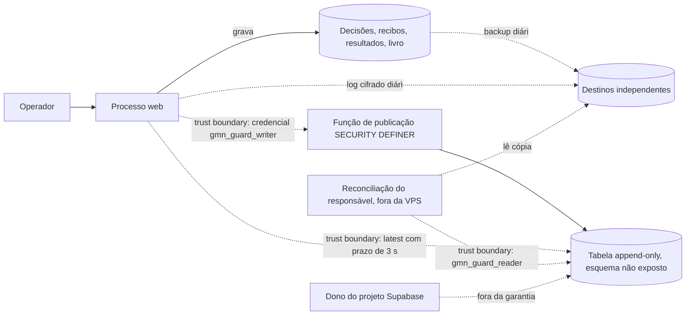

# Modelo de ameaças: Auditoria por Link — portões de produção (guarda externa no Supabase e caminho administrativo em 403)

- **Data**: 2026-11-20 (onda G0)
- **Autor(es)**: manager (subagente de documentação), a partir da spec e do código em `3899a67`
- **Status**: Rascunho (Draft), entregue com a G0. Nada do que está aqui foi implementado; a G1.b e a G2 atualizam os
  status
- **Escopo**: guarda externa do livro de cabeças no Supabase (D-G0-1), pseudônimo do `auditId` (D-G0-5), reconciliação
  externa (D-G0-2), números do contrato (`L_max`, `T`, prazo de resposta), caminho administrativo mantido em 403
  (D-G0-6), exportação dos logs (D-G0-8), backups independentes (D-G0-9) e homologação (D-G0-12)
- **Spec vinculada**: `docs/specs/link-audit-production-gates.md` (§5.1, §5.2, §5.3.4, §8, §10.4, §11)
- **ADR vinculado**: `docs/adr/0003-supabase-external-ledger-guard.md`

## 1. O que já está coberto (não repetir)

| Tema | Onde |
|---|---|
| Rollback coordenado **sem** guarda (não detectado) | `link-audit-ledger-e-resultados.md`, T-L01/L-T2; `onda6c-modelo-de-ameacas-recuperacao.md` §8b |
| Congelamento sem reabertura (`HISTORY_UNRESOLVED`, `UNTRUSTED`, `EXHAUSTED`, `LEGACY_READ_ONLY`) | `link-audit-ledger-e-resultados.md`, T-L02/L-D2 |
| Chaves de origem e do livro, recibos e testemunha | `link-audit-decisoes-e-recibos.md` |
| Rotas, sessão, limitadores, falta de log estruturado | `link-audit-api-e-interface.md` (A-R1) |
| Atestação offline (P1) | `link-audit-p1-atestacao.md` |

Este documento trata só o que a G0 muda: um terceiro (Supabase) entra como testemunha, a VPS ganha uma credencial e uma
chave novas, e a decisão de manter o 403 vira risco aceito.

## 2. Ativos

- Registro da guarda: `(audit_ref, key_id, ledger_seq, sha256, hora do provedor)` por auditoria.
- Integridade da ordem: a guarda ser **append-only e monotônica** por auditoria (regra 7 da spec §5.1.4).
- Credencial de escrita `gmn_guard_writer` (`GMN_LINK_AUDIT_GUARD_DB_URL`, na VPS) e credencial de leitura
  `gmn_guard_reader` (fora da VPS).
- Chave do pseudônimo `GMN_LINK_AUDIT_GUARD_KEY` (na VPS e com o responsável).
- Disponibilidade da Fase 6 (toda leitura passa pela guarda, D-G0-3).
- Cópia das cabeças guardada pela reconciliação (fora da VPS).
- Exportações cifradas dos logs e backups nos destinos independentes.

## 3. Atores

| Ator | Confiança | Notas |
|---|---|---|
| Responsável | alta | Único operador; dono do projeto Supabase, da VPS e do repositório; reconcilia (D-G0-2) |
| Operador autenticado | baixa | Sessão HMAC + `GMN_OPERATOR_EMAILS`; não tem papel administrativo |
| Processo web | média | Único que publica na guarda; se comprometido, mente para a própria aplicação |
| Atacante com root na VPS | hostil | Lê todos os segredos do web (inclusive `service_role`, credencial e chave da guarda) e escreve nos volumes |
| Dono ou administrador do projeto Supabase / conta tomada | hostil, quando comprometido | Altera gatilhos, privilégios e linhas; restaura o banco. **Fora da garantia** (ADR-0003) |
| Supabase (provedor) | média | Disponibilidade e execução correta do Postgres |
| Leitor do repositório público | não confiável | Não pode encontrar host, chave, nome real nem caminho de produção |

## 4. Diagrama de fluxo

## 5. Análise STRIDE

Status: **mitigado** (código + teste) · **parcial** · **aberto** (sem mitigação no código) · **aceito** (risco declarado
e aceito por decisão datada). Hoje nada da guarda real existe, então nenhuma linha está "mitigado".

| ID | STRIDE | Ameaça | Mitigação prevista (onde) | Risco residual | Status |
|---|---|---|---|---|---|
| PP-D1 | D | **Sequência falsa** publicada com a credencial de escrita (atacante na VPS): a cabeça da guarda sai do livro, as publicações legítimas viram `STALE` | Regra 7 (nunca esconde retrocesso, só congela) e alarme de `CONFLICT` (spec §5.1.4; GE-E6); reconciliação acusa (EN-07); PG-G05 | A auditoria congela (`GUARD_MISMATCH`) e, com a D-G0-6, não reabre pela aplicação. O atacante consegue congelar **todas** as auditorias | aberto (G1.b) |
| PP-T1 | T/S | **Web comprometido mente sobre o `latest`** para a própria aplicação e esconde um retrocesso das telas | Reconciliação fora da VPS com credencial só de leitura (GE-E5, D-G0-2) | Detecção **depois do fato**, em até uma semana (ou antes de uma restauração). L8 da spec do livro; D15.5 | aceito (limite declarado) |
| PP-E1 | T/E | **Dono ou administrador do projeto Supabase** (ou a conta tomada) altera ou remove gatilhos, privilégios e linhas, ou restaura o banco | MFA na conta; reconciliação guarda cópia própria das cabeças e acusa guarda que regrediu (PG-G09); Object Lock como revisão futura (ADR-0003) | Com uma pessoa só, quem administra a VPS é dono do projeto | aceito (D-G0-1) |
| PP-D2 | D | **Indisponibilidade** do provedor: queda, pausa por inatividade do plano, credencial expirada, rede (IPv4) | Prazo de 3 s, falha fechada na leitura e na escrita (D-G0-3; `model.ts:495`), alarme, runbook GE-E7; EN-02d, EN-02e, EN-05 | A Fase 6 inteira fica sem decisão vigente enquanto durar | aceito por desenho (D-G0-3) |
| PP-T2 | T/E | **Configuração errada no Supabase**: esquema exposto pela Data API ou `REVOKE` ausente ⇒ a `service_role` (já na VPS), `anon` ou `authenticated` publicam sequência falsa ou leem cabeças | Migração com conferência de privilégios no SQL (GE-E4); PG-G08 (ACL sem `PUBLIC`, `has_*_privilege`, `SECURITY DEFINER` com `search_path=''`, prova pela Data API); gatilhos como defesa em profundidade | *Exposed schemas* não verificado hoje (`docs/phase5/g5-s0-relatorio-2026-11-07.md:82`); padrões de `supabase_admin` inalterados (`NOTES.md`, G5) | aberto (G1.b, PG-G08) |
| PP-D3 | D | **Falso `GUARD_LAGGING`**: atraso legítimo acima de `L_max` congela uma auditoria sem reabertura | `L_max` = 5 contado no protocolo e travado em teste (spec §5.1.7, PG-G02); rotação da chave do livro só com `externalGuard` = `CONSISTENT` (GE-E7), eventualmente imposta no código | Contagem errada ou rotação fora da regra ⇒ congelamento | aberto (G1.b) |
| PP-R1 | R | **Reconciliação não feita**: rotina humana semanal esquecida; a guarda que "esqueceu" (regra 6) e o retrocesso escondido pelo web não são percebidos | D-G0-2 (semanal, depois de cada backup do livro, antes de qualquer restauração); alarme na idade do último resumo externo (GE-R7); registro de cada reconciliação | Uma pessoa só; sem canal de alerta fora da VPS (Q8 da observabilidade aberta) | aberto (GE-E5, rotina) |
| PP-S1 | S/T | **Reconciliação feita de dentro da VPS** ou com a credencial de leitura guardada nela: o host comprometido falsifica a conferência | Credencial `gmn_guard_reader` e execução só fora da VPS (D-G0-2, GE-E5); conferido no runbook | Processo | aberto (processo) |
| PP-I1 | I | **Leitura das cabeças** revela quais auditorias existem e quando têm atividade | Pseudônimo HMAC (D-G0-5); leitura só para `gmn_guard_writer` e `gmn_guard_reader` (PG-G08) | Quem tem a VPS tem a credencial **e** a chave: reverte por dicionário | parcial (G1.b) |
| PP-I2 | I | **Vazamento da `GMN_LINK_AUDIT_GUARD_KEY`**: o pseudônimo é revertido por dicionário de `auditId`, que pode carregar o nome da empresa (`src/lib/link-audit-runtime/run.ts:181`) | Chave exclusiva, Swarm secret por `*_FILE` (VC-E2), rotação por comprometimento com lista de aposentadas (spec §5.1.7) | Confidencialidade apenas; a integridade não depende da chave | aberto (G1.a, G1.b) |
| PP-I3 | I | **Credencial de escrita ou chave da guarda entregues errado** (valor literal no `stack.yml`, variável que vaza para o Worker) | Lista fixa do entrypoint, `*_FILE`, Worker sem `GMN_LINK_AUDIT_*` (VC-E2, VC-E4); teste estático PG-V01 | — | aberto (G1.a) |
| PP-I4 | I | **Chave de log vazada** (spec §8): com poucos e-mails, o `operatorRef` é revertido por dicionário | Chave exclusiva; acesso aos logs só do responsável e de quem opera o servidor (decisão de 16/11/2026); PG-L01 | Pseudonimização, não anonimização | aberto (G1.a) |
| PP-I5 | I/T | **Exportação dos logs** (D-G0-8): o arquivo exportado leva `operatorRef` e `auditId`; quem tem o destino lê; quem tem a VPS pode apagar exportações antigas | Cifrada antes de sair da VPS; recomendação para a G1.a: cifrar para uma chave pública cuja privada fica fora da VPS e usar credencial de destino só de escrita, sem apagar; expurgo aos 90 dias | Falta canal de alerta em tempo real | aberto (G1.a) |
| PP-T3 | T/D | **Backups** (D-G0-9): a VPS comprometida, com credencial de escrita nos destinos, apaga ou sobrescreve as cópias dos recibos e do livro | Destino independente por volume, fora do disco dos dados; nunca `--delete`, pares do mesmo instante, `sha256sum` e cabeças junto (VC-E6, AT-G1A-01..03); ensaio na G2 e a cada trimestre | Retenção dos destinos depende do serviço escolhido pelo responsável | aberto (G1.a, G2) |
| PP-E2 | E/D | **Caminho administrativo em 403** (D-G0-6): sem `ADOPT`, `RESTORE_ACK` nem `QUARANTINE_ACK`, a auditoria congelada fica perdida para a aplicação; um incidente de chave congela **todas** as protegidas (R6-13). Pressão para "destravar" editando os volumes à mão | Nenhuma superfície nova (403 fixo, `src/lib/link-audit-decisions/service.ts:1029-1031`; teste `tests/link-audit-ledger-q5.test.ts`); aceite formal escrito (§10.2, condição 4); recuperação = auditoria nova com a evidência preservada; edição manual dos volumes vira `GUARD_MISMATCH` (a guarda guarda a cabeça) | Disponibilidade (T-L02/L-D2 continua aberto no sentido forte) | aceito para o piloto (D-G0-6) |
| PP-E3 | E | **Caminho administrativo futuro** (opção 1 ou 2): elevação de privilégio nova (identidade administrativa, aprovação, chave offline) | Emenda da §16.8 com revisão independente antes do código; PG-A01–A04; canal de aviso fora da VPS antes da opção 2 (D-G0-7) | — | não se aplica hoje (D-G0-6) |
| PP-T4 | T/I | **Homologação** (D-G0-12): segredo de laboratório reaproveitado em produção, dado real no laboratório, ou W5 e G2 ao mesmo tempo na mesma pilha corrompendo a prova uma da outra | Pilha isolada, sem dados reais e sem Serper; laboratório Supabase descartável; W5 antes da G2 (§10.4); atestações AT-G2-01 (nada em produção) e AT-G2-02 (credenciais destruídas) | — | aberto (G2) |

## 6. Ameaças priorizadas

Escala do modelo do P1: Probabilidade Baixa=1, Média=2, Alta=3; Impacto Baixo=1, Médio=2, Alto=3, Crítico=4; Risco = P×I.

### T-PP01 [MÉDIO, 6] Tampering/Elevation — configuração errada do Supabase (PP-T2)
- **Vetor**: o esquema da guarda fica exposto pela Data API ou um `REVOKE` falta; a `service_role`, que já está na VPS,
  publica uma sequência monotônica válida acima da real. Os gatilhos aceitam (eles só barram o que viola a regra 7).
- **Probabilidade**: Média (estado de *Exposed schemas* não verificado; padrões de privilégio de esquema novo a
  confirmar). **Impacto**: Médio (congelamento em massa, sem reabertura).
- **Mitigação**: GE-E4 com conferência no SQL; PG-G08 no laboratório e, só leitura, em produção.
- **Dono**: manager (código, G1.b); responsável (aplicação e conferência em produção).

### T-PP02 [MÉDIO, 6] Repudiation — reconciliação esquecida (PP-R1)
- **Vetor**: sem a reconciliação, nada fora da VPS percebe a guarda que regrediu nem o web que mente sobre o `latest`.
- **Probabilidade**: Média (rotina manual, uma pessoa). **Impacto**: Alto (retrocesso escondido por tempo
  indeterminado).
- **Mitigação**: D-G0-2; CLI GE-E5 com saída `--json` e código de saída; alarme de idade do último resumo (GE-R7); o
  procedimento de restauração começa pela reconciliação.
- **Dono**: responsável (rotina); manager (CLI e runbook).

### T-PP03 [MÉDIO, 4] Tampering — dono ou administrador do projeto Supabase (PP-E1)
- **Probabilidade**: Baixa. **Impacto**: Crítico (a testemunha deixa de valer sem sinal na aplicação).
- **Mitigação**: MFA; reconciliação com cópia própria; revisão para Object Lock nos gatilhos do ADR-0003.
- **Status**: aceito (D-G0-1).

### T-PP04 [MÉDIO, 4] Denial of service — indisponibilidade do provedor (PP-D2)
- **Probabilidade**: Média. **Impacto**: Médio (Fase 6 parada enquanto durar; nada é perdido).
- **Mitigação**: prazo de 3 s, falha fechada, alarme, runbook. **Status**: aceito por desenho (D-G0-3).

### T-PP05 [BAIXO, 3] Tampering/Spoofing — web comprometido mente sobre o `latest` (PP-T1)
- **Probabilidade**: Baixa (exige controle do processo web). **Impacto**: Alto.
- **Mitigação**: reconciliação externa, depois do fato. **Status**: aceito (limite declarado).

### T-PP06 [BAIXO, 3] Denial of service — sequência falsa com a credencial de escrita (PP-D1)
- **Probabilidade**: Baixa (exige a VPS). **Impacto**: Alto (pode congelar todas as auditorias de uma vez).
- **Mitigação**: regra 7, alarme de `CONFLICT`, reconciliação. **Residual**: sem reabertura (D-G0-6).

### T-PP07 [BAIXO, 2] Denial of service — falso `GUARD_LAGGING` (PP-D3)
- **Probabilidade**: Baixa. **Impacto**: Médio. **Mitigação**: `L_max` contado e travado em teste; regra da rotação.

## 7. Abuse cases

- **Atacante na VPS publica `ledgerSeq` 9999 para cada auditoria:** todas congelam (`GUARD_MISMATCH`), o alarme de
  `CONFLICT` dispara nas publicações seguintes, a reconciliação acusa. Nenhuma revogação é escondida.
- **Atacante na VPS restaura os volumes de ontem e desliga a publicação:** a guarda continua com a cabeça de hoje ⇒
  `GUARD_MISMATCH` na primeira leitura.
- **Atacante na VPS altera o código do web para devolver um `latest` antigo:** as telas mostram o histórico restaurado
  como protegido; só a reconciliação semanal acusa (PP-T1).
- **Operador pede `RESTORE_ACK` depois de um incidente:** 403 `ADMIN_APPROVAL_UNAVAILABLE`, nada gravado; abre-se uma
  auditoria nova (PP-E2).
- **Alguém "conserta" uma auditoria congelada copiando arquivos para os volumes:** o livro deixa de bater com a guarda ou
  com os recibos e continua congelado; a edição fica registrada pela divergência.
- **Credencial de laboratório esquecida na configuração de produção:** AT-G2-02 exige a revogação com data.

## 8. Risco residual

| Risco | Aceito por | Base |
|---|---|---|
| Sem independência contra o dono ou administrador do projeto Supabase | Responsável, 20/11/2026 | D-G0-1; ADR-0003 |
| Web comprometido detectado só depois do fato (até uma semana) | Responsável, 20/11/2026 | D-G0-2; L8 da spec do livro |
| Fase 6 parada enquanto a guarda estiver indisponível | Responsável, 20/11/2026 | D-G0-3 |
| Auditoria congelada perdida para a aplicação; incidente de chave congela todas | Responsável, 20/11/2026, para o piloto; o aceite escrito específico é dado antes do deploy | D-G0-6; D-G0-11 |
| Retrocesso dentro da última operação não publicada (até `L_max` = 5 registros) | Spec §5.1.4, regra 3 | D-G0-4 |

## 9. Ações

| Ação | Critério de aceite | Onda |
|---|---|---|
| A-PP1 Migração da guarda com conferência de privilégios no SQL e prova pela Data API | PG-G08 com evidência no laboratório; em produção, só leitura, pelo responsável | G1.b |
| A-PP2 Contrato R6-10 com `L_max` = 5, `T` = 15 min e prazo de 3 s | PG-G01 a PG-G07 com testes sem rede; PG-G02 enumera os fluxos | G1.b |
| A-PP3 Reconciliação externa e rotina | PG-G09; EN-07 e EN-08 na G2; registro das reconciliações | G1.b, G2 |
| A-PP4 Runbook da guarda: ativação, rotação da credencial e da chave do pseudônimo, rotação da chave do livro só com `CONSISTENT`, indisponibilidade, restauração | GE-E7 publicado | G1.b |
| A-PP5 Segredos da guarda e exportação cifrada dos logs | PG-V01, PG-V03, PG-L01; exportação diária com expurgo aos 90 dias | G1.a |
| A-PP6 Backups independentes | PG-V02; AT-G1A-01..03; ensaio de restauração na G2 e trimestral | G1.a, G2 |
| A-PP7 Aceite formal do 403 e do INCONCLUSIVO no piloto | Aceite escrito do responsável registrado antes do deploy (spec §10.2, condição 4) | G3 |

## 10. Referências

- `docs/specs/link-audit-production-gates.md` (§5.1.4, §5.1.6, §5.1.7, §5.2, §8, §10, §11)
- `docs/adr/0003-supabase-external-ledger-guard.md`
- `docs/phase6-auditoria-link/onda6c-especificacao-livro-de-cabecas.md` (§13 L1, L2, L6, L8; §16.8; §16.11 R6-10, R6-13)
- `docs/security/threats/link-audit-ledger-e-resultados.md` (T-L01, T-L02)
- `docs/specs/link-audit-observability.md` (Q3, Q4, Q8)
