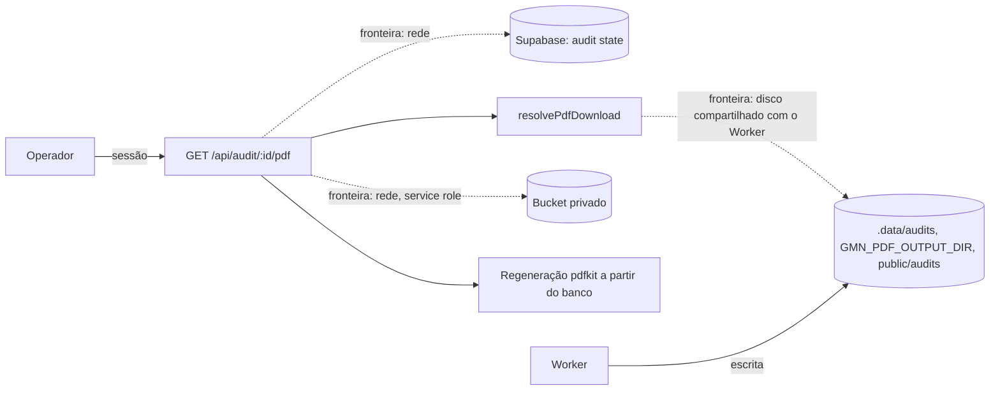

# Modelo de ameaças: Plataforma — download de PDF de auditoria

- **Data**: 2026-11-07
- **Autor(es)**: threat-modeler (subagente)
- **Status**: Rascunho (Draft)
- **Escopo**: `GET /api/audit/[id]/pdf` (`src/app/api/audit/[id]/pdf/route.ts`), `src/lib/pdf/serve.ts`, `src/lib/pdf/download-chain.ts`, `src/lib/pdf/private-store.ts`, regeneração (`src/lib/pdf/regenerate.ts`) e volumes de PDF no `stack.yml`
- **Spec vinculada**: `docs/phase5/security-review.md` §2–§5, `docs/phase5/pdf-migration-plan.md`
- **ADRs vinculados**: —

> **Fora da Fase 6.** A pendência do FIFO foi registrada em `onda6c-modelo-de-ameacas-recuperacao.md` §8 e `onda6c-checklist-producao.md` §12.2 (R2-INFO-3). Este documento é o modelo próprio do download.

## 1. Visão geral

O download é a única forma de obter um PDF (Fase 5): exige operador, valida o `id` como UUID e tenta, nesta ordem, (1) arquivo local nas pastas permitidas, (2) bucket **privado** do Supabase, (3) regeneração a partir do banco, sem chamada paga (`download-chain.ts:19-55`). Nunca usa URL pública. O caminho gravado (`diagrammer.pdfStoragePath`) vem do **banco**, não do cliente.

**Corrigido na branch `chore/saneamento-tecnico` (Draft PR; ainda não mergeado):** `serve.ts` passa a ler com `readRegularPdf` — `open(O_RDONLY|O_NONBLOCK|O_NOFOLLOW)`, `fstat` no descritor, recusa de não-arquivo e teto de 64 MiB (`serve.ts:12-44`, diff local) — e o teste de regressão `tests/pdf-serve-special-files.test.ts` (8 casos: FIFO, FIFO repetido, symlink final, diretório `.pdf`, teto, arquivo regular, inexistente) está **não rastreado** e já listado no script `test` do `package.json` (também modificado, sem commit).

## 2. Ativos

- PDFs de auditoria (dados de empresas prospectadas, análise comercial).
- Disponibilidade do processo web (o pool de I/O do libuv é compartilhado por todas as rotas).
- Service role do Supabase (usada para o bucket privado).

## 3. Atores

| Ator | Confiança | Observações |
|---|---|---|
| Operador autenticado | média | Baixa o PDF de qualquer auditoria (sem ACL) |
| Worker BullMQ | média | Processa conteúdo externo e monta a **mesma** pasta `/srv/gmn/audits` com escrita (`stack.yml:37-39` web, `:143-146` Worker) |
| Quem altera linhas do banco (`diagrammer_payload`) | não confiável se o RLS falhar | R13 (anon com privilégio de UPDATE, só o RLS barra) segue **ABERTO** em `docs/phase5/risk-register.md` |
| Administrador do host | alta | Pode plantar arquivos |

## 4. Diagrama de fluxo

## 5. Análise STRIDE

| ID | STRIDE | Ameaça | Mitigação existente (arquivo:linha / teste) | Risco residual | Status |
|---|---|---|---|---|---|
| P-S1 | S | Download sem sessão / IDOR por id inválido | `requireOperator` + UUID (`route.ts:19-22`); middleware cobre `/api/*` e `/audits/*` | Sem ACL por auditoria (qualquer operador baixa qualquer PDF) — herdado | mitigado |
| P-T1 | T | **Path traversal** pelo caminho gravado (`../../etc/passwd`, `C:\x\..\..\segredo`) | Candidatos só por **nome-base** `^[A-Za-z0-9._-]+\.pdf$` em cada raiz, ou caminho completo dentro das raízes com extensão `.pdf` e sem `\0` (`serve.ts:60-81`). Teste: `tests/pdf-render.test.ts:337-355`, `tests/pdf-private-store.test.ts:68` | O caminho completo (2º candidato, `serve.ts:79`) aceita subpastas dentro de uma raiz; `O_NOFOLLOW` só protege o **último** componente: um diretório intermediário que seja symlink (plantado por quem escreve na pasta) permite ler qualquer `*.pdf` do sistema de arquivos, se o banco também apontar para lá. Exige escrita na pasta **e** no banco — baixo | parcial |
| P-T2 | T | Banco adulterado aponta a auditoria A para o PDF da auditoria B (mesmo nome-base) ou altera o payload usado pela regeneração | Nenhuma vinculação entre `auditId` e o conteúdo do arquivo local (o bucket privado, sim, usa `audits/<auditId>/`, `private-store.ts:15-19`) | Depende do estado real do RLS (**NÃO VERIFICADO**; R13/G5 aberto) | parcial |
| P-T3 | T | Injeção no `Content-Disposition` (aspas, CRLF) | `safeDownloadName` só `[A-Za-z0-9._-]`, ≤ 120, termina em `.pdf` (`serve.ts:84-87`). Teste: `pdf-render.test.ts:349-350` | — | mitigado |
| P-R1 | R | Não saber quem baixou qual PDF | Erros passam por `apiFailure` com log redigido (`route.ts:36`); recusas de arquivo especial registradas sem caminho (`serve.ts`, corrigido na branch) | Downloads bem-sucedidos não são registrados | parcial |
| P-I1 | I | PDF exposto por URL pública (bucket público, `public/audits`) | Bucket antigo privado e originais removidos (R3 **FECHADO**, `risk-register.md`); `public/audits/*.pdf` no `.gitignore`; download nunca usa URL pública (`download-chain.ts:19-23`); `Cache-Control: no-store`, `nosniff` (`serve.ts:116-124`) | `public/audits` **continua** em `allowedPdfRoots` (`serve.ts:53`) embora a pasta não exista mais no repositório: qualquer PDF que alguém volte a colocar ali fica servível pela rota **e** pelo estático `/audits/*` (atrás do middleware) | parcial |
| P-I2 | I | Resposta do bucket privado com outro conteúdo | Chave `audits/<uuid>/<nome seguro>` (`private-store.ts:7-19`); só aceita bytes iniciados por `%PDF-` (`:38`) | — | mitigado |
| P-D1 | D | **FIFO/dispositivo** com nome `.pdf` na pasta compartilhada trava o pool de I/O (R2-INFO-3) | **Corrigido na branch `chore/saneamento-tecnico` (Draft PR; ainda não mergeado)**: `readRegularPdf` (`serve.ts:31-44`) + `tests/pdf-serve-special-files.test.ts` | Até o commit e o CI verde, o código de `main` continua vulnerável (`fs.readFile` direto). Quem pode plantar: o Worker (escrita no mesmo bind) ou o host | aberto até o merge (**em correção**) |
| P-D2 | D | PDF gigante na pasta ou no bucket esgota memória | Teto de 64 MiB no local (corrigido na branch; `MAX_PDF_BYTES` e leitura limitada em `serve.ts`); `NODE_OPTIONS=--max-old-space-size=768` no web | Download do bucket privado **sem teto de tamanho** (`private-store.ts:36-37` lê o objeto inteiro). Exige escrita no bucket (service role) — baixo | parcial |
| P-D3 | D | Laço de downloads que caem na **regeneração** (pdfkit, CPU) | Nenhum limitador na rota do PDF (diferente de `prospect`/`enqueue`, `api-limits.ts:10-18`) | Operador (ou script com a sessão dele) consegue ocupar a CPU do processo web; só quando o arquivo local e o bucket falham | aberto (baixo) |
| P-E1 | E | Worker comprometido (conteúdo externo malicioso) usa a pasta compartilhada para afetar o web | Contêineres `read_only`, `cap_drop: ALL` (`stack.yml:55-57,151-153`); correção do FIFO | O bind de escrita compartilhado continua sendo o canal (FIFO, symlink intermediário, arquivo grande). Não há volume só leitura para o web | parcial |

## 6. Ameaças priorizadas

### T-P01 [MÉDIO] DoS — FIFO na pasta de PDF (P-D1)
- **Vetor**: `mkfifo /srv/gmn/audits/<nome>.pdf` pelo Worker comprometido ou pelo host; cada download bloqueia uma thread do pool até esgotar.
- **Probabilidade**: Baixa. **Impacto**: Alto para disponibilidade (todo I/O de arquivo do web para).
- **Status**: corrigido na branch `chore/saneamento-tecnico` (Draft PR; ainda não mergeado).

### T-P02 [BAIXO] Tampering — vínculo auditoria ↔ arquivo depende do banco (P-T1/P-T2)
- Probabilidade Baixa; impacto Médio (PDF errado entregue ao cliente). Depende de R13.

## 7. Abuse cases

- **`GET /api/audit/..%2F..%2Fetc%2Fpasswd/pdf`**: 400 (UUID) — confirmado por HTTP na Fase 5.
- **Linha do banco com `pdfStoragePath = "/etc/passwd"`**: nenhum candidato ⇒ 404 (`pdf-render.test.ts:354`).
- **Worker cria `x.pdf` como FIFO e o banco aponta para ele**: com a correção, 404 imediato + aviso estruturado sem caminho.
- **Worker cria `sub/` → `/` e o banco grava `/app/.data/audits/sub/home/u/qualquer.pdf`**: hoje seria lido (P-T1, exige banco + pasta).
- **Operador clica "baixar" 200 vezes numa auditoria sem arquivo local**: 200 regenerações seguidas.

## 8. Risco residual e ações recomendadas

| Ação | Critério de aceite |
|---|---|
| **A-P1** Concluir a correção do FIFO (commit + CI) | `tests/pdf-serve-special-files.test.ts` no script `test` e verde no CI, incluindo o caso "FIFO repetido não prende requisições" executado em processo filho com prazo; `npm run typecheck` verde |
| **A-P2** Recusar candidatos cujo `realpath` saia da raiz (ou aceitar só o nome-base, removendo o 2º candidato de `serve.ts:79`) | Teste: diretório intermediário symlink para fora da raiz ⇒ 404 |
| **A-P3** Remover `public/audits` de `allowedPdfRoots` (R3 já fechado) | Teste em `pdf-private-store.test.ts`: `allowedPdfRoots()` não contém `public/audits`; regressão dos downloads históricos migrados verde |
| **A-P4** Limitador por operador na rota do PDF (ou só no ramo de regeneração) | Teste: N+1 regenerações no minuto ⇒ 429 |
| **A-P5** Teto de tamanho no download do bucket privado | Teste com cliente falso devolvendo objeto acima do teto ⇒ `null`/404 |
| **A-P6** Fechar R13/G5 (RLS) antes de confiar em `pdfStoragePath` | `npm run rls:probe` (somente leitura) mostra anon sem UPDATE efetivo; registro de risco atualizado |

## 9. Referências

- `docs/phase5/security-review.md` §2 (PDFs), §6; `docs/phase5/risk-register.md` (R3, R7, R13)
- `docs/phase6-auditoria-link/onda6c-modelo-de-ameacas-recuperacao.md` §7–§8
- `docs/phase6-auditoria-link/onda6c-checklist-producao.md` §12.2
