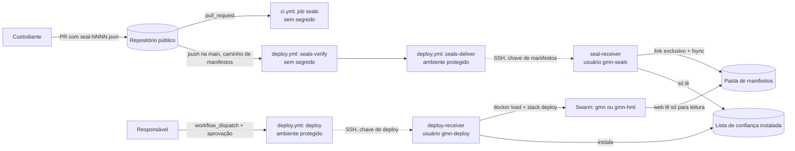

# Spec: deploy pelo CI e entrega dos manifestos selados (P-9)

> **Status:** PROPOSTA, fatia **P9.1** (só documentação, 23/11/2026). **P9.2 implementada** (verificação antes do merge, job `seals`,
> lista versionada e pasta `link-audit-seals/`; critérios marcados no §6 com o teste). **P9.4 implementada** (`deploy.yml`, scripts do
> job, sobreposição de homologação e runbook do responsável). **P9.3a implementada** (receptor de deploy, artefato com hash versionado em
> `deploy/hostinger/receivers.sha256`, modelos de *wrapper* e job `receivers artifact (build, hash)`; §5.6 "Implementação (P9.3a)";
> P9-D01 a P9-D14 marcados no §6). Ainda não há usuário de host nem ambiente do GitHub. O código restante vem nas fatias P9.3a a P9.5
> (`docs/plan/implementation-waves.md`, seção "Deploy pelo CI (P-9)"). Nenhuma fatia faz deploy: o primeiro deploy é do
> responsável, pelo workflow, depois das ações do §10.1.
>
> **Decisão do responsável (23/11/2026), registrada aqui e não rediscutida:** aceita a recomendação do manager de
> `docs/phase6-auditoria-link/p1-canal-de-entrega-manifestos.md` §6.3. Um único pipeline de deploy pelo CI, com um job de
> entrega de manifestos. O manifesto entra por **PR**, com `auditId` **opaco**, porque o repositório é público. A verificação
> `v2` roda no CI **antes do merge** (RC-06). A entrega é feita por um job num **ambiente protegido** do GitHub, com aprovação
> do responsável, usando uma chave SSH **restrita a um único comando receptor** no host. O receptor verifica de novo e grava
> com criação exclusiva e `fsync` (RC-04, RC-05, RC-06).
>
> **Fontes conferidas em `a711a36`:** `CLAUDE.md` (deploy só pelo CI); `NOTES.md` (rodada de 21–23/11/2026); spec dos portões
> `docs/specs/link-audit-production-gates.md` (P-9, §5.3, §10.4, D-G0-12); spec do P1 `docs/specs/link-audit-p1-attestation.md`
> (D7, D15.5); contrato do verificador `docs/phase6-auditoria-link/p1-contrato-verificador-v2.md`; requisitos RC-01 a RC-10 e
> pendências CE-1 a CE-5 de `p1-canal-de-entrega-manifestos.md`; código em `src/lib/link-audit-evidence/provenance-core.ts`,
> `src/lib/link-audit-attestation/sign-chain.ts`, `sign-run.ts`, `src/lib/link-audit-evidence/simulated.ts`,
> `src/app/api/link-audit/scoring/shared.ts`; implantação em `deploy/hostinger/` (`stack.yml`, `Dockerfile`,
> `build-images.sh`, `docker-entrypoint.sh`, `verificar-pastas-fase6.sh`, `GUIA-DE-IMPLANTACAO.md`,
> `VERIFICACAO-POS-DEPLOY.md`, `PLANO-DE-ROLLBACK.md`); `.github/workflows/ci.yml`.
>
> **Documentos ligados:** ADR `docs/adr/0004-ci-deploy-over-restricted-ssh.md`; ameaças
> `docs/security/threats/deploy-pelo-ci.md` (DC-01 a DC-22).

## 1. Objetivo

Fechar o portão **P-9** da spec dos portões ("deploy pelo CI, por decisão do responsável, com verificação pós-deploy") e, no
mesmo pipeline, o **canal de entrega dos manifestos** exigido pela D7 e pela D15.5 (P-4). Depois desta spec implementada:

1. o deploy da aplicação (homologação e produção) só acontece por um workflow do GitHub, disparado à mão na `main`, aprovado
   pelo responsável num ambiente protegido, com as imagens construídas no próprio job a partir do commit exato e entregues à
   VPS por SSH a um receptor de comando único;
2. um manifesto `seal-NNNN.json` (ou um fecho `_closures/<R>.json`) só chega ao volume de manifestos depois de passar duas
   vezes pelo verificador `v2` real: no CI, antes do merge, e no host, antes de gravar;
3. a lista de chaves de confiança tem **uma fonte só**, versionada, lida pelo CI, pelo receptor de manifestos e pelo servidor;
4. a pilha de homologação (D-G0-12) é implantada pelo mesmo workflow, isolada da produção.

## 2. Fora de escopo

- **Migrações do Supabase:** seguem em `supabase/proposed/` até o responsável aplicar (spec dos portões §10.3).
- **Secrets do Swarm e arquivo de variáveis do host:** criados e editados só pelo responsável, no host. O CI nunca os vê e nunca
  os escreve.
- **Ligar o Worker em produção** (`GUIA-DE-IMPLANTACAO.md` §7) e qualquer consulta paga.
- **Registry de imagens, runner próprio na VPS, serviço pago novo:** não (ADR-0004, alternativas).
- **Promoção obrigatória** homologação → produção: o responsável aprova cada ambiente; o pipeline não exige que o mesmo commit
  tenha passado pela homologação.
- **Rollback automático** feito pelo pipeline (R6-09 impede voltar a imagem anterior ao livro; §10.3).
- **O primeiro teste de escrita** do P-9 ("só numa auditoria sintética combinada"): continua passo manual do responsável.
- **Mudanças no verificador `v2`**, no formato do manifesto, no `AUDIT_ID_PATTERN` (`src/lib/link-audit-evidence/types.ts:10`)
  e na leitura do servidor (`scoring/shared.ts:105-107` continua lendo a lista pela variável de ambiente).
- **Os ensaios da G2** em si (spec dos portões §10.4); esta spec só entrega o que a G2 ensaia.

## 3. Atores

| Ator | Papel | Confiança |
|---|---|---|
| Responsável | Revisa e aprova PRs, dispara o deploy, aprova os ambientes `homologacao` e `producao`, provisiona host, chaves, secrets, pastas e receptores | alta (fora da garantia como administrador da VPS, D15.5) |
| Manager / workers | Escrevem código e PRs; não disparam deploy nem aprovam ambiente | média |
| Custodiante | Abre o PR com o manifesto saído da estação, sem editar os bytes; registra o livro de manifestos | média |
| Conferente | Confere o PR (sha256 contra o livro) e a verificação pós-entrega | média |
| Job `seals` (`ci.yml`) | Verifica o PR antes do merge, sem segredo | sistema, sem credencial |
| Job `deploy` / `seals-deliver` (`deploy.yml`) | Constrói e entrega; usa a chave do ambiente depois da aprovação | sistema, credencial restrita |
| Receptor de deploy (`gmn-deploy`, `gmn-hml-deploy`) | Único comando da chave de deploy; grupo `docker` | equivale a root no host (DC-02) |
| Receptor de manifestos (`gmn-seals`, `gmn-hml-seals`) | Único comando da chave de manifestos; sem `docker`; escreve só na pasta de manifestos | baixa (só acrescenta o que verifica) |
| Serviço web | Lê a pasta de manifestos só para leitura e a lista pela variável | sistema |
| Atacante externo | Abre PR, lê logs públicos, tenta usar chave vazada | hostil |

## 4. Histórias

- Como responsável, quero disparar o deploy de um commit da `main` para homologação ou produção e aprovar cada execução, para
  que nada chegue à VPS sem a minha decisão e sem o CI verde naquele commit.
- Como custodiante, quero entregar um manifesto abrindo um PR com o arquivo exato, para que a revisão e o verificador `v2`
  barrem qualquer erro antes de ele chegar ao servidor.
- Como conferente, quero ver no resumo do CI o `sha256sum` de cada arquivo verificado e entregue, para conferir com o livro de
  manifestos (RS-17, RC-08).
- Como responsável, quero que uma chave vazada do CI não dê shell nem root fora da aplicação, e que a chave de manifestos não
  consiga trocar a lista de confiança.

## 5. Contratos

### 5.1 Visão geral



### 5.2 Caminho versionado dos manifestos: `link-audit-seals/`

Diretório de topo novo, um subdiretório por ambiente. É o espelho, byte a byte, da pasta de manifestos de cada ambiente
(`GMN_RAIZ_DADOS_MANIFESTOS`, montada em `/data/evidence-seals` no web, `stack.yml:99-102`):

```
link-audit-seals/
  producao/
    trust-keys.txt                       lista de confiança fixada (§5.3)
    seals/aud-<16 hex>/seal-NNNN.json    manifestos v2
    seals/_closures/<keyId>.json         fechos de aposentadoria
  homologacao/
    trust-keys.txt
    seals/...                            mesmo layout
```

Regras de nome (exatas; qualquer outro caminho sob `link-audit-seals/` é recusado):

| Item | Padrão |
|---|---|
| Ambiente | `producao` ou `homologacao` |
| Manifesto | `link-audit-seals/<amb>/seals/<auditId>/seal-NNNN.json`, `NNNN` de `0001` a `0256` (`MAX_CHAIN_SEALS`, `provenance-core.ts:447`) |
| `auditId` no canal | **`^aud-[0-9a-f]{16}$`** (`AUDIT_ID_CHANNEL_PATTERN`, novo) |
| Fecho | `link-audit-seals/<amb>/seals/_closures/<keyId>.json`, `keyId` em `^[a-z0-9][a-z0-9-]{3,31}$` (o `TRUST_KEY_ID` do verificador) |
| Lista | `link-audit-seals/<amb>/trust-keys.txt` |
| Modo no git | `100644` (nunca link simbólico `120000`, executável ou submódulo) |

**`auditId` opaco.** O padrão do canal é um subconjunto estrito do `AUDIT_ID_PATTERN` (`^[a-z0-9][a-z0-9_-]{7,63}$`), que
continua igual para o resto do sistema. O sufixo é aleatório, gerado com `openssl rand -hex 8` no momento da autorização.
Motivo: no LIVE o `auditId` é o id da autorização em minúsculas (`src/lib/link-audit-runtime/run.ts:198`); o único caso real
registrado começava pelo nome da empresa (D-G0-5), e os rótulos públicos dos documentos (`AUD-001`…) estão ligados a clientes
reais no histórico do repositório, que não foi reescrito. Por isso:

- auditoria que vai ser atestada para produção (a W6 inclusive) nasce com autorização `aud-<16 hex>`. O vínculo com o rótulo
  `AUD-xxx` e com o cliente fica só no dossiê offline;
- os rótulos `AUD-xxx` e ids sequenciais (`aud-002-autorizacao-01`, exemplo de `docs/security/README.md`) **nunca** entram no
  canal;
- o padrão não prova aleatoriedade, só a forma; a geração é regra do runbook do custodiante (P9.2).

**Bytes.** `.gitattributes` ganha `link-audit-seals/** -text`, que desliga qualquer conversão de fim de linha. O CI também
exige a forma canônica do `sign`, então nenhum editor ou plataforma altera os bytes sem ser recusado. `.dockerignore` ganha
`link-audit-seals` (defesa; o `Dockerfile` não copia o caminho).

**Homologação.** A pasta de homologação do host pode conter manifestos entregues à mão no ensaio W5.3 (desvio D-01, §10.2),
que não estão no repositório. O receptor não toca neles. A pasta de produção nasce vazia e só recebe pelo canal; o repositório
é a história completa dela.

### 5.3 Lista de confiança: fonte única (resolve o ponto em aberto do p1-canal §4)

**Decisão.** A lista fixada de cada ambiente passa a ser o arquivo versionado `link-audit-seals/<amb>/trust-keys.txt`. Hoje ela
é a variável `GMN_LINK_AUDIT_EVIDENCE_TRUST_KEYS` do arquivo de variáveis do host (`stack.yml:42`, VC-E3). Fluxo:

| Quem | Como lê |
|---|---|
| CI (job `seals` e `seals-verify`) | o arquivo no commit |
| Receptor de deploy | recebe os bytes no `deploy` (§5.6), confere o hash declarado, valida, confere que a lista nova é uma **transição válida a partir da instalada** (`E_TRUST_LIST_TRANSITION`), passa o valor à `docker stack deploy` como `GMN_LINK_AUDIT_EVIDENCE_TRUST_KEYS` e, só depois de o serviço convergir, instala a cópia em `<estado>/trust-keys.txt` |
| Servidor web | a variável, como hoje (`trustKeysForServer`, `simulated.ts:33`; `scoring/shared.ts:107`): **sem mudança de código** |
| Receptor de manifestos | a cópia instalada; cada `put` traz o sha256 da lista do commit, e lista diferente recusa (`E_TRUST_LIST_MISMATCH`) |

Assim o CI e o servidor usam os mesmos bytes por construção (mesmo commit), e o receptor de manifestos prova a igualdade a cada
entrega. A chave de manifestos **não** instala lista (RC-09; ameaça DC-18). Mudar a lista exige PR revisado e deploy aprovado.
A edição do arquivo é o ponto de controle que o p1-canal §4 previa: entra na conferência do livro de manifestos (§5, item 5),
agora pelo histórico do git e pelo hash que o receptor de deploy registra.

**Quem chama o `deploy` escolhe a lista (limite declarado).** A lista chega ao receptor de deploy pelo stdin. Quem tem a chave
de deploy pode mandar outra lista. **Não é uma escalada nova:** a mesma chave já implanta uma imagem arbitrária, que pode
ignorar o verificador (DC-02, comprometimento da aplicação). Mitigações:

1. no host, a lista nova tem de ser uma **transição válida a partir da instalada**, pelas regras de transição abaixo (§5.6
   passo 3). Nem a chave vazada nem uma execução aprovada antiga revertem uma revogação, reativam uma aposentada, trocam um
   hash fixado ou removem um item. A primeira instalação (arquivo instalado ausente ou vazio) é livre;
2. o `OK DEPLOYED` devolve o sha256 da lista **instalada**, e o resumo do job o registra (§5.9);
3. a conferência do livro de manifestos (`p1-livro-de-manifestos.md` §5, item 5) compara o hash da lista instalada (log do
   receptor de deploy) com o do arquivo do repositório no commit implantado.

Opção futura, fora de escopo: amarrar imagens e lista à execução aprovada por um token OIDC do GitHub verificado no host
(§11.4).

**Formato do arquivo.** Um item por linha, na gramática do contrato `v2` §5 (`<id>:<pub>` | `<id>:<pub>:active|retired|revoked`
| `<id>:<pub>:retired:<sha256>`), `\n` no fim de cada linha, sem linha vazia, sem comentário, sem espaço, no máximo 16 linhas
(`MAX_TRUST_KEYS`). O valor da variável é a junção das linhas com `,`, que tem de passar por `parseTrustKeyring`
(`provenance-core.ts:238`). **Arquivo vazio (0 bytes) = política fechada**, como a variável vazia de hoje.

**Regras por ambiente.** Produção: nenhum id com o prefixo `ensaio-` (`REHEARSAL_KEY_PREFIX`, `simulated.ts:26`; o servidor sem a
trava já recusaria a lista inteira). Homologação: todo id com `ensaio-` (a W5 e a G2 só usam chave descartável).

**Regras de transição** (CI, comparando com a lista do commit-base; a lista do commit é sempre a autoridade para o deploy):

| Mudança | Aceita? |
|---|---|
| Item novo `active` (ou `retired` sem fecho) | sim |
| `active` → `retired:<sha256>` (aposentar e fixar de uma vez) | sim, **só** se `_closures/<id>.json` já existe no commit-base com esse sha256 dos bytes e passa de novo pelo S-11 contra a lista do commit. É o caminho do runbook: o `close-key` produz o fecho com R ainda ativa (`keyStateRefusal`, `sign-closure.ts:115-122`, só recusa R revogada), então não há janela sem cobertura |
| `active` → `retired` (sem hash) | sim, mas as posições de R **deixam de autenticar até a fixação**: pelo contrato `v2` §6, aposentada sem hash fixado nunca conta (`SEAL_KEY_RETIRED_UNCOVERED`). O runbook não usa este caminho |
| `retired` → `retired:<sha256>` (fixar depois) | sim, com a mesma condição do fecho no commit-base e do S-11 |
| qualquer → `revoked` | sim |
| `revoked` → outro estado | **não** (`TRUST_LIST_TRANSITION`) |
| `retired` → `active` | **não** |
| trocar ou tirar o hash fixado | **não** |
| trocar a chave pública de um id, ou o id de uma chave | **não** |
| remover um item | **não** (aposentadas e revogadas ficam na lista, contrato `v2` O2) |
| apagar o arquivo | **não** |

Um PR não pode, no mesmo ambiente, mudar a lista **e** acrescentar manifestos (`SEALS_AND_TRUST_LIST_TOGETHER`): a lista nova só
vale no host depois do deploy, e o PR da lista é revisado sozinho.

**Mesmas regras no host.** O receptor de deploy aplica a tabela acima contra a lista **instalada** (§5.6 passo 3), menos a
condição do fecho no commit-base, que só o CI vê.

**Ordem da aposentadoria** (emenda ao runbook de chaves §4, P9.2):

1. PR do fecho `_closures/<R>.json`;
2. entrega do fecho, com `WRITTEN` ou `ALREADY_PRESENT` no resumo;
3. PR da fixação, `active → retired:<sha256>`;
4. deploy.

O receptor de deploy não lê a pasta de manifestos (o usuário de deploy não está no grupo `10001`), então não confere a entrega
do passo 2. Fixar antes de entregar deixa as posições de R descobertas até a entrega (falha fechada, transitória).

**Mudanças de código (fatias P9.2 e P9.3).** Os dois `trust-keys.txt` (vazios no início); parser do arquivo, regras de ambiente
e de transição no núcleo novo do canal (§5.4); o receptor de deploy recusa o arquivo de variáveis do host que ainda defina
`GMN_LINK_AUDIT_EVIDENCE_TRUST_KEYS` (`E_HOST_CONFIG`) e passa o valor à stack; o receptor de manifestos lê a cópia instalada.
O `stack.yml` mantém `${GMN_LINK_AUDIT_EVIDENCE_TRUST_KEYS:-}` (teste). Documentos: `GUIA-DE-IMPLANTACAO.md` §3.4, VC-E3 e P-7
da spec dos portões, runbook de chaves §4 (a fixação passa a ser por PR e deploy).

### 5.4 Verificação antes do merge: job `seals` no `ci.yml` (CE-2)

**Forma.** Job novo `seals` em `.github/workflows/ci.yml`, em todo `pull_request` e `push` na `main` (sem filtro de caminho, para
poder ser check obrigatório). Quando nada mudou sob `link-audit-seals/`, termina verde sem instalar nada. `permissions:
contents: read`; checkout com `persist-credentials: false` e histórico completo; actions fixadas pelos SHAs que o `ci.yml` já
usa (`actions/checkout@3d3c42e5…`, `actions/setup-node@949feb24…`). Nenhum segredo.

**Base da comparação.** No PR, o primeiro pai do commit de merge (`HEAD^1`): é exatamente o que o PR introduz sobre a base em
que foi mesclado. No push, `github.event.before`..`github.sha`.

**Comando.** `npm run link-audit:seals-check -- --changes <arquivo> --modes <arquivo> --base-trust <pasta> --repo <raiz>`
(`scripts/link-audit-seals-check.ts`, novo). O workflow entrega a lista de mudanças (`git diff --name-status --no-renames -z`),
os modos (`git ls-tree -r`) e as listas do commit-base (`git show <base>:…/trust-keys.txt`). O comando não chama git nem rede.
A lógica fica num módulo puro novo, `src/lib/link-audit-seals-channel/`, com disco só pela porta `FsOps`. O mesmo núcleo é
empacotado no receptor de manifestos (P9.3b).

**Regras, na ordem** (código fixo na primeira recusa; o resumo lista todas as recusas, sem conteúdo de arquivo):

| # | Regra | Código |
|---|---|---|
| S-01 | Sob `<amb>/seals/`, só status `A`; `M`, `D`, `T`, `R`, `C` recusam | `SEALS_NOT_APPEND_ONLY` |
| S-02 | `trust-keys.txt`: `A` ou `M`; `D` recusa | `TRUST_LIST_DELETED` |
| S-03 | Todo caminho casa a tabela do §5.2 | `SEALS_UNEXPECTED_PATH` |
| S-04 | Modo `100644`; o arquivo do checkout é regular (`lstat`, sem link) | `SEALS_BAD_MODE` |
| S-05 | Até 256 KiB por arquivo (`MAX_SEAL_BYTES`, `MAX_CLOSURE_BYTES`), lido com teto antes de qualquer parse; até 200 arquivos novos e 16 MiB por execução | `SEALS_TOO_LARGE`, `SEALS_TOO_MANY` |
| S-06 | Manifesto: `parseEvidenceSealV2Text` (só `v2`; porta de texto estrita: UTF-8, sem BOM, sem `\`, sem chave repetida) | `SEAL_FORMAT` |
| S-07 | Bytes = forma canônica do `sign`: `JSON.stringify` do valor validado + `\n` (como `serializeSealFile`, `sign-chain.ts:319`; para o fecho, `sign-closure.ts:282`) | `SEAL_NOT_CANONICAL` |
| S-08 | `auditId` do corpo = pasta; `seq` do corpo = nome; `retiredKeyId` do fecho = nome | `SEAL_NAME_MISMATCH` |
| S-09 | Os `seq` novos de uma auditoria vêm depois do maior `seq` do commit-base, contíguos | `SEALS_NOT_AT_END` |
| S-10 | Para cada auditoria com arquivo novo, a cadeia inteira do commit (base + novos) passa pelo verificador `v2` real: lista do commit com estados, fechos de `<amb>/seals/_closures/`, `acceptedVersions: [2]`, evidências = entradas da cabeça (o método de `readSealChain`, `sign-chain.ts:59`), e o resultado é `AUTHENTICATED` com `headSeq` = último `seq` novo e `headSealSha256` = `sealSha256` dele | `SEAL_V2_<RAZÃO>` (as razões fixas de `EvidenceTrustReason`) ou `SEAL_HEAD_MISMATCH` |
| S-11 | Fecho novo: `parseKeyRetirementClosureText`; signatário na lista e assinatura válida; `retiredKeyId` na lista; cada `heads[]` existe na cadeia do repositório com o mesmo `seq` e `sealSha256` | `CLOSURE_<MOTIVO>` |
| S-12 | Lista: gramática, `parseTrustKeyring` não nulo (ou arquivo vazio), regra de ambiente, regras de transição do §5.3. Uma fixação `retired:<sha256>` roda de novo o S-11 sobre o fecho fixado | `TRUST_LIST_FORMAT`, `TRUST_LIST_ENV_PREFIX`, `TRUST_LIST_TRANSITION` |
| S-13 | Lista e manifestos do mesmo ambiente no mesmo PR | `SEALS_AND_TRUST_LIST_TOGETHER` |
| S-14 | Resumo do job, uma linha por arquivo novo, por tipo (§5.9). Manifesto: caminho relativo, `sha256sum` dos bytes, `seq`, `sealSha256`. Fecho: caminho relativo, `sha256sum` dos bytes, `retiredKeyId`, `signerKeyId` e as cabeças como `auditId:seq:<prefixo do sealSha256>`. O conferente compara com o livro | — |

As cadeias que o PR não toca **não** são reverificadas. Uma revogação legítima deixa cadeias antigas `SEAL_KEY_REVOKED`, e isso não
pode travar o CI para sempre. Quando a lista muda, o resumo traz, só como informação, o veredito de cada cadeia do ambiente sob a
lista nova.

**Implementação (P9.2) e pontos que esta spec deixava em aberto.** O núcleo está em `src/lib/link-audit-seals-channel/` (gramática,
lista, regras S-01 a S-13, resumo e comando), o passo de preparo do job em `.github/scripts/seals-prepare.sh` e o comando em
`scripts/link-audit-seals-check.ts`. Decisões tomadas na fatia, todas de falha fechada:

- **O código que verifica não vem do PR verificado** (revisão do PR #68). O job resolve a revisão base (`HEAD^1` do commit de merge no
  `pull_request`, `github.event.before` no `push`), cria uma `git worktree` dela em `$RUNNER_TEMP/seals-base` e roda de lá o
  `seals-prepare.sh`, o `npm ci` e o comando; o checkout do PR entra só como dado (`--repo`, e o git lê dele a mudança e os modos). Se a
  base ainda não tem o verificador (`.github/scripts/seals-prepare.sh` e `scripts/link-audit-seals-check.ts`), o job usa o do próprio
  PR e escreve no resumo o aviso fixo `SEALS_BOOTSTRAP`. Isso só acontece até a P9.2 estar na `main`. O atalho "nada mudou ⇒ verde sem
  instalar nada" é calculado pelo preparo da base. Como o próprio workflow vem do PR no `pull_request`, o CODEOWNERS do responsável
  (P9-O02) tem de cobrir também `.github/workflows/ci.yml`, `.github/scripts/seals-prepare.sh`, `src/lib/link-audit-seals-channel/**`
  e `scripts/link-audit-seals-check.ts`.
- **Sem base utilizável** (push com `before` todo zero de um branch novo, `before` fora do histórico, evento que não é
  `pull_request` nem `push`): o passo da base sai com `ERRO SEALS_NO_BASE` (código 2) e o job fica vermelho. Nada é dado como "sem
  mudança".
- **Submódulos sempre visíveis:** o preparo lê o PR com `git diff --ignore-submodules=none --no-ext-diff --no-textconv` e
  `-c diff.ignoreSubmodules=none`. Sem isso, um `.gitmodules` com `ignore = all` no próprio PR esconderia do diff um gitlink sob
  `link-audit-seals/` (verificado em teste). O gitlink aparece com modo `160000` e o comando recusa (`SEALS_BAD_MODE`).
- **Saída do comando:** o resumo público em Markdown no stdout (o job o acrescenta a `$GITHUB_STEP_SUMMARY`) e, na recusa, uma linha
  `ERRO <CÓDIGO>` no stderr. Códigos de saída: `0` nada recusado (ou nada sob `link-audit-seals/`), `1` recusa (código da primeira, na
  ordem das regras), `2` uso ou entrada ilegível (`SEALS_USAGE`, `SEALS_INPUT_INVALID`), `3` falha inesperada sem nenhuma recusa
  (`SEALS_INTERNAL`). Uma etapa que falha de forma inesperada não apaga as recusas já coletadas: a execução fica "incompleta" (aviso no
  resumo) e sai com `1` e a primeira recusa; sem nenhuma, com `3`. Os modos vêm de `git ls-tree -r -z HEAD -- link-audit-seals` (com
  `-z`, como a lista de mudanças).
- **Pastas:** `<amb>/seals` e a pasta de cada auditoria são conferidas por `lstat` antes de qualquer listagem; uma que existe e não é
  diretório real (arquivo, link) dá `SEALS_UNEXPECTED_PATH` (detalhe `<amb>/seals` ou `<amb>/seals/<auditId>`) e nunca é listada.
- **Tetos de leitura:** além dos tetos do S-05 (256 KiB por arquivo, 200 arquivos e 16 MiB de arquivos novos, conferidos pelo tamanho
  antes de ler), toda leitura de uma execução passa por um teto **único** de 64 MiB (`MAX_RUN_READ_BYTES`): os arquivos novos, a
  releitura de cada cadeia tocada pelo verificador no S-10 (que ainda tem o próprio teto de 16 MiB por cadeia, `MAX_CLASSIFY_BYTES`), as
  cabeças dos fechos no S-11, os fechos das fixações no S-12 e as listas do commit. Esgotado, nada mais é lido e a execução recusa com
  `SEALS_TOO_MANY` (detalhe `READ_BUDGET`). O veredito informativo das cadeias sob a lista nova tem um teto próprio do mesmo tamanho e
  só trunca a informação (aviso no resumo), nunca recusa. A lista do commit-base tem o tamanho do blob conferido com `git cat-file -s`
  antes de ser materializada: acima de 8 KiB, o preparo sai com `ERRO SEALS_TOO_LARGE`.
- **Fecho:** formato fora do esquema ⇒ `CLOSURE_FORMAT` (S-11); nome ≠ `retiredKeyId` ⇒ `SEAL_NAME_MISMATCH` (S-08, a regra da
  tabela; o P9-S09 cita `CLOSURE_<MOTIVO>` de modo genérico). Os motivos do S-11 são `CLOSURE_SIGNER_NOT_LISTED`,
  `CLOSURE_SIGNATURE_INVALID`, `CLOSURE_RETIRED_NOT_LISTED` e `CLOSURE_HEAD_NOT_IN_REPO`.
- **S-10 junto com o S-09:** a cadeia é verificada sempre que os arquivos novos da auditoria passaram do S-04 ao S-08, mesmo com o
  S-09 recusado, para o resumo listar as duas recusas (o código continua o da primeira). Leitura da cadeia do repositório que não é
  uma das razões de `EvidenceTrustReason` (pasta ilegível, nome em outra caixa) ⇒ `SEAL_V2_VERIFICATION_ERROR`.
- **S-13:** "manifestos" são todos os arquivos novos sob `<amb>/seals/` (manifestos e fechos).
- **S-12:** a lista tem teto de 8 KiB (o do stdin do receptor de deploy), acima disso `SEALS_TOO_LARGE`. Um item **novo** já fixado
  (`retired:<sha256>`) exige a mesma prova do fecho no commit-base; um item novo `revoked` passa ("qualquer → revoked"). Lista do
  commit-base ilegível com a lista alterada ⇒ `TRUST_LIST_TRANSITION` (detalhe `BASE_UNREADABLE`). Cada violação de transição sai
  com o detalhe `<id> <MOTIVO>` (`ITEM_REMOVED`, `PUBLIC_KEY_CHANGED`, `KEY_ID_CHANGED`, `REVOKED_CHANGED`, `RETIRED_REACTIVATED`,
  `PIN_CHANGED`, `PIN_REMOVED`, `PIN_UNPROVEN`). A função de transição (`trustListTransition`) é a que o receptor de deploy (P9.3a)
  aplica contra a lista instalada, ignorando as fixações novas (`newPins`), que só o CI pode provar.
- **Resumo:** uma tabela por tipo e por ambiente; o caminho é relativo à pasta de manifestos do ambiente, como no §5.9. Caminho fora
  da gramática e `auditId` de cabeça fora do padrão opaco nunca são ecoados (só o código). O job não restaura cache do npm.

**O que o CI verifica e o que não pode verificar.** As evidências não estão no repositório (têm dado de cliente). Por isso:

| Verifica | Não verifica (e quem cobre) |
|---|---|
| Formato estrito e bytes canônicos | Que as evidências do host batem com as `entries` (linha 14 do contrato: cobertura). Cobre o servidor ao ler (RC-07) e a verificação pós-entrega do custodiante (a prévia mostra a coleta autenticada) |
| Assinatura contra a lista do commit, estados `active`/`retired`/`revoked`, pré-passo de revogação | Que a pasta do host tem a mesma cadeia do repositório. Cobre o receptor (segunda verificação, `seq` = último + 1 no host) e a conferência do livro (§5 do livro) |
| Cadeia completa no repositório (1…N, `prevSealSha256`, cumulatividade, sem rebaixamento) | Que a lista instalada no host é a do repositório. Cobre o hash da lista em cada `put` e o registro do deploy |
| Fecho coerente com as cadeias do repositório; fixação só de fecho já mergeado | Conteúdo e existência do dossiê (`dossier.sha256` é só um hash; prova humana, spec do P1 §9) |
| `auditId` na forma opaca | Que o sufixo é de fato aleatório e não deriva de nome de empresa (runbook) |
| Só acréscimo | Veracidade de `sealedAt`, custódia da chave, legitimidade do pacote e da aprovação (contrato `v2` §1) |

### 5.5 Workflow `.github/workflows/deploy.yml` (CE-1)

**Gatilhos e entradas.**

```yaml
on:
  workflow_dispatch:
    inputs:
      ambiente: { type: choice, required: true, options: [homologacao, producao] }
      acao:     { type: choice, required: true, default: deploy, options: [deploy, entregar-selos] }
  push:
    branches: [main]
    paths: ['link-audit-seals/*/seals/**']
permissions:
  contents: read
```

**Jobs.**

| Job | Quando | Ambiente | Segredos | Faz |
|---|---|---|---|---|
| `deploy` | `workflow_dispatch`, `acao = deploy`, `github.ref == refs/heads/main` | `${{ inputs.ambiente }}` | os de build e a chave de deploy | §5.5.1 |
| `seals-verify` | push no caminho, ou dispatch com `acao = entregar-selos` | nenhum | nenhum | roda o mesmo `seals-check` sobre a árvore inteira do ambiente (S-03 a S-08 em todos os arquivos; S-10 nas auditorias tocadas pelo push; no dispatch, só S-03 a S-08, porque todo arquivo já passou pelo S-10 no merge e o receptor verifica de novo os que faltam no host) e calcula quais ambientes têm arquivos |
| `seals-deliver` | depois de `seals-verify` verde, um por ambiente com arquivos (matriz) | `${{ matrix.ambiente }}` | só a chave de manifestos e os de conexão | §5.5.2 |

**Regras comuns.**

- Actions fixadas por SHA (os mesmos do `ci.yml`); nenhuma action nova de terceiros nos jobs com segredo.
- `persist-credentials: false`; nada de `upload-artifact`, `docker login`, `docker push`, cache do GitHub (`actions/cache`, `cache:`
  do `setup-node`, `--cache-to type=gha`) nos jobs `deploy` e `seals-deliver`. As camadas da imagem levam valores do ambiente, e
  cache compartilhado abre envenenamento (DC-03).
- O job `seals-deliver` não roda `npm` nem código do repositório: só `git`, `sha256sum` e `ssh`. A verificação com código já
  rodou em `seals-verify`, sem segredo.
- **Permissões por job.** As `permissions` de um job **substituem** as do workflow (não somam), então cada job declara as suas,
  sem nenhuma de escrita:

  | Job | `permissions` |
  |---|---|
  | `deploy` | `contents: read` + `actions: read` (a segunda lista as execuções do `ci.yml` no SHA exato, §5.5.1 passo 1) |
  | `seals-verify` | `contents: read` |
  | `seals-deliver` | `contents: read` |

  O `permissions: contents: read` do topo fica só como padrão.
- **`concurrency` por operação e ambiente:** `gmn-<amb>-deploy` no `deploy` e `gmn-<amb>-seals` no `seals-deliver`, com
  `cancel-in-progress: false`. Os grupos são separados porque o GitHub cancela um job **pendente** quando chega outro mais novo
  do mesmo grupo: com um grupo só, um deploy cancelaria uma entrega pendente, e vice-versa.
  - Dentro da mesma operação, o mais novo substituir o pendente é seguro. O deploy antigo falharia em `NOT_MAIN_HEAD` de
    qualquer forma (§5.5.1), e a entrega manda todos os arquivos, de forma idempotente.
  - Deploy e entrega do mesmo ambiente podem correr ao mesmo tempo. O receptor de deploy só instala a lista no passo 14, de
    forma atômica (`rename`). Uma entrega que encontra no host outra lista que não a do seu commit falha fechada com
    `E_TRUST_LIST_MISMATCH`, sem gravar nada. Resolve-se rodando a entrega de novo depois do deploy (dispatch `acao =
    entregar-selos`).
- Segredos só como **segredos de ambiente** (nunca de repositório), passados por `env:` no passo que os usa; nunca `${{ secrets.* }}`
  nem `${{ inputs.* }}` dentro de `run:`; sem `set -x`, sem `ssh -v`.
- `timeout-minutes`: 60 no `deploy`, 20 no `seals-deliver`.

**Segredos por ambiente** (os valores de `homologacao` apontam para os usuários de homologação e para o laboratório Supabase):

| Nome | Usado em | Observação |
|---|---|---|
| `GMN_SSH_HOST`, `GMN_SSH_PORT` | os dois jobs | segredo, não variável: o log é público e mensagens do `ssh` repetem o host; só segredo é mascarado |
| `GMN_SSH_KNOWN_HOSTS` | os dois jobs | a linha da chave de host fixada (sem TOFU); segredo pelo mesmo motivo |
| `GMN_DEPLOY_SSH_KEY` | só `deploy` | chave privada Ed25519 de `gmn-deploy` / `gmn-hml-deploy` |
| `GMN_SEALS_SSH_KEY` | só `seals-deliver` | chave privada Ed25519 de `gmn-seals` / `gmn-hml-seals` |
| `GMN_BUILD_SUPABASE_URL`, `GMN_BUILD_SUPABASE_ANON_KEY` | só o passo de build | os dois argumentos públicos do build (`Dockerfile:17-21`); segredo para não expor o projeto no log |
| `GMN_PUBLIC_HOST` | só a verificação externa | o domínio do ambiente (`<DOMINIO_PRODUCAO>`, `<DOMINIO_HML>`) |

**Proteção dos ambientes (ação do responsável, §10.1):** revisor obrigatório = o responsável; *deployment branches* = só `main`;
"permitir que administradores contornem" desligado. "Impedir autoaprovação" fica **desligado**: o responsável é a única pessoa e
dispara e aprova as próprias execuções (risco aceito, §11.2).

#### 5.5.1 Job `deploy`

1. **CI verde no SHA:** a execução mais recente do `ci.yml` por `push` com `head_sha = github.sha` concluiu `success`. Senão,
   `CI_NOT_GREEN` ou `CI_PENDING`.
2. **O commit ainda é a cabeça da `main`:** no início do job, isto é, depois da aprovação (que pode ter esperado horas ou dias),
   a leitura de `refs/heads/main` pela API com o token do job (só leitura; ver as precisões da P9.4) tem de devolver `github.sha`. Senão sai `NOT_MAIN_HEAD`,
   e nada é construído. A conferência se repete imediatamente antes do comando `deploy` por SSH (passo 9). Motivo: uma
   execução aprovada antiga, de um commit já superado, implantaria imagens antigas e uma lista antiga, desfazendo por exemplo
   uma revogação (DC-21). A janela entre a segunda conferência e a instalação no host fica coberta pela regra de transição do
   receptor (§5.6 passo 3).
3. Checkout do SHA, sem credencial persistida.
4. **Build** dos alvos `web` e `worker` de `deploy/hostinger/Dockerfile` (como `build-images.sh:16-21`), `linux/amd64`, tag
   **`<amb>-<sha40>`** (ex.: `gmn-web:producao-<sha40>`). Os argumentos vêm do `env:` do passo (`--build-arg
   NEXT_PUBLIC_SUPABASE_URL` sem `=valor`, para o valor não aparecer na linha de comando). A tag carrega o ambiente porque a URL
   do Supabase é embutida no build (`GUIA-DE-IMPLANTACAO.md` §0): as imagens de homologação e de produção do mesmo commit são
   diferentes e vivem no mesmo daemon Docker.
5. **Pacote:** `docker save gmn-web:<tag> gmn-worker:<tag> | gzip -n` em `$RUNNER_TEMP`, com sha256 e tamanho. Nunca vira artefato
   nem vai a registry.
6. **Hashes declarados:** `deploy/hostinger/stack.yml`; em homologação, também `deploy/hostinger/stack-hml.yml` (§5.11); a lista
   `link-audit-seals/<amb>/trust-keys.txt`; e a impressão do projeto Supabase (12 primeiros hex do sha256 de
   `GMN_BUILD_SUPABASE_URL`), que só vai ao receptor e **não** ao resumo.
7. **Chave:** só agora (depois do build) a chave e o `known_hosts` são escritos em `$RUNNER_TEMP/ssh` (0700/0600). Opções fixas:
   `-T -o BatchMode=yes -o IdentitiesOnly=yes -o StrictHostKeyChecking=yes -o UserKnownHostsFile=<arquivo>
   -o GlobalKnownHostsFile=/dev/null -o LogLevel=ERROR -o ConnectTimeout=20 -o ServerAliveInterval=15`.
8. `upload` (§5.6) com o pacote no stdin.
9. Nova conferência `NOT_MAIN_HEAD`; logo depois, `deploy` com a lista no stdin.
10. **Verificação externa somente leitura** (do runner, contra `https://$GMN_PUBLIC_HOST`, com repetição por até 2 min): `/login`
   = 200 (`EX-01`); `/api/system/health` = 401 (`EX-02`); `/api/link-audit/evidence` = 401 (`EX-03`); TLS válido (o `curl`
   verifica). Só os códigos vão ao log.
11. `if: always()`: apaga a pasta da chave e escreve o resumo (§5.9).

**Precisões da implementação (P9.4)** (`.github/workflows/deploy.yml`, `deploy/ci/`, testes `tests/deploy-workflow.test.ts` e
`tests/deploy-ci-scripts.test.ts`; runbook do responsável `deploy/hostinger/RUNBOOK-DEPLOY-PELO-CI.md`):

- Os passos 1 e 2 rodam antes do checkout, então são escritos no próprio workflow; a segunda conferência `NOT_MAIN_HEAD` (passo 9) é
  o mesmo texto da primeira (teste). **No lugar do `git ls-remote`** do passo 2, a cabeça da `main` é lida pela API, só leitura
  (`gh api repos/<repo>/git/ref/heads/main --jq .object.sha`, permissão `contents: read`): o `gh` autentica com o token do job no
  ambiente (`GH_TOKEN`), sem montar cabeçalho nem pedir máscara ao runner (o SAST bloqueia `::add-mask::` de valor montado no
  workflow, regra `unsafe-add-mask-workflow-command`). Os demais passos chamam scripts pequenos em `deploy/ci/`, testados com comandos
  falsos no `PATH`.
- **Impressão do projeto Supabase:** os 12 primeiros hex do sha256 dos bytes da URL, **sem** quebra de linha (o receptor calcula
  igual sobre o `NEXT_PUBLIC_SUPABASE_URL` do arquivo do host). Calculada só no passo do `deploy`, a partir do segredo, e **nunca
  impressa**: vai só no comando remoto (argv do `ssh`, fora do log), nunca às saídas do passo nem ao resumo (teste). Nenhum passo do
  job usa `::add-mask::`.
- **`OK DEPLOYED`:** o job aceita os ids das imagens no formato do Docker (`sha256:<64 hex>`), confere tag, stack e sobreposição
  declaradas, e exige que a lista **instalada** seja a enviada (senão `TRUST_LIST_INSTALLED_MISMATCH`, vermelho).
- **Configuração privada do `ssh`:** o passo 7 escreve, além da chave e do `known_hosts`, `$RUNNER_TEMP/gmn-ssh/config` (`0600`) com o
  apelido fixo `gmn-receiver`: `HostName`, `Port`, `User` e todas as opções fixas do passo 7. Os passos 8 e 9 chamam
  `ssh -F <config> -T gmn-receiver <comando>`: host, porta e usuário nunca vão à linha de comando, e o `-F` faz o `ssh` ignorar
  qualquer outra configuração (nem a do sistema). O usuário (`gmn-deploy`, `gmn-hml-deploy`) sai do ambiente, não de segredo.
- **Saída do `ssh` e do receptor:** o stderr do `ssh` nunca vai ao log (repete host e endereço). O erro do receptor também não passa
  como veio: o código tem de ser do conjunto **fechado** do §5.8 (os do receptor de deploy e os comuns), com a saída numérica
  correspondente; o detalhe só pode vir da lista fechada do código (`E_HOST_CONFIG <nome>` de uma lista fixa de variáveis,
  `E_POSTDEPLOY_CHECK PD-01..PD-08`; os demais sem detalhe), e a linha pública é remontada pelo job. Qualquer outra coisa vira
  `RECEIVER_UNKNOWN_ERROR EXIT_<n>`, sem repetir nada. Conexão que falha (255) vira `SSH_CONNECT_FAILED HOST_KEY|AUTH|OTHER`. **A
  P9.3a usa a mesma lista de nomes do `E_HOST_CONFIG`** (`HOST_CONFIG_NAMES` em `deploy/ci/receiver-call.sh`); um nome novo entra
  nela no mesmo PR.
- **Saída do Docker:** a saída do `docker build` e do `docker save` vai só para arquivos `0600` em `$RUNNER_TEMP/gmn-build`, apagados
  na limpeza; o log público recebe só `BUILD_FAILED <web|worker>` ou `BUNDLE_FAILED`. Para depurar: o job público `build` do `ci.yml` e,
  na máquina de desenvolvimento, `build-images.sh` e `verify-local.sh`.
- **`GMN_SSH_PORT` é opcional (ausente = 22):** um segredo curto como `22` seria mascarado em todo o log, inclusive dentro dos hashes;
  a porta nunca é impressa, porque o stderr do `ssh` não vai ao log.
- **Códigos do lado do workflow**, além dos do §5.8: `INPUT_INVALID`, `GITHUB_API_FAILED`, `CI_PENDING`, `CI_NOT_GREEN`,
  `NOT_MAIN_HEAD`, `CHECKOUT_MISMATCH`, `BUILD_CONFIG_MISSING`, `BUILD_CONFIG_INVALID`, `BUILD_FAILED`, `BUNDLE_FAILED`,
  `BUNDLE_SIZE_OUT_OF_RANGE`, `HASH_INPUT_MISSING`, `TRUST_LIST_TOO_LARGE`, `SSH_CONFIG_MISSING`, `SSH_CONFIG_INVALID`,
  `BUNDLE_MISSING`, `BUNDLE_CHANGED`, `TRUST_LIST_CHANGED`, `SSH_CONNECT_FAILED`, `RECEIVER_UNKNOWN_ERROR`, `RECEIVER_BAD_OUTPUT`,
  `TRUST_LIST_INSTALLED_MISMATCH`, `EX_CONFIG_INVALID`, `EX_CHECK_FAILED` (o que fazer em cada um: runbook §0.1).
- **Verificação externa:** até 12 tentativas, com o prazo de 2 min conferido antes de cada tentativa e de cada chamada; o `--max-time`
  de cada chamada é o menor entre 10 s e o tempo que falta. `curl -q --proto =https --tlsv1.2 --max-redirs 0 --config -`: a URL vai
  pela configuração no stdin (o domínio nunca na linha de comando), `-q` ignora `.curlrc`, sem `-k`, sem cookie. Uma chamada só vale
  se o `curl` sair com 0 (um código impresso antes de um erro, como o 28 de prazo, conta como `000`).
- **Pacote:** `gzip -n` só estabiliza o cabeçalho do gzip (sem nome nem data). O sha256 do pacote é a **integridade** do pacote daquela
  execução, conferida pelo receptor; não é prova de build reprodutível entre execuções.
- Até a P9.5, `acao = entregar-selos` não roda nenhum job, e o gatilho `push` no caminho dos manifestos ainda não existe.
- **Fusão da sobreposição (conferida offline com o `docker stack config` do Docker CLI 29.10):** os 12 `name: gmn-hml_*`, o `target`
  `gmn_*` e o `replicas: 0` do Worker valem; um `SERPER_API_KEY_FILE: ""` **não** sobrescreveria a variável (a fusão ignora valor
  vazio). Por isso o Serper de homologação sai pelo entrypoint (§5.11, decisão do manager de 23/11/2026), e a sobreposição não mexe
  nessa variável. Com os padrões, a renderização de produção é a mesma de antes, a menos do `target` explícito igual à origem.

#### 5.5.2 Job `seals-deliver`

1. Checkout do SHA; calcula o sha256 de `link-audit-seals/<amb>/trust-keys.txt`.
2. Escreve chave e `known_hosts` como no deploy.
3. Envia **todos** os arquivos de `link-audit-seals/<amb>/seals/`, em ordem determinística: manifestos por `auditId` e por `seq`,
   depois os fechos. Um `ssh … "put <relpath> <sha256> <trust-sha256>" < arquivo` por arquivo. Mandar tudo é idempotente
   (arquivo igual já presente = `ALREADY_PRESENT`) e corrige sozinho uma entrega anterior que falhou, não foi aprovada ou foi
   cancelada. Teto de 1000 arquivos por execução (`SEALS_TOO_MANY`).
4. Para no primeiro erro (RC-10): execução vermelha, código do receptor no resumo.
5. `if: always()`: apaga a chave e escreve o resumo (RC-08).

### 5.6 Receptor de deploy

**Instalação.** Artefato Node único `gmn-deploy-receiver.cjs`, empacotado pelo esbuild travado (o mesmo padrão de
`scripts/build-sign-artifact.ts`), com hash versionado em `deploy/hostinger/receivers.sha256` e conferido por um job do CI.
O responsável o instala no host como root (`0444`), depois de `sha256sum -c` contra o hash do commit. O CI **nunca** atualiza o
receptor. O comando forçado é um *wrapper* do root (`0755`) que confere de novo o sha256 do artefato a cada execução
(`E_ARTIFACT`) e chama o Node 22 fixado com parâmetros fixos do ambiente:

```
env -i PATH=/usr/bin:/bin /opt/gmn-receivers/node/bin/node --disable-sigusr1 /opt/gmn-receivers/<versão>/gmn-deploy-receiver.cjs \
  --env producao --stack-name gmn --stack /opt/gmn/stack.yml --host-vars /opt/gmn/<ARQUIVO_DE_VARIAVEIS> \
  --folders-check /opt/gmn/verificar-pastas-fase6.sh --state /var/lib/gmn-deploy/producao --log /var/log/gmn-receivers/producao-deploy.log
# homologação: --env homologacao --stack-name gmn-hml --stack /opt/gmn-hml/stack.yml --overlay /opt/gmn-hml/stack-hml.yml
#              --host-vars /opt/gmn-hml/<ARQUIVO_DE_VARIAVEIS> --data-prefix /srv/gmn-hml/ --forbid-supabase <impressão de produção> …
```

O receptor só chama `docker`, `tar` e `gzip` por `execFile`, com argv fixo e sem shell.

**Gramática** (`SSH_ORIGINAL_COMMAND`, ASCII, até 512 bytes, um espaço entre campos; qualquer outra coisa é `E_COMMAND`):

```
upload <sha40> <bundle-sha256> <bytes>
deploy <sha40> <bundle-sha256> <stack-sha256> <overlay-sha256|-> <trust-sha256> <supabase-fp12>
```

`sha40` = `[0-9a-f]{40}`; hashes = `[0-9a-f]{64}`; `bytes` = decimal de 1 a 3 GiB; `supabase-fp12` = `[0-9a-f]{12}`. Em
produção o `overlay` tem de ser `-`; em homologação, um hash.

**`upload`:** apaga pacotes antigos da própria pasta de recebimento (temporários, nunca dado histórico); lê o stdin com teto e
prazo de 120 s sem dados para um arquivo novo exclusivo (`O_EXCL`, `0600`), calculando o sha256 em fluxo. Bytes a mais ⇒
`E_INPUT_TOO_LARGE`; a menos ou prazo vencido ⇒ `E_INPUT_TRUNCATED`; hash diferente ⇒ `E_HASH_MISMATCH` (o arquivo é apagado).
Sucesso: `OK UPLOADED <sha40> <bundle-sha256>`.

**`deploy`, na ordem** (trava exclusiva por ambiente, `E_LOCKED`; até o passo 8 o Docker só é consultado, com `docker service
inspect` e `docker info`; nada é carregado nem implantado antes do passo 9):

1. O pacote recebido existe com o mesmo `sha40` e o mesmo hash (`E_NOT_STAGED`, `E_HASH_MISMATCH`).
2. **A stack é do host:** sha256 de `--stack` (e de `--overlay`) = os declarados, senão `E_STACK_FILE_MISMATCH`. O `stack.yml` e
   a sobreposição são instalados pelo responsável a partir do commit (desvio D-1, §11.1).
3. **Lista:** stdin até 8 KiB; sha256 = `trust-sha256`; formato, `parseTrustKeyring` e regra de ambiente (§5.3), senão
   `E_TRUST_LIST_MISMATCH` / `E_TRUST_LIST_INVALID`. Depois, **transição a partir da lista instalada** (`<estado>/trust-keys.txt`)
   pelas regras do §5.3, menos a condição do fecho no commit-base, que só o CI vê. Sem `revoked` → outro estado, sem `retired`
   → `active`, sem trocar ou tirar hash fixado, sem trocar chave ou id, sem remover item. Arquivo instalado ausente ou vazio ⇒
   primeira instalação, livre. Lista igual à instalada passa. Senão, `E_TRUST_LIST_TRANSITION`, e nada é carregado nem
   implantado (DC-21; protege contra execução aprovada antiga e contra a lista escolhida por quem tem a chave).
4. **Arquivo de variáveis do host**, por um parser estrito (`NOME=valor`, aspas simples ou duplas sem expansão, `#` e linhas
   vazias; o resto recusa). O receptor nunca o executa como shell. Proibidas nos dois ambientes: `GMN_IMAGE_TAG` e
   `GMN_LINK_AUDIT_EVIDENCE_TRUST_KEYS` (o receptor define as duas), `GMN_AUTH_DISABLED`, `GMN_DEMO_MODE`. Proibida em produção:
   `GMN_LINK_AUDIT_HOMOLOGATION`. Em homologação: `GMN_TRAEFIK_NAME` obrigatória e diferente de `gmn`; `GMN_WORKER_REPLICAS`
   ausente ou `0`; `GMN_DATA_ROOT` e os seis `GMN_RAIZ_DADOS_*` sob `--data-prefix` (`E_DATA_PREFIX`). Falha: `E_HOST_CONFIG
   <NOME_DA_VARIÁVEL>` (o nome, nunca o valor).
5. **Projeto Supabase:** a impressão de `NEXT_PUBLIC_SUPABASE_URL` do arquivo do host = `supabase-fp12` (a imagem foi construída
   para o mesmo projeto que vai rodar, `E_SUPABASE_MISMATCH`). Em homologação, diferente de `--forbid-supabase`, a impressão de
   produção que o responsável escreveu no wrapper (`E_HML_PRODUCTION_PROJECT`: nunca o projeto de produção).
6. **Pastas:** roda `verificar-pastas-fase6.sh` com os seis `GMN_RAIZ_DADOS_*` (só leitura), senão `E_HOST_FOLDERS`.
7. **Worker:** se o serviço `<stack>_gmn-worker` existe, as réplicas atuais = `GMN_WORKER_REPLICAS` do arquivo (padrão 0). Se
   diferem, `E_WORKER_REPLICAS_DRIFT`. O receptor nunca liga o Worker em silêncio (custo) nem o desliga no meio de uma auditoria;
   o responsável alinha o arquivo ou a escala (`GUIA-DE-IMPLANTACAO.md` §7).
8. **Disco:** espaço livre na raiz do Docker ≥ max(10 GiB, 3 × pacote), senão `E_DISK_LOW`.
9. **Pacote:** `gzip -t`; `manifest.json` do tar lido sem extrair. Exatamente duas imagens, com `RepoTags` = `["gmn-web:<amb>-<sha40>"]`
   e `["gmn-worker:<amb>-<sha40>"]`, senão `E_BUNDLE_TAGS`. Depois, `docker load -i` (`E_DOCKER_LOAD`) e conferência de que os ids
   carregados são os do manifesto.
10. `docker stack config` com o ambiente do arquivo do host, mais `GMN_IMAGE_TAG=<amb>-<sha40>` e a lista (`E_STACK_CONFIG`; a
    saída vai só ao log local).
11. `docker stack deploy --resolve-image never -c <stack> [-c <overlay>] <stack-name>` (`E_STACK_DEPLOY`). Sem `--prune`.
12. **Convergência:** por até 10 min, a atualização do web termina `completed` e as tarefas rodam a imagem nova. Se terminar
    `rollback_*` (o `failure_action: rollback` do `stack.yml:148`), sai `E_ROLLED_BACK`; se o prazo vencer, `E_CONVERGE_TIMEOUT`.
    O receptor **nunca** faz rollback por conta própria (R6-09).
13. **Verificações pós-deploy somente leitura** (de `VERIFICACAO-POS-DEPLOY.md` §1–2 e do EN-12), cada uma com id fixo:
    PD-01 web 1/1; PD-02 redis 1/1; PD-03 Worker com as réplicas do arquivo (homologação: 0); PD-04 nenhuma porta publicada na
    stack; PD-05 Worker só com a pasta de PDFs e `/tmp`; PD-06 imagens = `gmn-web:<tag>` e `gmn-worker:<tag>`; PD-07 a variável da
    lista no web = a lista recebida; PD-08 produção sem `GMN_LINK_AUDIT_HOMOLOGATION` no web, homologação com `1`. Falha:
    `E_POSTDEPLOY_CHECK <PD-xx>`. O serviço já foi atualizado: o responsável decide pelo `PLANO-DE-ROLLBACK.md`.
14. **Instala a lista** em `<estado>/trust-keys.txt` (temporário + `fsync` + `rename` + `fsync` da pasta; arquivo de configuração
    do receptor, não manifesto), só se PD-07 passou, e apaga o pacote recebido.
15. Sucesso: `OK DEPLOYED <amb>-<sha40> <web-image-id> <worker-image-id> <stack-sha256> <overlay-sha256|-> <trust-sha256>`, em que
    `trust-sha256` é o sha256 da lista **instalada** no passo 14, lido de volta do arquivo.

O log local (`--log`, `0600`, do usuário do receptor; rotação pelo responsável) guarda as saídas do Docker. Elas podem conter
caminhos reais e nunca vão ao SSH.

**Implementação (P9.3a)** (`src/lib/deploy-receiver/`, entrada fina `scripts/deploy-receiver.ts`, artefato por
`scripts/build-receivers-artifact.ts`, modelos de *wrapper* em `deploy/hostinger/receivers/`; testes `tests/deploy-receiver*.test.ts`).
Núcleo puro, com disco, processo filho, relógio, trava, stdin e log só por portas (`ports.ts`); o adaptador de produção
(`node-adapters.ts`) é o único arquivo com `node:fs` e `node:child_process` (só `execFile`, `shell: false`, ambiente completo dado pelo
chamador, prazo com `SIGKILL` e teto de saída). A lista de confiança usa o módulo da P9.2 (`parseTrustListFile`,
`trustListEnvironmentViolations`, `trustListTransition`), sem reimplementar. Decisões tomadas na fatia, todas de falha fechada:

- **Wrapper e ambiente.** A linha do wrapper acima, com `env -i`, apagaria o `SSH_ORIGINAL_COMMAND`. O modelo o repassa explicitamente
  (`"SSH_ORIGINAL_COMMAND=${SSH_ORIGINAL_COMMAND-}"`, um argumento do `env`, nunca interpretado pelo shell). O receptor exige o ambiente
  exatamente com `PATH` (diretórios absolutos) e `SSH_ORIGINAL_COMMAND`. Qualquer outra variável (wrapper sem `env -i`), parâmetro fixo
  inválido (flag desconhecida, repetida, ausente, caminho relativo ou não normalizado, flag de homologação em produção, impressão que
  não tem 12 hex, inclusive o marcador sem preencher) ou log que não abre como arquivo regular sem permissão de grupo e outros ⇒
  `E_INTERNAL`. O wrapper confere o sha256 com `/usr/bin/sha256sum` antes do `exec` (`E_ARTIFACT`, 17, sem rodar o Node). Modelos:
  `gmn-deploy.modelo.sh` (produção, instalado em `/opt/gmn-receivers/bin/gmn-deploy`) e `gmn-hml-deploy.modelo.sh` (homologação,
  `/opt/gmn-receivers/bin/gmn-hml-deploy`). O artefato fica em `/opt/gmn-receivers/<sha40 do commit>/`. Instalação: runbook
  `RUNBOOK-DEPLOY-PELO-CI.md` H-04.
- **Trava** `<estado>/deploy.lock` (`O_EXCL`, com o pid), tomada pelo `upload` **e** pelo `deploy`, para um `upload` nunca apagar o pacote de
  um `deploy` em andamento. Trava de processo morto (`kill -0` ⇒ `ESRCH`) é retirada uma vez; dono vivo, arquivo ilegível ou fora do
  formato ⇒ `E_LOCKED`. A gramática vem antes da trava: `E_COMMAND` não lê o stdin nem cria nada.
- **Recebimento** `<estado>/incoming` (`0700`, criado pelo receptor; link ou arquivo no lugar ⇒ `E_INTERNAL`). O `upload` grava
  `.bundle-<sha40>.partial-<aleatório>` (`O_EXCL | O_NOFOLLOW`, `0600`) e só renomeia para `bundle-<sha40>.tar.gz` depois do hash conferido
  (`rename` + `fsync` da pasta). Só nomes nesses dois formatos são apagados, e o resto da pasta não é tocado. O stdin tem de terminar
  (EOF) dentro do prazo de 120 s sem dados. O primeiro byte além do declarado recusa sem ler o resto. Prazo do stdin da lista no `deploy`: 30 s.
- **Passo 2:** stack e sobreposição têm de ser arquivos regulares (link, ausente ou ilegível ⇒ `E_STACK_FILE_MISMATCH`).
- **Passo 3:** lista instalada que existe mas não é arquivo regular, está ilegível ou fora do formato ⇒ `E_TRUST_LIST_TRANSITION` (como o
  `BASE_UNREADABLE` do CI). As fixações novas (`newPins`) são aceitas no host: a prova do fecho é do CI. Stdin acima de 8 KiB ⇒
  `E_INPUT_TOO_LARGE`. Os motivos de cada violação (`<id>:<MOTIVO>`) vão só ao log local.
- **Passo 4, parser** (`host-vars.ts`). `$`, crase e barra invertida são recusados em **qualquer** valor, inclusive entre aspas simples, como
  na conferência do runbook (H-08). `#` só comenta na coluna 0. Também recusam: linha só de espaços, espaço em volta do `=`, `export`,
  comentário no fim da linha, caractere de controle (CR inclusive), BOM, UTF-8 inválido, arquivo acima de 64 KiB, nome repetido e os nomes
  reservados `PATH`, `HOME`, `DOCKER_*` e `LD_*`, que mudariam o filho `docker` ou o daemon que ele alcança. Obrigatórias, além das do
  passo 4: `NEXT_PUBLIC_SUPABASE_URL`, `GMN_HOST`, `GMN_NODE_HOSTNAME` e `GMN_OPERATOR_EMAILS` não vazias, e os seis `GMN_RAIZ_DADOS_*`
  como caminho absoluto normalizado (a stack os exige com `:?`). `GMN_WORKER_REPLICAS` tem de ser de 0 a 99. Em homologação,
  `GMN_DATA_ROOT` é obrigatória. "Sob o prefixo" aceita o próprio prefixo sem a barra (`GMN_DATA_ROOT=/srv/gmn-hml`, como no modelo do
  H-08). Além do texto, o caminho **real** de cada pasta (e do prefixo) é conferido, então um link para fora, ou uma pasta que não
  resolve, dá `E_DATA_PREFIX`. O detalhe do `E_HOST_CONFIG` só sai quando o nome é da lista fechada (`HOST_CONFIG_NAMES`, a mesma do
  job). Linha sem nome reconhecível, ou com nome fora da lista, sai como `E_HOST_CONFIG` sem detalhe. O log local leva o motivo e o
  número da linha, nunca o valor.
- **Passo 5:** em homologação, `E_HML_PRODUCTION_PROJECT` vem antes e vale tanto para a impressão do arquivo do host quanto para a
  declarada pelo CI.
- **Passo 6:** o script é executado direto (`execFile`, sem shell), com as seis pastas na ordem dele e só o `PATH`. Script ausente ⇒
  `E_HOST_FOLDERS`.
- **Passos 7 e 8:** o Worker ausente ("no such service" no `docker service inspect`) pula a conferência. A raiz do Docker vem de
  `docker info --format '{{json .DockerRootDir}}'`, e o espaço livre do `statfs` dela (`bavail × bsize`).
- **Passo 9:** `gzip -t <pacote>` e `tar -xzOf <pacote> manifest.json` (o `manifest.json` vai para o stdout, com teto de 1 MiB, e nada é
  extraído para o disco). Qualquer falha nesses dois ou no esquema do manifesto ⇒ `E_BUNDLE_TAGS`, antes de qualquer `docker load`.
  O id esperado de cada tag é `sha256:<digest do Config>` (`blobs/sha256/<hex>` do formato OCI ou `<hex>.json` do antigo), conferido
  depois do load com `docker image inspect --format '{{json .Id}}'`. **Limite declarado:** com o *containerd image store* do Docker, o id
  passa a ser o digest do manifesto, e a conferência recusa (`E_DOCKER_LOAD`). No primeiro deploy de homologação, o responsável
  confirma o armazenamento clássico (junto do P9-H06/P9-H07).
- **Passos 10 e 11:** o ambiente dos dois `docker stack …` é o arquivo do host, mais `GMN_IMAGE_TAG`, a lista e o `PATH`; as consultas
  ao Docker recebem só o `PATH`. O stdout do `docker stack config` não vai nem ao log local (tem o ambiente renderizado, com e-mails de
  operador); o stderr vai.
- **Passo 12:** antes do `stack deploy`, o receptor lê o `UpdateStatus.StartedAt` do web. Só conta como resultado a atualização com
  outro `StartedAt`: um `rollback_completed` ou um `completed` antigos não valem. Sem atualização nova (serviço criado agora, mesmo
  commit de novo), bastam as tarefas `desired-state=running` em `Running` com a tag nova (`docker service ps`). Consulta a cada 5 s, a
  primeira 5 s depois do deploy. Falha passageira de consulta só vai ao log. `paused` espera até o prazo.
- **Passo 13:** `docker service ls --filter label=com.docker.stack.namespace=<stack>` para as réplicas (`N/N`) e `docker service inspect`
  para o resto. PD-04 olha `Spec.EndpointSpec.Ports` e `Endpoint.Ports` de **todos** os serviços da stack. PD-05 exige exatamente
  `bind:/app/.data/audits` e `tmpfs:/tmp`. PD-06 aceita a tag com ou sem `@sha256:…`. PD-07 exige uma única entrada, igual à lista.
  PD-08 exige, em homologação, exatamente `GMN_LINK_AUDIT_HOMOLOGATION=1`. Consulta que falha reprova a verificação que dependia dela.
- **Passo 14:** `trust-keys.txt` com `fchmod 0644` explícito, para o `umask` não tirar a leitura do receptor de manifestos. Falha ao
  instalar ⇒ `E_INTERNAL`, com o serviço já atualizado: o responsável segue o `PLANO-DE-ROLLBACK.md`. Falha ao apagar o pacote só vai
  ao log.
- **Saída e sinais:** a entrada escreve exatamente uma linha e sai. Exceção não tratada ⇒ `E_INTERNAL`. stdout ou stderr fechado ⇒ saída
  29, sem texto. `SIGHUP` (job cancelado, ssh caído) é ignorado: o `deploy` termina o que começou, com trava, lista e log coerentes. No
  `upload`, o fim do stdin já recusa (`E_INPUT_TRUNCATED`).
- **Log local:** uma linha JSON por evento (hora, pedido, evento, campos públicos, código). Ele guarda o stderr dos programas e o stdout
  que não tem ambiente (`docker load`, `stack deploy`, script de pastas), com teto de 4 KiB, e o sha256 da lista instalada (conferência
  do livro, §5.3 item 3). Nunca leva valor do arquivo de variáveis.
- **Artefato:** `gmn-deploy-receiver.cjs` reaproveita as opções fixas do esbuild e as guardas de saída do `sign`
  (`artifactBuildOptions`, `checkMetafileImports`, `checkArtifactText`, agora com a lista de módulos como parâmetro, e o hash do `sign`
  não muda). A lista literal do receptor é `node:child_process`, `node:crypto`, `node:fs`, `node:fs/promises` e `node:path`. O zod roda
  sem JIT (`scripts/receiver-artifact-zod.ts`, importado primeiro). `receivers.sha256` tem uma linha por artefato, na ordem de
  `RECEIVER_ARTIFACTS`; `#` é comentário, ignorado também pelo `sha256sum -c --strict`. A P9.3b acrescenta a linha do receptor de
  manifestos.

### 5.7 Receptor de manifestos (CE-3)

**Instalação.** Artefato Node único `gmn-seal-receiver.cjs`, mesmo processo do §5.6 (hash em `deploy/hostinger/receivers.sha256`).
Ele empacota o núcleo do canal (§5.4), o verificador `v2` (núcleo `provenance-core.ts`, sem disco padrão) e a gravação
exclusiva do `sign`. Roda sob o modelo de permissões do Node 22, sem filho:

```
env -i PATH=/usr/bin:/bin /opt/gmn-receivers/node/bin/node --disable-sigusr1 --permission \
  --allow-fs-read=<raiz-manifestos>,<lista-instalada>,<artefato> --allow-fs-write=<raiz-manifestos>,<pasta-de-trava>,<pasta-de-log> \
  /opt/gmn-receivers/<versão>/gmn-seal-receiver.cjs --env producao --seals-root <raiz-manifestos> \
  --trust-list /var/lib/gmn-deploy/producao/trust-keys.txt --lock /var/lib/gmn-seals/producao/lock --log /var/log/gmn-receivers/producao-seals.log
```

A linha 22 do Node é obrigatória: do 24.22 em diante, `fsync` é bloqueado sob `--permission` (a mesma nota do `sign`, spec do P1
§5.5.1). No Node 22, o modelo de permissões não restringe rede; o artefato passa pelas mesmas guardas de saída do build do
`sign` (só os módulos da lista literal, sem `require` dinâmico).

**Gramática** (ASCII, até 256 bytes; qualquer outra coisa é `E_COMMAND`):

```
put <relpath> <sha256> <trust-sha256>
relpath = aud-[0-9a-f]{16}/seal-(000[1-9]|00[1-9][0-9]|01[0-9][0-9]|02[0-4][0-9]|025[0-6])\.json | _closures/[a-z0-9][a-z0-9-]{3,31}\.json
```

Não há verbo de leitura, listagem, remoção nem troca de lista.

**Passos de `put`, na ordem** (trava exclusiva do ambiente; `umask 027`):

1. stdin até 256 KiB + 1 byte, com prazo de 30 s (`E_INPUT_TOO_LARGE`, `E_INPUT_TRUNCATED`); sha256 = declarado
   (`E_HASH_MISMATCH`).
2. Lista instalada: sha256 = `trust-sha256` (`E_TRUST_LIST_MISMATCH`, que normalmente quer dizer "falta o deploy da lista nova");
   formato, `parseTrustKeyring` e regra de ambiente (`E_TRUST_LIST_INVALID`).
3. Formato estrito, bytes canônicos, `auditId`/`seq`/`retiredKeyId` coerentes com o `relpath` (S-06 a S-08): `E_FORMAT`.
4. Raiz: caminho absoluto, diretório, igual ao próprio caminho real; a subpasta, se existe, é diretório real e não link
   (`rootIsReal`/`subDir` de `sign-run.ts:197-233`), senão `E_UNSAFE_PATH`.
5. **Destino já existe** (`lstat`, sem seguir link): arquivo regular com bytes **idênticos** ⇒ `OK ALREADY_PRESENT` (idempotente,
   sem nova verificação); bytes diferentes ⇒ `E_EXISTS_DIFFERENT`; outro tipo ⇒ `E_UNSAFE_PATH`.
6. **Segunda verificação `v2`, no host** (RC-06), sobre a fotografia somente leitura da pasta mais o arquivo novo em memória
   (`chainSnapshot` + `withVirtualFile`, `sign-chain.ts:154` e `:343`; o mesmo julgamento do autoteste do `sign`, `selfTestSeal`,
   `:407`): lista instalada com estados, fechos de `<raiz>/_closures/`, `[2]`, evidências = entradas do candidato. Tem de dar
   `AUTHENTICATED` com `headSeq` = `seq` do candidato e `headSealSha256` = `sealSha256` dele. Isso prova que `seq` = último + 1 **no
   host**, porque um buraco quebra a cadeia. Senão, `E_V2_REFUSED <RAZÃO>`. Fecho: as regras S-11 contra as cadeias **do host**
   (`E_CLOSURE_REFUSED <MOTIVO>`).
7. **Gravação** pela criação exclusiva do `sign` (`linkExclusive`/`commitFile`, `sign-run.ts:242-286`): temporário
   `.<nome>.tmp-<aleatório>` (fora de `SEAL_FILE`), escrita, `fsync` do arquivo, `link()` exclusivo para o nome final, remoção do
   temporário e `fsync` da pasta. Pasta nova: `mkdir` e `fsync` da raiz. Arquivo `0444` (`SEAL_MODE`, `sign-run.ts:32`).
   **Não** se usa o `publishExclusive` do armazenamento de snapshots, que ignora a falha do `fsync` da pasta (CE-3). `EEXIST` no
   `link()` (corrida) ⇒ volta ao passo 5. Falha antes do `link()` ⇒ `E_WRITE_FAILED` (nada gravado). Falha depois ⇒
   `E_WRITE_UNCONFIRMED`: o arquivo existe e nunca é apagado pelo receptor; é incidente pelo runbook, e a próxima entrega o acha
   como `ALREADY_PRESENT` só se os bytes conferem.
8. Releitura do disco e nova classificação (`E_POSTWRITE_VERIFY`).
9. Sucesso: `OK WRITTEN <relpath> <sha256>`.

**Mudança de código ligada (P9.3b):** extrair `linkExclusive`, `commitFile`, `subDir` e `rootIsReal` de `sign-run.ts` para um
módulo compartilhado. O comportamento não muda, mas o hash do artefato do `sign` muda
(`docs/phase6-auditoria-link/p1-sign-artifact.sha256` refeito no mesmo PR, como nas W5.2a/W5.2b).

### 5.8 Códigos de saída e saída pública dos receptores

Saída **pública** (vai ao log do Actions, que é público): no sucesso, uma linha no stdout (`OK …`, gramática acima); na falha, uma
linha no stderr, `ERRO <CÓDIGO>[ <DETALHE>]`. `DETALHE` só pode ser uma razão fixa do verificador, um id `PD-xx`, um motivo fixo de
fecho ou o **nome** de uma variável. Nunca conteúdo de arquivo, caminho real, host, valor de variável ou saída do Docker.

| Saída | Código | Receptor | Quando |
|---|---|---|---|
| 0 | `OK` | ambos | sucesso |
| 10 | `E_COMMAND` | ambos | comando fora da gramática |
| 11 | `E_INPUT_TOO_LARGE` | ambos | stdin acima do teto |
| 12 | `E_INPUT_TRUNCATED` | ambos | stdin menor que o declarado ou prazo vencido |
| 13 | `E_HASH_MISMATCH` | ambos | sha256 dos bytes ≠ declarado |
| 14 | `E_TRUST_LIST_MISMATCH` | ambos | lista ≠ hash declarado |
| 15 | `E_TRUST_LIST_INVALID` | ambos | gramática, `parseTrustKeyring` ou regra de ambiente |
| 16 | `E_LOCKED` | ambos | outra execução do mesmo ambiente no host |
| 17 | `E_ARTIFACT` | ambos | sha256 do artefato ≠ fixado no wrapper |
| 29 | `E_INTERNAL` | ambos | erro inesperado (nada gravado antes do `link()`) |
| 30 | `E_FORMAT` | manifestos | formato, bytes canônicos ou nome |
| 31 | `E_EXISTS_DIFFERENT` | manifestos | destino existe com outros bytes (RC-04) |
| 32 | `E_V2_REFUSED <RAZÃO>` | manifestos | verificador `v2` no host |
| 33 | `E_CLOSURE_REFUSED <MOTIVO>` | manifestos | regras do fecho no host |
| 34 | `E_UNSAFE_PATH` | manifestos | raiz ou subpasta que não é diretório real, destino não regular |
| 35 | `E_WRITE_FAILED` | manifestos | falha antes do `link()`; nada gravado |
| 36 | `E_WRITE_UNCONFIRMED` | manifestos | arquivo criado, durabilidade não confirmada; incidente |
| 37 | `E_POSTWRITE_VERIFY` | manifestos | releitura não autentica |
| 50 | `E_NOT_STAGED` | deploy | `deploy` sem `upload` correspondente |
| 51 | `E_STACK_FILE_MISMATCH` | deploy | stack ou sobreposição do host ≠ commit |
| 52 | `E_HOST_CONFIG <NOME>` | deploy | arquivo de variáveis fora das regras |
| 53 | `E_HOST_FOLDERS` | deploy | `verificar-pastas-fase6.sh` recusou |
| 54 | `E_SUPABASE_MISMATCH` | deploy | imagem e ambiente de projetos diferentes |
| 55 | `E_HML_PRODUCTION_PROJECT` | deploy | homologação apontando para o projeto de produção |
| 56 | `E_WORKER_REPLICAS_DRIFT` | deploy | réplicas do Worker ≠ arquivo do host |
| 57 | `E_DISK_LOW` | deploy | pouco espaço na raiz do Docker |
| 58 | `E_BUNDLE_TAGS` | deploy | pacote com outras imagens ou tags |
| 59 | `E_DOCKER_LOAD` | deploy | `docker load` falhou ou ids não conferem |
| 60 | `E_STACK_CONFIG` | deploy | `docker stack config` recusou |
| 61 | `E_STACK_DEPLOY` | deploy | `docker stack deploy` falhou |
| 62 | `E_ROLLED_BACK` | deploy | o Swarm voltou sozinho à especificação anterior |
| 63 | `E_CONVERGE_TIMEOUT` | deploy | não convergiu em 10 min |
| 64 | `E_POSTDEPLOY_CHECK <PD-xx>` | deploy | verificação pós-deploy falhou |
| 65 | `E_DATA_PREFIX` | deploy | pasta de homologação fora do prefixo |
| 66 | `E_TRUST_LIST_TRANSITION` | deploy | lista nova não é transição válida a partir da instalada |

O `ssh` sai com 255 quando não conecta. O job registra `SSH_CONNECT_FAILED`, e o host fica mascarado por ser segredo.

### 5.9 Registro no resumo do job (RC-08)

O resumo (`$GITHUB_STEP_SUMMARY`) é público e só tem campos públicos. O custodiante copia a linha para o livro de manifestos
(coluna "entrega (id da execução do CI)", `p1-livro-de-manifestos.md` §2), porque a retenção dos logs do GitHub é limitada.

**Verificação** (job `seals` no PR; `seals-verify` na entrega), uma linha por arquivo, numa tabela por tipo (S-14):

| manifesto: caminho relativo | sha256 dos bytes | `seq` | `sealSha256` |
|---|---|---|---|
| `aud-…/seal-0003.json` | `<64 hex>` | `3` | `<64 hex>` |

| fecho: caminho relativo | sha256 dos bytes | `retiredKeyId` | `signerKeyId` | cabeças (todas) |
|---|---|---|---|---|
| `_closures/<R>.json` | `<64 hex>` | `<R>` | `<S>` | `aud-…:3:<12 hex>`, `aud-…:1:<12 hex>`, … (`auditId:seq:` + 12 primeiros hex do `sealSha256`) |

**Entrega** (`seals-deliver`), uma linha por arquivo, dos dois tipos:

| execução | tentativa | commit | ambiente | caminho relativo | sha256 dos bytes | resultado | código |
|---|---|---|---|---|---|---|---|
| `<run_id>` | `<run_attempt>` | `<sha40>` | `producao` | `aud-…/seal-0003.json` | `<64 hex>` | `WRITTEN` / `ALREADY_PRESENT` / `FALHOU` | `OK` / `E_…` |

O `seals-deliver` não roda código do repositório e não interpreta o JSON. O livro junta as duas tabelas da mesma execução pelo
caminho e pelo sha256.

**Deploy**, uma linha por execução (a lista é a **instalada**, devolvida no `OK DEPLOYED`):

| execução | commit | ambiente | pacote sha256 | stack sha256 | sobreposição sha256 | lista instalada sha256 | imagem web | imagem worker | CI verde | cabeça da `main` | EX-01..03 | resultado |
|---|---|---|---|---|---|---|---|---|---|---|---|---|

O resumo nunca leva host, porta, domínio, URL ou impressão do projeto Supabase, nem saída do Docker.

### 5.10 Host: usuários, chaves, arquivos e pasta de manifestos

| Item | Produção | Homologação |
|---|---|---|
| Usuário de deploy | `gmn-deploy`, grupo `docker` | `gmn-hml-deploy`, grupo `docker` |
| Usuário de manifestos | `gmn-seals`, **sem** `docker`, sem `sudo` | `gmn-hml-seals`, idem |
| `authorized_keys` | em pasta do root (`/etc/ssh/authorized_keys/%u`, `0644`, dono root), uma linha por usuário: `restrict,command="<wrapper do ambiente>" ssh-ed25519 …` | idem |
| `sshd` | `Match User` dos quatro: `PasswordAuthentication no`, `PermitTTY no`, `AllowTcpForwarding no`, `X11Forwarding no`, `ForceCommand <wrapper>` (redundante com `command=`, de propósito) | idem |
| Shell de login | `/bin/sh`: o `sshd` roda o comando forçado pelo shell do usuário, e `nologin` o impediria | idem |
| Stack | `/opt/gmn/stack.yml` (root, `0644`) | `/opt/gmn-hml/stack.yml` + `/opt/gmn-hml/stack-hml.yml` |
| Arquivo de variáveis | `/opt/gmn/<ARQUIVO_DE_VARIAVEIS>`, root:`gmn-deploy` `0640`, editado só pelo responsável | `/opt/gmn-hml/…`, root:`gmn-hml-deploy` `0640` |
| Estado do deploy | `/var/lib/gmn-deploy/producao/` (`0711`; recebimento `0700`; `trust-keys.txt` `0644`) | `/var/lib/gmn-deploy/homologacao/` |
| Receptores e Node | `/opt/gmn-receivers/` (root, `0755`/`0444`); Node 22.23.2, a versão do `Dockerfile:3`, do tarball oficial conferido por `SHASUMS256.txt` | o mesmo |
| Pasta de manifestos | dono `gmn-seals`, grupo `10001`, **`2750`**; arquivos `0444` | dono `gmn-hml-seals`, grupo `10001`, `2750` |

**Pasta de manifestos: dono e modo (muda o VC-E8 só para ela).** Hoje as seis pastas da Fase 6 são `10001:10001 0700`
(`GUIA-DE-IMPLANTACAO.md` §3.3; `verificar-pastas-fase6.sh:25-26` exige `700`). Dar ao usuário de manifestos o uid `10001`
seria dar à chave de manifestos o mesmo poder do processo web sobre as outras cinco pastas (decisões, recibos, livro). Proposta:
dono `gmn-seals` (uid próprio, diferente de `10001` e de `0`), grupo `10001`, modo `2750`. O bit setgid faz as subpastas
novas herdarem o grupo `10001`; com `umask 027`, elas nascem `2750`. O web roda como `10001:10001` (`Dockerfile:52`, `USER
10001:10001`): lê pelo grupo (`r-x` na pasta, `r--` nos arquivos `0444`) e já monta a pasta só para leitura
(`stack.yml:102`). O verificador não confere dono nem modo da pasta de manifestos; ele só usa `lstat`, `readdir` e
`readFile` pela porta. O leitor do servidor não muda.

**Mudanças ligadas (P9.3b):** `verificar-pastas-fase6.sh` passa a exigir, só para `manifestos`: modo `2750`, grupo `10001` e dono
diferente de `10001` e de `0` (as outras cinco continuam `0700`); `tests/deploy-verificar-pastas.test.ts`; `GUIA-DE-IMPLANTACAO.md`
§3.3 (`install -d -m 2750 -o gmn-seals -g 10001`); VC-E8, PG-V04 e EN-12 da spec dos portões; o plano de backup (restaurar
preservando dono, grupo e modo).

### 5.11 Homologação: a pilha `gmn-hml` (D-G0-12)

Mesmo workflow, ambiente `homologacao`, mesma VPS e mesmo nó, como **stack separada `gmn-hml`**:

| Aspecto | Como fica isolado |
|---|---|
| Arquivos | `deploy/hostinger/stack.yml` + sobreposição nova `deploy/hostinger/stack-hml.yml` (`docker stack deploy -c stack.yml -c stack-hml.yml gmn-hml`) |
| Pastas | `GMN_DATA_ROOT` e os seis `GMN_RAIZ_DADOS_*` sob `/srv/gmn-hml/`, conferidos pelo receptor (`--data-prefix`). Recibos e livro em dispositivos distintos por montagem *loop*: passa no `verificar-pastas-fase6.sh`, mas **não** é independência física (limite declarado da homologação) |
| Secrets | prefixo `gmn-hml_` (`gmn-hml_supabase_service_role`, …, `gmn-hml_link_audit_guard_key`), mapeados pela sobreposição com `name:` nos secrets de topo; o caminho dentro do contêiner continua `/run/secrets/gmn_*` (o `stack.yml` passa à sintaxe longa com `target:` explícito) |
| Redis | o serviço `gmn-redis` da stack `gmn-hml`, na rede interna própria (`gmn-hml_gmn_internal`), dados em `/srv/gmn-hml/redis`; o `REDIS_URL` continua passando na regra do entrypoint (`docker-entrypoint.sh:49-52`) |
| Traefik | os nomes de router, serviço e middlewares viram `${GMN_TRAEFIK_NAME:-gmn}` no `stack.yml` (produção continua `gmn`); homologação usa `gmn-hml` e `GMN_HOST=<DOMINIO_HML>`. Sem isso, as duas stacks definiriam o router `gmn` com regras diferentes, e o Traefik descartaria o router |
| Worker | `replicas: 0` literal na sobreposição, e o receptor confere (PD-03) |
| Serper | nenhum. **Decisão do manager (23/11/2026, P9.4):** a fusão de dois `-c` do Docker ignora valor vazio, então a sobreposição não consegue esvaziar `SERPER_API_KEY_FILE`. A regra fica no `docker-entrypoint.sh`: com `GMN_LINK_AUDIT_HOMOLOGATION=1` (só no web da sobreposição), ele apaga `SERPER_API_KEY` e `SERPER_API_KEY_FILE` antes de carregar os segredos, nunca carrega a chave e imprime uma linha fixa, sem valor. O Worker fica em 0. O secret `gmn-hml_serper_api_key` tem de existir, porque a lista de secrets do serviço não se remove por sobreposição, e guarda um texto fixo **não secreto** (segunda barreira). Produção nunca declara a trava (testes e receptor) |
| Trava de homologação | `GMN_LINK_AUDIT_HOMOLOGATION: "1"` **só** na sobreposição. O teste `tests/link-audit-simulated-guards.test.ts:279-280` proíbe a trava no `stack.yml`, e continua valendo |
| Supabase | o laboratório descartável (nunca o projeto de produção): URL e chaves no ambiente `homologacao` do GitHub e nos secrets `gmn-hml_*`; o receptor confere a impressão (passo 5 do §5.6) |
| Lista de confiança | `link-audit-seals/homologacao/trust-keys.txt`, só ids `ensaio-` |
| Domínio | `<DOMINIO_HML>` (registro DNS do responsável) |

**Sequência (spec dos portões §10.4):** primeiro o ensaio W5.3; a G2 só depois do relatório da W5 aprovado; nunca os dois ao
mesmo tempo na mesma pilha.

**Limite declarado: rede externa do Traefik compartilhada.** O web de homologação entra na mesma rede externa
(`automacaotrafegopagoredeinterna`, `stack.yml:110`) que o web de produção e os outros serviços da VPS ligados a ela. Tem a
mesma exposição do web de produção e pode alcançar diretamente outros serviços dessa rede (inclusive a porta 3000 do web de
produção), sem passar pelo Traefik. O Traefik e a rede não são alterados (`GUIA-DE-IMPLANTACAO.md` proíbe). Mitigações:

- a sobreposição não acrescenta rede (P9-H02, P9-H09);
- a homologação não tem **nenhum** secret ou credencial em comum com a produção: secrets do Swarm, chaves SSH, segredos do
  ambiente do GitHub e projeto Supabase (P9-H09, P9-O08). Um web de homologação comprometido não leva credencial de produção;
- os dados são só sintéticos, o Worker fica em 0 e não há Serper;
- o web de produção continua exigindo sessão em tudo, menos `/login`.

Ameaça DC-22.

**Limite declarado:** o alias DNS `gmn-web` existe nas duas stacks na rede externa compartilhada. Nada resolve esse nome por
ela (o Traefik usa os IPs das tarefas, e o Redis está só na rede interna), mas o nome não é único. Os serviços não podem ser
renomeados por sobreposição.

**A confirmar no primeiro deploy de homologação** (critério P9-H07): que o Docker do host aceita dois `-c` com fusão dos secrets
de topo e que o `target` explícito mantém `/run/secrets/gmn_*`. Se não aceitar, a alternativa é `name: ${GMN_SECRET_PREFIX:-gmn}_…`
no próprio `stack.yml` (produção inalterada pelo padrão).

## 6. Critérios de aceite

Cada critério vira um teste com o id no nome ou uma conferência documentada (marcada **[doc]**), registrada pelo responsável no
relatório indicado.

**Verificação antes do merge (P9.2):**

- [x] **P9-S01** PR com `M`, `D`, `R` ou `T` sob `<amb>/seals/` ⇒ `SEALS_NOT_APPEND_ONLY`; só `A` passa. Teste: `tests/link-audit-seals-check.test.ts` (P9.2).
- [x] **P9-S02** caminho fora da tabela do §5.2 (inclusive `auditId` fora de `^aud-[0-9a-f]{16}$`, `seal-0000`, `seal-0257`, caixa
  diferente) ⇒ `SEALS_UNEXPECTED_PATH`. Teste: `tests/link-audit-seals-check.test.ts` (P9.2).
- [x] **P9-S03** link simbólico, executável ou submódulo ⇒ `SEALS_BAD_MODE`. Teste: `tests/link-audit-seals-check.test.ts` (P9.2).
- [x] **P9-S04** arquivo acima de 256 KiB é recusado **sem** ser lido inteiro; acima do teto de quantidade ⇒ `SEALS_TOO_MANY`. Teste: `tests/link-audit-seals-check.test.ts` (P9.2).
- [x] **P9-S05** manifesto `v1`, com BOM, com `\`, com chave repetida ou com campo extra ⇒ `SEAL_FORMAT`. Teste: `tests/link-audit-seals-check.test.ts` (P9.2).
- [x] **P9-S06** manifesto válido com espaços, outra ordem de chaves, CRLF ou sem `\n` final ⇒ `SEAL_NOT_CANONICAL`. Teste: `tests/link-audit-seals-check.test.ts` (P9.2).
- [x] **P9-S07** `auditId`/`seq` do corpo diferente do caminho ⇒ `SEAL_NAME_MISMATCH`. Teste: `tests/link-audit-seals-check.test.ts` (P9.2).
- [x] **P9-S08** cadeia com buraco, `prevSealSha256` errado, não cumulativa, chave fora da lista, chave revogada ou aposentada sem
  fecho ⇒ `SEAL_V2_<RAZÃO>` correspondente; cadeia correta ⇒ verde com `headSeq` = último novo. Teste: `tests/link-audit-seals-check.test.ts` (P9.2).
- [x] **P9-S09** fecho novo com signatário fora da lista, assinatura inválida, nome ≠ `retiredKeyId` ou cabeça ausente da cadeia do
  repositório ⇒ `CLOSURE_<MOTIVO>`. Nome ≠ `retiredKeyId` sai como `SEAL_NAME_MISMATCH` (S-08; §5.4, "Implementação"). Teste:
  `tests/link-audit-seals-check.test.ts` (P9.2).
- [x] **P9-S10** PR sem nada sob `link-audit-seals/` ⇒ job verde sem `npm ci` (teste estático do workflow). Teste: `tests/link-audit-seals-workflow.test.ts` (P9.2).
- [x] **P9-S11** o resumo traz uma linha por arquivo novo, por tipo: manifesto com `sha256sum`, `seq` e `sealSha256`; fecho
  com `sha256sum`, `retiredKeyId`, `signerKeyId` e as cabeças `auditId:seq:<12 hex>`. Nenhum conteúdo de arquivo além disso. Teste: `tests/link-audit-seals-check.test.ts` (P9.2).
- [x] **P9-S12** cadeias não tocadas não são reverificadas: uma revogação na lista não deixa vermelho um PR que só mexe em outra
  auditoria. Teste: `tests/link-audit-seals-check.test.ts` (P9.2).

**Lista de confiança (P9.2):**

- [x] **P9-T01** arquivo fora da gramática, com linha vazia, espaço, mais de 16 itens, mais de 2 `active`, id ou chave repetidos
  ⇒ `TRUST_LIST_FORMAT`; arquivo vazio ⇒ aceito (política fechada). Teste: `tests/link-audit-seals-trust-list.test.ts` (P9.2).
- [x] **P9-T02** `ensaio-` em produção, ou id sem `ensaio-` em homologação ⇒ `TRUST_LIST_ENV_PREFIX`. Teste: `tests/link-audit-seals-trust-list.test.ts` (P9.2).
- [x] **P9-T03** cada transição proibida do §5.3 ⇒ `TRUST_LIST_TRANSITION`; cada permitida passa. Teste: `tests/link-audit-seals-trust-list.test.ts` (P9.2).
- [x] **P9-T04** fixar `retired:<hash>` (vindo de `active` ou de `retired`) sem o fecho no commit-base, com outro hash ou com
  um fecho que não passa no S-11 ⇒ recusa. Teste: `tests/link-audit-seals-trust-list.test.ts` (P9.2).
- [x] **P9-T05** lista e manifestos do mesmo ambiente no mesmo PR ⇒ `SEALS_AND_TRUST_LIST_TOGETHER`. Teste: `tests/link-audit-seals-trust-list.test.ts` (P9.2).
- [x] **P9-T07** `active → retired:<sha256>` com o fecho no commit-base, de sha256 igual e válido no S-11 ⇒ aceito; `active →
  retired` sem hash ⇒ aceito, e o resumo avisa que as posições de R deixam de autenticar até a fixação. Teste: `tests/link-audit-seals-trust-list.test.ts` (P9.2).
- [x] **P9-T06** a junção das linhas por `,` é exatamente o que `parseTrustKeyring` aceita, e o servidor continua lendo a
  variável (`scoring/shared.ts` inalterado; teste estático). Teste: `tests/link-audit-seals-trust-list.test.ts` (P9.2).

**Receptor de manifestos (P9.3b), sem rede, em pastas temporárias:**

- [ ] **P9-R01** comando fora da gramática (verbo desconhecido, `..`, `/` a mais, campo a mais, não ASCII, acima de 256 bytes) ⇒
  `E_COMMAND`, nada lido do stdin.
- [ ] **P9-R02** stdin acima do teto, menor que o hash ou com hash diferente ⇒ `E_INPUT_TOO_LARGE` / `E_INPUT_TRUNCATED` /
  `E_HASH_MISMATCH`, nada gravado.
- [ ] **P9-R03** lista instalada com hash diferente ⇒ `E_TRUST_LIST_MISMATCH`; inválida ⇒ `E_TRUST_LIST_INVALID`.
- [ ] **P9-R04** destino com bytes idênticos ⇒ `OK ALREADY_PRESENT`; com outros bytes ⇒ `E_EXISTS_DIFFERENT` e o arquivo
  existente intacto (sha256 antes e depois).
- [ ] **P9-R05** manifesto não assinado, assinado por chave fora da lista, revogada ou aposentada sem fecho, ou com `seq` que não
  é o último + 1 do host ⇒ `E_V2_REFUSED <RAZÃO>`, nada gravado.
- [ ] **P9-R06** raiz como link simbólico, subpasta como link ou arquivo, destino FIFO ⇒ `E_UNSAFE_PATH`.
- [ ] **P9-R07** falha injetada no `fsync` do arquivo ⇒ `E_WRITE_FAILED` sem nome final; no `fsync` da pasta ou na remoção do
  temporário ⇒ `E_WRITE_UNCONFIRMED`, arquivo final presente e não apagado.
- [ ] **P9-R08** duas entregas concorrentes do mesmo arquivo: uma `WRITTEN`, a outra `ALREADY_PRESENT`; de bytes diferentes no
  mesmo nome: uma `WRITTEN`, a outra `E_EXISTS_DIFFERENT`.
- [ ] **P9-R09** fecho: as regras S-11 contra as cadeias do host.
- [ ] **P9-R10** toda saída é exatamente uma linha da gramática do §5.8; nenhum caminho absoluto ou conteúdo de arquivo aparece
  (teste sobre todas as recusas).
- [ ] **P9-R11** o artefato reconstruído tem o hash versionado e roda sob `node --permission` com os grants do §5.7, gravando
  com `fsync` no Node 22 (job do CI).
- [ ] **P9-R12** depois da gravação, o arquivo é `0444` e a pasta nova herda o grupo e o setgid da raiz.
- [ ] **P9-R13** lista instalada trocada (`rename` atômico) no meio de uma sequência de `put`: os seguintes recusam com
  `E_TRUST_LIST_MISMATCH`, nada é gravado e nenhum lê um arquivo parcial; repetidos com o hash novo, gravam.

**Receptor de deploy (P9.3a), com `docker`, `tar` e `gzip` falsos no `PATH` (sem rede, sem Docker real):**

- [x] **P9-D01** gramática: cada campo fora do padrão, `overlay` presente em produção ou ausente em homologação ⇒ `E_COMMAND`. Teste: `tests/deploy-receiver-grammar.test.ts` (P9.3a).
- [x] **P9-D02** `upload` com bytes a mais, a menos ou hash diferente ⇒ código fixo, e o arquivo parcial apagado. Teste: `tests/deploy-receiver.test.ts` e `tests/deploy-receiver-artifact.test.ts` (P9.3a).
- [x] **P9-D03** stack ou sobreposição do host com outro hash ⇒ `E_STACK_FILE_MISMATCH`, sem chamar `docker`. Teste: `tests/deploy-receiver.test.ts` (P9.3a).
- [x] **P9-D04** arquivo de variáveis com variável proibida (cada uma do passo 4), linha fora do parser ou, em homologação, pasta
  fora do prefixo ⇒ `E_HOST_CONFIG <NOME>` / `E_DATA_PREFIX`; o valor nunca aparece na saída. Teste: `tests/deploy-receiver-host-vars.test.ts` e `tests/deploy-receiver.test.ts` (P9.3a).
- [x] **P9-D05** impressão do Supabase diferente ⇒ `E_SUPABASE_MISMATCH`; homologação com a impressão de produção ⇒
  `E_HML_PRODUCTION_PROJECT`. Teste: `tests/deploy-receiver.test.ts` (P9.3a).
- [x] **P9-D06** réplicas do Worker diferentes do arquivo ⇒ `E_WORKER_REPLICAS_DRIFT`, sem `docker stack deploy`. Teste: `tests/deploy-receiver.test.ts` (P9.3a).
- [x] **P9-D07** pacote com tag de outro ambiente, de outro commit, imagem a mais ou a menos ⇒ `E_BUNDLE_TAGS`, sem
  `docker load`. Teste: `tests/deploy-receiver.test.ts` (P9.3a).
- [x] **P9-D08** argv do `docker stack deploy` exato: `--resolve-image never`, os `-c` do ambiente, o nome da stack do
  wrapper, sem `--prune`; `GMN_IMAGE_TAG` e a lista no ambiente do filho, não na linha de comando. Teste: `tests/deploy-receiver.test.ts` (P9.3a).
- [x] **P9-D09** convergência em `rollback_completed` ⇒ `E_ROLLED_BACK`, e a lista **não** é instalada. Teste: `tests/deploy-receiver.test.ts` (P9.3a).
- [x] **P9-D10** cada PD-01 a PD-08 reprovado ⇒ `E_POSTDEPLOY_CHECK <PD-xx>`. Teste: `tests/deploy-receiver.test.ts` (P9.3a).
- [x] **P9-D11** sucesso ⇒ uma linha `OK DEPLOYED …` com o sha256 da lista **instalada** (relido do arquivo), igual ao recebido;
  pacote apagado. Teste: `tests/deploy-receiver.test.ts` (P9.3a).
- [x] **P9-D12** espaço insuficiente ⇒ `E_DISK_LOW`; pastas recusadas pelo script ⇒ `E_HOST_FOLDERS`. Teste: `tests/deploy-receiver.test.ts` (P9.3a).
- [x] **P9-D13** nenhuma saída do `docker` chega ao stdout/stderr do receptor (teste com saída falsa contendo um caminho). Teste: `tests/deploy-receiver.test.ts` (todas as execuções) e `tests/deploy-receiver-artifact.test.ts` (processo real) (P9.3a).
- [x] **P9-D14** contra a lista instalada: `revoked` → outro estado, `retired` → `active`, hash fixado trocado ou tirado, chave ou
  id trocados, item removido (inclusive voltar à lista vazia) ⇒ `E_TRUST_LIST_TRANSITION`, sem `docker load` e sem instalar.
  Arquivo instalado ausente ou vazio ⇒ qualquer lista válida passa. Lista igual à instalada passa. Teste: `tests/deploy-receiver.test.ts` (P9.3a).

**Workflows, teste estático (P9.4 e P9.5):**

- [ ] **P9-W01** *(P9.4: entradas do dispatch, permissões efetivas por job e nenhum `write` testados em
  `tests/deploy-workflow.test.ts`; o gatilho `push` e os jobs `seals-*` entram na P9.5, que fecha o critério)* `deploy.yml`: gatilhos e
  entradas exatamente os do §5.5. **Permissões efetivas por job**: todo job declara
  `permissions`; `deploy` = exatamente `{contents: read, actions: read}`; `seals-verify` e `seals-deliver` = exatamente
  `{contents: read}`; nenhum `write` em lugar nenhum; topo = `contents: read`.
- [x] **P9-W02** `deploy` só com `github.ref == 'refs/heads/main'`; `environment` = a entrada; `seals-deliver` com `environment` da
  matriz.
- [x] **P9-W03** toda `uses:` fixada por SHA de 40 hex e só entre as actions já usadas no `ci.yml`.
- [x] **P9-W04** nenhum `upload-artifact`, `docker push`, `docker login`, `actions/cache`, `cache:` do `setup-node` ou `type=gha`
  em `deploy.yml`.
- [x] **P9-W05** nenhum `${{ secrets.` e nenhum `${{ inputs.` dentro de `run:`; nenhum `set -x` nem `ssh -v`.
- [x] **P9-W06** `concurrency` por operação e ambiente: `gmn-<amb>-deploy` no `deploy` e `gmn-<amb>-seals` no `seals-deliver`;
  nenhum grupo comum às duas operações; nenhum `cancel-in-progress: true`.
- [x] **P9-W07** *(P9.4: na configuração privada do `ssh -F`, §5.5.1, precisões)* `StrictHostKeyChecking=yes` e `UserKnownHostsFile` explícito em todo `ssh`; nenhum `StrictHostKeyChecking=no`
  nem `accept-new`.
- [x] **P9-W08** a chave só é escrita depois do passo de build, e há limpeza com `if: always()`.
- [ ] **P9-W09** `seals-deliver` não roda `npm`, `node` nem `npx`.
- [x] **P9-W10** `ci.yml`: job `seals` sem filtro de caminho, sem segredo, `persist-credentials: false`, base = `HEAD^1` no PR. Teste: `tests/link-audit-seals-workflow.test.ts` (P9.2).
- [x] **P9-W11** *(P9.4: a leitura é pela API, `gh api …/git/ref/heads/main`, só leitura, no lugar do `git ls-remote`; §5.5.1,
  precisões)* o job `deploy` compara `github.sha` com `refs/heads/main` (pela API, só leitura) no início do job, antes do
  checkout e do build, e de novo imediatamente antes do comando `deploy` por SSH; diferença ⇒ `NOT_MAIN_HEAD` (teste estático da
  presença e da ordem dos passos).

**Stack e homologação (P9.4):**

- [x] **P9-H01** `stack.yml` sem `GMN_LINK_AUDIT_HOMOLOGATION` (o teste existente continua).
- [x] **P9-H02** `stack-hml.yml` só acrescenta o permitido: a trava `"1"` no web, `SERPER_API_KEY_FILE: ""` no web e no Worker,
  `replicas: 0` no Worker, `name: gmn-hml_*` nos secrets de topo; nenhuma porta, bind, rede ou imagem nova. *(P9.4: sem o
  `SERPER_API_KEY_FILE`, que a fusão não aplica; o Serper sai pelo entrypoint com a trava, §5.11, testado em
  `tests/deploy-config.test.ts`)*
- [x] **P9-H03** labels do Traefik com `${GMN_TRAEFIK_NAME:-gmn}` e, com o padrão, exatamente as de hoje.
- [x] **P9-H04** secrets na sintaxe longa com `target:` igual ao nome lido pelo `*_FILE`.
- [x] **P9-H05** `stack.yml` mantém `GMN_LINK_AUDIT_EVIDENCE_TRUST_KEYS: ${GMN_LINK_AUDIT_EVIDENCE_TRUST_KEYS:-}`.
- [ ] **P9-H06** **[doc]** primeiro deploy de homologação: PD-01 a PD-08 verdes, `docker service inspect` do web com
  `/run/secrets/gmn_*` e a trava; relatório do ensaio W5.3 (pré-condição).
- [ ] **P9-H07** **[doc]** *(P9.4: pré-conferido offline com o Docker CLI 29.10, §5.5.1, precisões)* `docker stack config -c stack.yml -c stack-hml.yml` no host funde os secrets de topo (registrado
  junto com o P9-H06).
- [x] **P9-H08** `.dockerignore` exclui `link-audit-seals`; `.gitattributes` tem `link-audit-seals/** -text`. Teste: `tests/link-audit-seals-workflow.test.ts` (P9.2).
- [x] **P9-H09** a sobreposição não declara `networks` (nem no topo nem nos serviços) e dá `name: gmn-hml_*` a **todos** os secrets
  de topo do `stack.yml`: nenhum secret de homologação aponta para um nome de produção (teste estático que cruza as duas listas).

**Pastas (P9.3b):**

- [ ] **P9-F01** `verificar-pastas-fase6.sh`: manifestos com `0700` ⇒ recusa; com `2750`, grupo `10001` e dono ≠ `10001` ⇒ aceito;
  com dono `10001` ou `0` ⇒ recusa; as outras cinco continuam exigindo `0700`.

**Conferências do responsável [doc]:**

- [ ] **P9-O01** ambientes `homologacao` e `producao` com revisor obrigatório, só `main`, sem contorno por administrador (captura
  da configuração no relatório).
- [ ] **P9-O02** `seals (append-only, v2)` como check obrigatório da `main` e CODEOWNERS do responsável para `.github/workflows/`,
  `deploy/hostinger/` e `link-audit-seals/**/trust-keys.txt`; desde a P9.2 (revisão do PR #68), também para
  `.github/scripts/seals-prepare.sh`, `src/lib/link-audit-seals-channel/**` e `scripts/link-audit-seals-check.ts` (o código que
  verifica, §5.4 "Implementação").
- [ ] **P9-O03** quatro usuários criados, `authorized_keys` com `restrict,command=`, `sshd -T` com o `Match User`, e `ssh` com
  outro comando recusado (`E_COMMAND`).
- [ ] **P9-O04** artefatos dos receptores e Node com `sha256sum -c` OK no host.
- [ ] **P9-O05** pasta de manifestos com `stat -c '%U:%g %a'` = `gmn-seals:10001 2750` (EN-12 da G2; G-3 em produção).
- [ ] **P9-O06** **G2:** entrega de um manifesto e de um fecho pelo canal em homologação (`WRITTEN`, depois `ALREADY_PRESENT` na
  segunda execução, `E_EXISTS_DIFFERENT` com bytes alterados) e recusa de manifesto não assinado; critério de entrada da produção.
- [ ] **P9-O08** nenhum segredo ou credencial em comum entre homologação e produção: cada secret `gmn-hml_*` gerado ou obtido
  de novo (laboratório Supabase, guarda de laboratório, chaves de origem, do livro, de log e do pseudônimo, senha do Redis),
  chaves SSH e segredos dos ambientes do GitHub distintos. O responsável registra a lista, com a data, no relatório do ensaio
  W5.3; a impressão do Supabase é conferida pelo receptor (P9-D05).
- [ ] **P9-O07** primeiro deploy de produção pelo workflow, com a verificação pós-deploy completa (`VERIFICACAO-POS-DEPLOY.md`) e o
  primeiro teste de escrita só numa auditoria sintética combinada (P-9).

## 7. Casos-limite

- **Job pendente cancelado por outro mais novo do mesmo grupo** (comportamento do GitHub): os grupos são por operação e ambiente
  (§5.5), então um deploy nunca cancela uma entrega, nem o contrário. Dentro da mesma operação, a entrega manda todos os
  arquivos (idempotente), e um deploy antigo falharia em `NOT_MAIN_HEAD`. Nada se perde, e o resumo mostra qual execução
  entregou.
- **Execução de deploy aprovada muito depois de disparada:** se a `main` andou, `NOT_MAIN_HEAD` no início do job e nada é
  construído. Se a `main` andar durante o build, a segunda conferência barra antes do `deploy`. O que sobra (segundos entre a
  conferência e o passo 14) é coberto, para a lista, pela regra de transição do host. Dispara-se um deploy novo.
- **Entrega durante um deploy que troca a lista:** a entrega cuja lista difere da instalada naquele instante recusa com
  `E_TRUST_LIST_MISMATCH`, sem gravar. Repete-se depois do deploy.
- **Entrega antes do deploy da lista nova:** `E_TRUST_LIST_MISMATCH`. Faz-se o deploy e depois a entrega por `workflow_dispatch`
  (`acao = entregar-selos`).
- **Dois custodiantes com o mesmo `seq`:** o segundo PR conflita no git (mesmo caminho, bytes diferentes) ou recusa em S-09/S-10.
  Se chegasse ao host, daria `E_EXISTS_DIFFERENT` ou `E_V2_REFUSED SEAL_CHAIN_BROKEN`. Refaz-se com o `--expect-seq` do livro
  (spec do P1 §7.3).
- **Manifesto entregue à mão no host** (homologação W5.3, ou o administrador por fora): se for o mesmo arquivo, `ALREADY_PRESENT`;
  se forem outros bytes no mesmo nome, `E_EXISTS_DIFFERENT`; se for outra auditoria, o canal não a vê. Em produção, a conferência
  do livro (§5 do livro, item 2) acusa o manifesto que está no host e não no livro.
- **Queda no meio da gravação:** o temporário fica (fora de `SEAL_FILE`; o verificador o ignora); o runbook manda apagá-lo. Queda
  depois do `link()` sem `fsync` da pasta é `E_WRITE_UNCONFIRMED` e vira incidente. Se o arquivo sumir no reinício, a próxima
  entrega o grava de novo.
- **Revogação de chave:** cadeias com posição da chave revogada viram `SEAL_KEY_REVOKED` no servidor e no CI informativo. Um PR que
  acrescenta à cadeia recusa (S-10), e o runbook manda abrir auditoria nova.
- **Aposentadoria de chave:** a ordem é PR do fecho → entrega → PR `active → retired:<sha256>` → deploy (§5.3). A fixação exige
  o fecho no commit-base (S-12). Se a fixação chegar ao host antes da entrega do fecho, as posições de R ficam descobertas até a
  entrega. Se alguém usar `active → retired` sem hash, as cadeias de R deixam de autenticar até a fixação. Nos dois casos a
  falha é fechada e transitória.
- **CI do commit ainda rodando ou vermelho:** `CI_PENDING` / `CI_NOT_GREEN`; nada é construído.
- **Deploy do mesmo commit duas vezes:** `docker load` re-etiqueta a mesma imagem, a stack não muda, converge na hora.
- **Deploy com o Worker ligado em produção:** a atualização do Worker segue o `stop-first` com até 30 min de encerramento gracioso
  (`stack.yml:212`, `:239-242`). O runbook manda fazer o deploy com a fila vazia. O receptor só confere o desvio de réplicas.
- **Swarm volta sozinho** (`failure_action: rollback`): `E_ROLLED_BACK`, lista não instalada, serviço na especificação anterior.
- **Reversão de aplicação:** normal = commit de reversão na `main` + deploy pelo workflow; emergência = `docker service rollback`
  pelo responsável no host (já no `PLANO-DE-ROLLBACK.md` §1), registrado como desvio. Depois do primeiro `ENROLL`, nunca para
  imagem anterior ao livro (R6-09). O receptor não sabe disso; é regra do runbook (DC-15).
- **Disco do host enchendo de imagens antigas:** `E_DISK_LOW` antes de carregar; limpeza das tags antigas (mantendo a atual e a
  anterior, `PLANO-DE-ROLLBACK.md` §1) é ação do responsável.
- **Recebimento abandonado** (`upload` sem `deploy`): o próximo `upload` apaga o pacote antigo da pasta de recebimento.
- **Porta SSH:** os runners do GitHub saem de faixas grandes e variáveis. Se o host restringe SSH por IP, o deploy não conecta
  (`SSH_CONNECT_FAILED`; questão Q-2, §11.2).
- **Arquivo de variáveis com sintaxe de shell** (expansões, `export`): o parser estrito recusa (`E_HOST_CONFIG`). O responsável
  ajusta o arquivo para o subconjunto `NOME=valor`.
- **Stack mudou no commit:** `E_STACK_FILE_MISMATCH` até o responsável instalar o `stack.yml` do commit (§10.1, H-08).

## 8. Segurança

Modelo de ameaças: `docs/security/threats/deploy-pelo-ci.md` (DC-01 a DC-22). Em resumo:

- **Autenticação:** chaves Ed25519 por usuário e por ambiente, só como segredo de ambiente; chave de host fixada.
- **Autorização:** revisor obrigatório nos ambientes, só `main`, commit ainda na cabeça da `main` (`NOT_MAIN_HEAD`), comando
  forçado, nenhum shell. A chave de deploy equivale a root no host pelo grupo `docker` (DC-02). Por isso o receptor não aceita
  stack vinda do CI, e a gramática é fechada. Quem tem a chave de deploy escolhe a lista de confiança, mas isso não é escalada
  nova, porque a mesma chave já implanta imagem arbitrária. A regra de transição no host impede reverter a lista (DC-07,
  DC-21).
- **Separação (RC-09):** a chave de manifestos não tem `docker`, não troca a lista e só acrescenta o que o verificador aceita.
- **Dados:** nenhum dado de cliente no repositório nem no log; `auditId` opaco; host, domínio e projeto só como segredo; saída dos
  receptores em código fixo.
- **Homologação na rede externa do Traefik:** a mesma exposição do web de produção, sem credencial em comum (DC-22).
- **Limites mantidos:** o administrador da VPS fica fora da garantia (D15.5); a mesma conta do GitHub concentra código, CI e canal
  (spec do P1 §5.5.1 item 6); uma chave de deploy vazada compromete a aplicação, mas não o host.

## 9. Observabilidade

- **Resumo do job** (§5.9): fonte do RC-08 e do registro de deploy; copiado para o livro de manifestos e para o
  `RELATORIO-DE-IMPLANTACAO.md`.
- **Histórico de aprovações** dos ambientes no GitHub (quem aprovou, quando, qual commit).
- **Log local dos receptores** (`/var/log/gmn-receivers/<amb>-{deploy,seals}.log`, `0600`): uma linha por pedido com hora,
  verbo, campos públicos, código e, no deploy, as saídas do Docker. Lido pelo responsável com `sudo`.
- **Alertas:** não há canal de alerta (questão Q8 da spec de observabilidade, aberta). Execução vermelha notifica pelo e-mail
  padrão do GitHub.

## 10. Rollout, ações do responsável e rollback

### 10.1 Ações do responsável

Homologação, antes do primeiro deploy (todas fora do código, nenhuma pelo manager):

| # | Ação |
|---|---|
| H-01 | Confirmar recursos da VPS para a segunda pilha e o laboratório Supabase sem custo (D-G0-12; Q-1) |
| H-02 | Criar o projeto de laboratório Supabase descartável; aplicar a 004 nele (roteiro do PG-G08) |
| H-03 | Ambiente `homologacao` no GitHub: revisor obrigatório, só `main`, sem contorno; os segredos do §5.5 com os valores de homologação |
| H-04 | Instalar o Node 22.23.2 oficial em `/opt/gmn-receivers/node` (conferido por `SHASUMS256.txt`) e os dois artefatos dos receptores com `sha256sum -c` (Q-3) |
| H-05 | Criar `gmn-hml-deploy` (grupo `docker`) e `gmn-hml-seals` (sem `docker`), shell `/bin/sh`, `authorized_keys` em pasta do root com `restrict,command=`, `Match User` no `sshd`; gerar os pares fora do repositório e pôr as privadas só no ambiente |
| H-06 | Pastas em `/srv/gmn-hml/` (recibos e livro em montagens *loop*), manifestos `gmn-hml-seals:10001 2750`, as outras `10001:10001 0700`; `verificar-pastas-fase6.sh` OK |
| H-07 | Secrets `gmn-hml_*` no Swarm (com o texto fixo não secreto em `gmn-hml_serper_api_key`) |
| H-08 | Instalar `/opt/gmn-hml/stack.yml` e `stack-hml.yml` do commit exato (clone limpo, `sha256sum` igual ao do resumo do job), o arquivo de variáveis de homologação (`GMN_TRAEFIK_NAME=gmn-hml`, `GMN_HOST=<DOMINIO_HML>`, sem a lista de confiança, sem `GMN_IMAGE_TAG`) e o registro DNS de `<DOMINIO_HML>` |
| H-09 | Fixar a chave de host de verdade (`ssh-keyscan` conferido com `ssh-keygen -lf` no console da VPS) no segredo `GMN_SSH_KNOWN_HOSTS` |
| H-10 | Check obrigatório `seals (append-only, v2)` e CODEOWNERS (P9-O02) |

Produção, antes do primeiro deploy de produção (G3): repetir H-03 a H-09 com os nomes de produção (`gmn-deploy`, `gmn-seals`,
`/opt/gmn`, pastas reais), mais a impressão do projeto de produção escrita no wrapper de homologação (`--forbid-supabase`) e a
autorização escrita da implantação (checklist §0).

### 10.2 Ordem de implantação

1. P9.1 (esta spec) → P9.2 → P9.3a → {P9.3b ∥ P9.4} → P9.5 (plano de ondas).
2. Depois da P9.4: H-01 a H-10 → **primeiro deploy de homologação pelo workflow** (P9-H06, P9-H07).
3. **W5.3** em homologação. A entrega do manifesto é **manual**, como desvio declarado D-01 da D15.5 (decisão a do manager,
   p1-canal §6.1), até a P9.5 estar na `main`. Se a P9.5 já estiver na `main` antes do ensaio, o ensaio usa o canal e o desvio
   não se aplica. Nunca há entrega manual em produção.
4. **G2:** ensaio da entrega pelo canal (P9-O06), critério de entrada da produção.
5. **G3:** provisionamento de produção, primeiro deploy de produção pelo workflow, verificação pós-deploy e primeiro teste de
   escrita numa auditoria sintética combinada (P9-O07).

### 10.3 Rollback

- **Da aplicação:** commit de reversão + deploy pelo workflow. Emergência: `docker service rollback` pelo responsável no host
  (§7). Nunca para imagem anterior ao livro depois do primeiro `ENROLL`.
  - *(P9.4, revisão do PR #69)* O `docker service rollback` do web volta a especificação anterior **inteira**, inclusive
    `GMN_LINK_AUDIT_EVIDENCE_TRUST_KEYS`, e pode reativar uma chave que o último deploy revogou, enquanto o receptor mantém a lista
    revogada instalada. Antes de usá-lo, o responsável compara o hash da lista da `PreviousSpec` do serviço com o da lista instalada
    (`<estado>/trust-keys.txt`), sem imprimir valores. Se diferirem, não usa o rollback de serviço: reverte por commit + workflow ou,
    na emergência, `docker service update --no-resolve-image --image <imagem anterior>`, que mantém o ambiente atual, e confere de novo o
    PD-07 (runbook §6, `PLANO-DE-ROLLBACK.md` §1).
- **Do pipeline:** tirar a linha do `authorized_keys` (corta o acesso na hora) e apagar os segredos do ambiente. Nada é apagado
  no host: manifestos, imagens, stacks e pastas ficam. Voltar ao deploy manual **não** é opção em produção (`CLAUDE.md`). Sem o
  pipeline, a produção fica parada até ele voltar.
- **Rotação de chave SSH:** par novo gerado fora do repositório, linha nova no `authorized_keys`, segredo trocado, linha antiga
  removida. A cada 12 meses (junto da rotação da chave de assinatura, D12) ou na hora, sob suspeita.
- **Receptor com defeito:** o responsável reinstala a versão anterior (hash do commit anterior). O CI nunca atualiza receptor.

## 11. Desvios dos padrões do manager, emendas e questões em aberto

### 11.1 Desvios (com a evidência no código)

| # | Padrão do manager | O que esta spec faz | Evidência |
|---|---|---|---|
| D-1 | Receptor de deploy roda `docker stack config` + `docker stack deploy` (sem dizer de onde vem a stack) | A stack (e a sobreposição de homologação) é **instalada pelo responsável** no host. Cada deploy confere o sha256 do arquivo instalado contra o do commit (`E_STACK_FILE_MISMATCH`). O CI entrega só imagens e a lista | O usuário de deploy está no grupo `docker`. Uma stack vinda do CI pode montar `/` do host (`type: bind`, como `stack.yml:71-102`) e dar root fora da aplicação, atingindo Traefik e os outros projetos da VPS (`stack.yml:1-3`). Assim, a chave de deploy vazada compromete a aplicação, mas não o host. Alternativa futura: stack vinda do CI com uma política mecânica sobre a configuração renderizada (exige um parser de YAML no receptor) |
| D-2 | Chave de host fixada por **variável** de ambiente | **Segredo** de ambiente (`GMN_SSH_KNOWN_HOSTS`, `GMN_SSH_HOST`, `GMN_SSH_PORT`) | Repositório público ⇒ log público; o GitHub só mascara segredos, e as mensagens do `ssh` repetem o host. A linha do `known_hosts` traz o host |
| D-3 | Parametrizar o `stack.yml` para homologação | Sobreposição `stack-hml.yml` com dois `-c`; no `stack.yml` só os nomes do Traefik (com padrão `gmn`) e a sintaxe longa dos secrets | `tests/link-audit-simulated-guards.test.ts:279-280` proíbe `GMN_LINK_AUDIT_HOMOLOGATION` no `stack.yml`; a lista de secrets do serviço (`stack.yml:59-69`, `:195-199`) não se remove por variável; os nomes do Traefik são globais (`stack.yml:159-177`) |
| D-4 | `permissions: contents: read` | Permissões declaradas por job (as do job substituem as do workflow): `deploy` com `contents: read` **e** `actions: read`; `seals-verify` e `seals-deliver` com `contents: read` | O `actions: read` serve para conferir que o `ci.yml` está verde no SHA exato antes de construir: a `main` aceita merge com checks do PR, e a execução no commit de merge pode falhar depois. Declarar só `actions: read` no job tiraria o `contents: read` dele |
| D-5 | Ensaio do canal na G2 | Se a P9.5 chegar à `main` antes da W5.3, o ensaio da W5 já usa o canal | Remove o desvio D-01 quando possível; não muda a regra de nunca entregar à mão em produção |
| D-6 | Lista de onde o CI lê a lista fixada (proposta em aberto) | Arquivo versionado por ambiente + instalação pelo receptor de deploy + variável no servidor (sem mudar o servidor) + hash em cada entrega | A chave de manifestos não pode instalar a lista (RC-09); o servidor já lê a variável (`scoring/shared.ts:107`) e a `stack.yml` já a interpola (`:42`) |
| D-7 | Receptor de manifestos com "publicação exclusiva" (CE-3 diz que o `publishExclusive` não serve) | Reaproveita `linkExclusive`/`commitFile` do `sign`, que já reportam a falha do `fsync` da pasta | `sign-run.ts:242-262` (`SIGN_WRITE_UNCONFIRMED`), revisado na W4.3/W4.6; extrair para módulo compartilhado muda o hash do artefato do `sign` |
| D-8 | Fatia única "receptores + testes" | Duas fatias: P9.3a (deploy) e P9.3b (manifestos), as duas depois da P9.2 | Os dois receptores reusam o módulo da lista da P9.2 (parser do arquivo, regras de ambiente e de transição); o de manifestos também usa o núcleo do canal e entra no pipeline de artefatos criado pela P9.3a |

### 11.2 Questões para o responsável (respondidas em 23/11/2026)

> **Respondidas pelo responsável em 23/11/2026**, por escrito: "Q1 OK, Q2 OK, Q3 OK, Q4 OK". As quatro seguem a recomendação
> abaixo. O H-01 (§10.1) continua sendo conferir os recursos na hora de criar a pilha; qualquer custo novo que aparecer
> ainda depende de aprovação própria (D-G0-12).

| # | Questão | Recomendação | Decisão (23/11/2026) |
|---|---|---|---|
| Q-1 | Recursos da VPS e custo zero para a segunda pilha (web 1 CPU/1 GiB, Redis 0,5/512 MiB) e para o laboratório Supabase no plano gratuito | Confirmar antes do H-01; sem custo novo sem aprovação própria (D-G0-12) | **Confirmado**: a VPS comporta a segunda pilha e o laboratório fica no plano gratuito, sem custo novo |
| Q-2 | A porta SSH da VPS precisa aceitar os runners do GitHub, que saem de faixas grandes e variáveis. Se hoje há restrição por IP, aceitar abrir a porta (só chave, sem senha, com `fail2ban`), ou recusar e ficar sem deploy pelo CI | Abrir só com autenticação por chave e os quatro usuários restritos | **Aceita**: porta aberta aos runners, só chave, sem senha, com `fail2ban`, só os quatro usuários restritos |
| Q-3 | Instalar o Node 22 oficial **no host** (fora de contêiner), só para os receptores | Aceitar. A alternativa (receptor de manifestos em contêiner) exigiria o grupo `docker` para a chave de manifestos e desfaria o RC-09 | **Aceita**: Node 22 oficial no host, só para os receptores |
| Q-4 | Aceite de que a mesma pessoa dispara e aprova as próprias execuções (sem "impedir autoaprovação"), enquanto não houver segunda pessoa (como na D-G0-6) | Aceitar por escrito; rever quando houver segunda pessoa | **Aceita** por escrito; rever quando houver segunda pessoa |

### 11.3 Emendas a outros documentos (feitas nas fatias indicadas, não neste PR)

- **VC-E3** (spec dos portões §5.3.3): a lista de confiança sai do arquivo de variáveis do host e vem do repositório (P9.2/P9.3a).
  **Feita na P9.2** (o texto; a recusa do arquivo de variáveis que ainda a defina é do receptor de deploy, P9.3a).
- **P-7** (spec dos portões §10.1): "chave pública ativa na lista" passa a ser PR em `link-audit-seals/producao/trust-keys.txt` +
  deploy (P9.2). **Feita na P9.2.**
- **VC-E8, PG-V04, EN-12:** a pasta de manifestos é `gmn-seals:10001 2750` (P9.3b).
- **Runbook de chaves §4** e **runbook do custodiante**: fixação por PR; ordem da aposentadoria (fecho → entrega → `active →
  retired:<sha256>` → deploy, §5.3); `auditId` `aud-<16 hex>` gerado na autorização; entrega por PR (P9.2). **Feita na P9.2**
  (`onda6c-runbook-chaves.md` §4, `p1-runbook-custodiante.md` §6, §6.1 e §9).
- **`p1-canal-de-entrega-manifestos.md` §3:** procedimento final com o PR e o resumo do job (P9.5).
- **`p1-livro-de-manifestos.md`** §5, item 5: comparar o sha256 da lista instalada (log do receptor de deploy e resumo do deploy)
  com o do `trust-keys.txt` no commit implantado. §2: juntar as tabelas de verificação e de entrega pelo id da execução, caminho
  e sha256 (P9.5).
- **`docs/security/README.md`:** o exemplo `aud-002-autorizacao-01` não vale para auditorias atestadas (P9.2). **Feita na P9.2.**
- **`GUIA-DE-IMPLANTACAO.md`** §1–§2 (o build e a transferência passam ao workflow) e §3.4 (P9.4, **feita**), §3.3 (P9.3b);
  **`PLANO-DE-ROLLBACK.md`** (reversão por commit + workflow) e **`VERIFICACAO-POS-DEPLOY.md`** (nome da stack como parâmetro)
  (P9.4, **feitas**).
- **`CLAUDE.md`:** "Deploy staging" passa a apontar para o ambiente `homologacao` do `deploy.yml`, e "Deploy prod" para o mesmo
  workflow (P9.4, **feita**).

### 11.4 Opções futuras (fora de escopo)

- **Amarrar imagens e lista à execução aprovada** por um token OIDC do GitHub (`id-token: write` no job), verificado no host pelo
  receptor de deploy (emissor, repositório, `ref = refs/heads/main`, ambiente, `sha` e um *nonce* ligado ao pacote e à lista).
  Assim, uma chave de deploy vazada sozinha não bastaria para implantar. Exige a verificação de JWT no receptor, a chave pública
  do emissor no host e a rotação dela, por isso fica para depois.
- **Stack vinda do CI** com uma política mecânica sobre a configuração renderizada (desvio D-1).

## 12. Rastreabilidade

| Requisito (p1-canal §2) | Onde |
|---|---|
| RC-01 só o canal escreve; web só leitura; Worker sem montagem | §5.10 (dono `gmn-seals`), `stack.yml:99-102`, PD-05 |
| RC-02 nenhuma cópia manual | §10.2 (só o desvio D-01 em homologação) |
| RC-03 byte a byte | §5.2 (`-text`), S-07, sha256 de ponta a ponta (livro → resumo do CI → receptor) |
| RC-04 só acréscimo | S-01, passo 5 e 7 do §5.7, P9-R04, P9-R08 |
| RC-05 temporário + `fsync` + `link()` + `fsync` da pasta | §5.7 passo 7, P9-R07 |
| RC-06 verificação `v2` antes de gravar | S-10 no CI; §5.7 passo 6 no host |
| RC-07 o servidor só aceita pelo próprio verificador | inalterado (`scoring/shared.ts:108-113`) |
| RC-08 registro por entrega | §5.9 (verificação por tipo + entrega; deploy com a lista instalada) |
| RC-09 credencial exclusiva | §5.10, §5.3 (a chave de manifestos não troca a lista; a de deploy só a avança por transição válida, §5.6 passo 3) |
| RC-10 falha fechada com código fixo | §5.8 |

| Pendência (p1-canal §5) | Onde |
|---|---|
| CE-1 workflow | §5.5 (P9.4, P9.5) |
| CE-2 pré-verificação | §5.4 (P9.2) |
| CE-3 receptor | §5.7 (P9.3b) |
| CE-4 volume | feito na G1.a; dono e modo emendados no §5.10 |
| CE-5 testes | §6 (P9-S, P9-T, P9-R) |

## 13. Referências

- ADR-0004 `docs/adr/0004-ci-deploy-over-restricted-ssh.md`; ameaças `docs/security/threats/deploy-pelo-ci.md`.
- `docs/phase6-auditoria-link/p1-canal-de-entrega-manifestos.md` (RC, CE, §6.3); `p1-livro-de-manifestos.md` (§2, §5);
  `p1-contrato-verificador-v2.md` (§1, §2, §5, §6, §8); `p1-runbook-custodiante.md`; `onda6c-runbook-chaves.md` §4.
- Spec dos portões `docs/specs/link-audit-production-gates.md` (§5.3, §10.1 P-4/P-7/P-9, §10.4, D-G0-12); spec do P1
  `docs/specs/link-audit-p1-attestation.md` (D7, D15.5, §5.5.1).
- Implantação: `deploy/hostinger/` (`stack.yml`, `Dockerfile`, `build-images.sh`, `docker-entrypoint.sh`,
  `verificar-pastas-fase6.sh`, guias).
- Plano: `docs/plan/implementation-waves.md`, seção "Deploy pelo CI (P-9)".
